# k3s-vmware-lab

데스크톱 한 대로 구성하는 모델 학습·추론 실습 클러스터

**[개요](#개요) • [워크플로우](#워크플로우) • [요구 사항](#요구-사항) • [시작하기](#시작하기) • [프로젝트 구조](#프로젝트-구조) • [로드맵](#로드맵)**


가상머신과 물리 GPU 호스트를 하나의 쿠버네티스 클러스터로 묶고, 학습·추론 작업을 같은 방식으로 반복 실행할 수 있는 환경을 코드로 관리합니다.

> 2026학년도 2학기 개별연구 과제 저장소

## 개요

실험 환경을 매번 다시 만드는 비용을 줄이는 데서 출발합니다. 특정 모델보다는 작업을 실행하고, 멈추고, 이어서 돌리고, 결과를 확인하는 공통 흐름에 초점을 둡니다.

### 구성도

<p align="center">
  
</p>

- **k3s-server**: 클러스터의 컨트롤 플레인입니다.<br>
  클러스터 상태를 관리하고 워크로드를 각 노드에 스케줄링합니다.
- **worker-cpu-1**: 플랫폼 역할(`k3slab.io/role=platform`)의 CPU 워커입니다.<br>
  학습·추론 이미지를 저장하는 내부 레지스트리와 작업 상태 DB(MySQL), Jenkins 컨트롤러, Prometheus·Grafana를 호스팅합니다.
- **worker-cpu-2**: 애플리케이션 역할(`k3slab.io/role=app`)의 CPU 워커입니다.<br>
  Argo CD와 Argo CD가 읽는 클러스터 내부 Git 서버(Gitea)를 실행합니다.
- **gpu-host**: 물리 GPU(RTX 3090 24GB)를 가진 호스트 노드입니다.<br>
  NVIDIA device plugin으로 GPU를 노출해 학습·추론 워크로드를 실행합니다.<br>
  Jenkins 빌드 에이전트(GPU 없이 CPU만, 한 번에 1개)와 GPU 지표 수집기(dcgm-exporter)도 여기서 돕니다.

### 주요 기능

- [x] 기준 이미지 기반 가상머신 구성
- [x] 선언형 인프라와 재실행 가능한 프로비저닝
- [x] 물리 GPU 노드를 포함한 K3s 클러스터
- [x] 클러스터 내부 이미지 빌드·레지스트리
- [x] 템플릿 기반 학습·추론 실행
- [x] 체크포인트 기반 학습 재개
- [x] 요청 큐 기반 추론 워커 (GPU 배치 추론, GPU가 없으면 CPU로 대체)
- [x] 작업 상태 DB와 같은 작업 번호 중복 실행 방지
- [x] Jenkins CI: 코드 검사(C++·Python·쉘·Helm) 뒤 Kaniko 이미지 빌드, 검사가 실패하면 이미지를 만들지 않음
- [x] Argo CD GitOps 배포: Git 값이 바뀌면 자동 sync, 손으로 바꾼 것은 되돌림(self-heal), rollback
- [x] 코드 변경에서 배포까지 자동 연결: 클러스터 안 Git 서버(Gitea)에 커밋하면 Jenkins가 검사·빌드하고 새 이미지 태그를 커밋, Argo CD가 배포 (검사가 실패하면 배포하지 않음)
- [x] Prometheus·Grafana 모니터링: 노드·파드·GPU·추론 큐 지표와 대시보드 3개

### 기술 스택

<p align="center">
  
</p>

## 워크플로우

<p align="center">
  
</p>

### 1. 사전 점검

- 실행 전에 필수 파일, 커널 모듈, 가상 네트워크, 도구 상태를 한 번에 확인합니다.
- 통과하지 못하면 이후 단계로 넘어가지 않습니다.

### 2. 기준 이미지 (Packer)

- 무인 설치로 GUI 없는 Rocky Linux 기준 이미지를 만듭니다.
- 만들어진 이미지는 버전과 해시를 고정하고 수정하지 않습니다.

### 3. 가상머신 생성 (Terraform)

- 가상머신을 선언형으로 정의하고 상태 파일로 관리합니다.
- VMware의 REST API를 통해 복제, 전원, 네트워크를 제어합니다.
- 생성된 가상머신은 Workstation 목록에 중복 없이 등록합니다.

### 4. 노드 구성 (Ansible)

- Terraform 출력에서 인벤토리를 만들어 SSH로 노드를 구성합니다.
- 같은 플레이북을 다시 실행해도 결과가 같도록(멱등성) 작성합니다.
- 물리 GPU 노드는 호스트 콘솔에서 명시적으로 실행할 때만 합류시킵니다.

### 5. 운영 원칙

- 도구와 provider 버전은 고정하고, 비밀값은 코드에 두지 않습니다.
- Terraform이 지원하지 않는 작업만 스크립트로 보완합니다.
- GPU는 가상머신에 넘기지 않고 물리 호스트에서 직접 사용합니다.

## 요구 사항

| 항목 | 기준 |
|---|---|
| 하드웨어 (검증 환경) | `AMD Ryzen 7 5700X` 8C/16T, `32GB RAM`, `NVIDIA GeForce RTX 3090 24GB` |
| OS | Linux x86_64 (검증: Ubuntu 26.04 LTS) |
| 메모리 / 디스크 | 가용 메모리 14GB 이상 / 데이터 경로 여유 40GB 이상 |
| GPU | NVIDIA 드라이버 580 계열 (CUDA 13.0) |
| 가상화 | VMware Workstation Pro 26.0.0, vmrest 1.3.1 |
| 도구 | Terraform 1.16.3, Packer 1.16.0, Helm 4.3.1 |
| Python | 3.12 이상, `ansible-core` 2.21.4 (`infra/ansible/requirements.txt`) |
| 기타 CLI | `jq`, `curl`, `gpg`, `openssl`, `xorriso`, `ip`, `ss`, `ssh-keygen` |
| 네트워크 | VMware NAT `vmnet8` = `172.16.133.0/24` |

### 환경 파일

고정 버전 목록(`scripts/lib/pinned-versions.env`) 같은 env 파일과 인증서·키·접속 정보처럼 암호화가 필요한 파일은 저장소에 포함하지 않습니다. 필요하면 [djrlee1@naver.com](mailto:djrlee1@naver.com)으로 메일을 보내 주시면 따로 전달해 드립니다. 받은 파일은 안내받은 경로에 그대로 두면 됩니다.

## 시작하기

### 1. 준비

```bash
# Ansible 가상환경
python3 -m venv --without-pip ~/.local/share/k3s-vmware-lab/ansible-venv
python3 -m pip --python ~/.local/share/k3s-vmware-lab/ansible-venv/bin/python install -r infra/ansible/requirements.txt

# 데이터·상태·비밀값 디렉터리
mkdir -p ~/.local/share/k3s-vmware-lab/{images,vms,iso-cache}
install -d -m 0700 ~/.local/state/k3s-vmware-lab/terraform ~/.config/k3s-vmware-lab/secrets
```

- `~/.vmware/preferences`의 `prefvmx.defaultVMPath`를 `~/.local/share/k3s-vmware-lab/vms`로 설정합니다.
- `~/.config/k3s-vmware-lab/secrets/`에 vmrest 인증서·자격증명(`vmrest.env`), SSH 키(`ansible_ed25519`), 콘솔 비밀번호 해시(`golden-console.env`)를 둡니다. 모두 권한은 `0600`입니다.

### 2. 클러스터 구성

```bash
scripts/entry.sh
```

### 3. GPU 노드 합류 (호스트 콘솔)

```bash
cd infra/ansible && ansible-playbook playbooks/gpu-host.yml -e host_changes_allowed=true -K
```

### 4. 작업 실행

```bash
# 작업 상태 DB (처음 한 번)
scripts/mysql-deploy.sh

# 학습 → 상태 확인 → 결과로 추론 워커 띄우기
scripts/job.sh submit train exp-001 --epochs 10
scripts/job.sh status exp-001
scripts/job.sh submit infer exp-001-svc --model-job exp-001
```

- 작업은 `charts/k3slab-workload`의 학습·추론 템플릿으로 실행되고, 상태는 MySQL에 기록됩니다.
- 이미 등록된 작업 번호로 다시 요청하면 새로 실행하지 않고 기존 상태를 돌려줍니다.
- 입력 파일은 `scripts/job.sh upload <파일.npz>`로 등록한 뒤 `--dataset npz:/data/<파일.npz>`로 지정합니다.

### 5. CI/CD와 모니터링

```bash
scripts/monitoring-deploy.sh        # Prometheus, Grafana, 지표 수집기
scripts/argocd-deploy.sh up         # Gitea와 Argo CD (추론 Application은 `app`으로 따로 적용, GPU 1장)
scripts/argocd-source.sh ci-init    # Jenkins가 쓰는 Gitea 계정과 토큰 Secret (Jenkins보다 먼저)
scripts/jenkins-deploy.sh           # Jenkins (ci 네임스페이스, 첫 시작은 플러그인 때문에 약 10분)
```

- 화면은 클러스터 밖으로 열지 않고 `kubectl port-forward`로 봅니다. 방법과 계정은 `infra/k8s/{monitoring,jenkins,argocd}/README.md`에 있습니다.
- 각 시험은 `scripts/monitoring-test.sh`, `scripts/jenkins-ci-test.sh`, `scripts/argocd-test.sh`, 전체 흐름은 `scripts/cicd-e2e-test.sh`이고 결과는 `docs/labs/`에 남습니다.
- Jenkins는 GitHub가 아니라 클러스터 안 Gitea(`k3slab/k3s-vmware-lab`의 `main`)를 1분마다 확인합니다. Gitea에 코드를 올리는 순서는 `infra/k8s/jenkins/README.md`의 "코드 변경에서 배포까지"에 있습니다.
- 장애 실험은 `scripts/fault-test.sh list`로 목록을 보고, 실험마다 `--dry-run`으로 절차를 먼저 확인합니다.

## 프로젝트 구조

```text
k3s-vmware-lab/
├── apps/
│   ├── train/              # 학습 작업
│   └── infer/              # 추론 워커
├── charts/
│   └── k3slab-workload/    # 학습·추론 실행 템플릿
├── infra/
│   ├── packer/             # 기준 이미지
│   ├── terraform/          # 가상머신
│   ├── ansible/            # 노드 구성
│   └── k8s/                # 클러스터 공용 매니페스트 (jenkins/, argocd/, monitoring/ 포함)
├── scripts/                # 프로비저닝·빌드·배포·검증
│   ├── entry.sh
│   └── lib/
├── tests/                  # 단위 시험 (Jenkins 검사 단계가 실행)
├── docs/                   # 설계 문서, 실행 기록
└── Jenkinsfile             # CI 파이프라인
```

## 로드맵

- [x] 인프라 구성과 클러스터 구축
- [x] 이미지·레지스트리·실행 템플릿
- [x] 학습 흐름과 체크포인트
- [x] 추론 워커 고도화 (GPU 경로)
- [x] 작업 상태 저장소 (MySQL)
- [x] CI/CD (코드 변경 → Jenkins 검사·이미지 → 태그 커밋 → Argo CD 배포)
- [x] 모니터링
- [ ] 장애 상황 검증 (과부하·잘못된 배포·추론 파드 강제 종료 완료, 설계는 [`docs/plan-week13-verification.md`](docs/plan-week13-verification.md))
