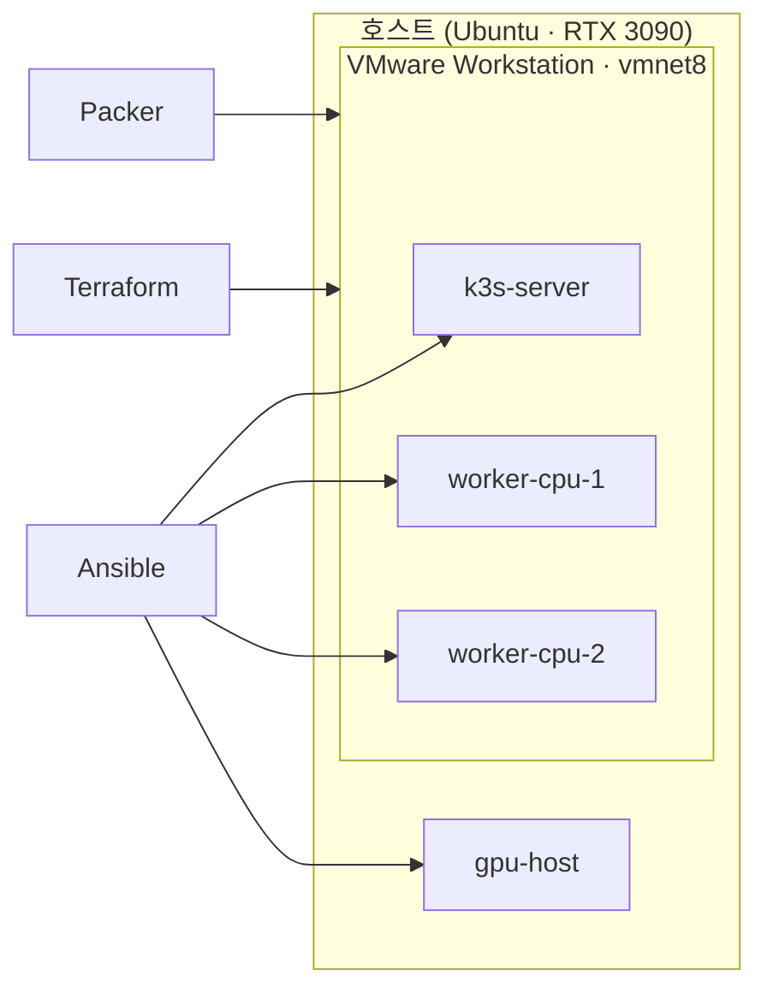

# k3s-vmware-lab

데스크톱 한 대로 구성하는 모델 학습·추론 실습 클러스터

**[개요](#개요) • [요구 사항](#요구-사항) • [시작하기](#시작하기) • [프로젝트 구조](#프로젝트-구조) • [로드맵](#로드맵)**


가상머신과 물리 GPU 호스트를 하나의 쿠버네티스 클러스터로 묶고, 학습·추론 작업을 같은 방식으로 반복 실행할 수 있는 환경을 코드로 관리합니다.

> 2026학년도 2학기 개별연구 과제 저장소

## 개요

실험 환경을 매번 다시 만드는 비용을 줄이는 데서 출발합니다. 특정 모델보다는 작업을 실행하고, 멈추고, 이어서 돌리고, 결과를 확인하는 공통 흐름에 초점을 둡니다.

### 구성도



### 주요 기능

- [x] 기준 이미지 기반 가상머신 구성
- [x] 선언형 인프라와 재실행 가능한 프로비저닝
- [x] 물리 GPU 노드를 포함한 K3s 클러스터
- [x] 클러스터 내부 이미지 빌드·레지스트리
- [x] 템플릿 기반 학습·추론 실행
- [x] 체크포인트 기반 학습 재개
- [x] 요청 큐 기반 추론 워커

### 기술 스택

| 구분 | 사용 기술 |
|---|---|
| 가상화 | VMware Workstation Pro, vmrest |
| 이미지·인프라·구성 | Packer, Terraform, Ansible |
| 오케스트레이션 | K3s, Helm |
| GPU | NVIDIA Container Toolkit, NVIDIA device plugin |
| 빌드·배포 | Kaniko, 내부 레지스트리 |
| 워크로드 | PyTorch(학습), C++(추론) |

## 요구 사항

| 항목 | 기준 |
|---|---|
| 하드웨어 (검증 환경) | `AMD Ryzen 7 5700X` 8C/16T, `32GB RAM`, `NVIDIA GeForce RTX 3090 24GB` |
| OS | Linux x86_64 (검증: Ubuntu 26.04 LTS) |
| 메모리 / 디스크 | 가용 메모리 14GB 이상 / 데이터 경로 여유 40GB 이상 |
| GPU | NVIDIA 드라이버 580 계열 (CUDA 13.0) |
| 가상화 | VMware Workstation Pro 26.0.0, vmrest 1.3.1 |
| 도구 | Terraform 1.16.3, Packer 1.16.0, Helm 4.3.1 |
| Python | 3.12 이상, `ansible-core` 2.21.4 (`infra/ansible/requirements.txt`) |
| 기타 CLI | `jq`, `curl`, `gpg`, `openssl`, `xorriso`, `ip`, `ss`, `ssh-keygen` |
| 네트워크 | VMware NAT `vmnet8` = `172.16.133.0/24` |

### 환경 파일

고정 버전 목록(`scripts/lib/pinned-versions.env`) 같은 env 파일과 인증서·키·접속 정보처럼 암호화가 필요한 파일은 저장소에 포함하지 않습니다. 필요하면 [djrlee1@naver.com](mailto:djrlee1@naver.com)으로 메일을 보내 주시면 따로 전달해 드립니다. 받은 파일은 안내받은 경로에 그대로 두면 됩니다.

## 시작하기

### 1. 준비

```bash
# Ansible 가상환경
python3 -m venv --without-pip ~/.local/share/k3s-vmware-lab/ansible-venv
python3 -m pip --python ~/.local/share/k3s-vmware-lab/ansible-venv/bin/python install -r infra/ansible/requirements.txt

# 데이터·상태·비밀값 디렉터리
mkdir -p ~/.local/share/k3s-vmware-lab/{images,vms,iso-cache}
install -d -m 0700 ~/.local/state/k3s-vmware-lab/terraform ~/.config/k3s-vmware-lab/secrets
```

- `~/.vmware/preferences`의 `prefvmx.defaultVMPath`를 `~/.local/share/k3s-vmware-lab/vms`로 설정합니다.
- `~/.config/k3s-vmware-lab/secrets/`에 vmrest 인증서·자격증명(`vmrest.env`), SSH 키(`ansible_ed25519`), 콘솔 비밀번호 해시(`golden-console.env`)를 둡니다. 모두 권한은 `0600`입니다.

### 2. 클러스터 구성

```bash
scripts/entry.sh
```

### 3. GPU 노드 합류 (호스트 콘솔)

```bash
cd infra/ansible && ansible-playbook playbooks/gpu-host.yml -e host_changes_allowed=true -K
```

워크로드는 `charts/k3slab-workload`의 학습·추론 템플릿으로 실행합니다.

## 프로젝트 구조

```text
k3s-vmware-lab/
├── apps/
│   ├── train/              # 학습 작업
│   └── infer/              # 추론 워커
├── charts/
│   └── k3slab-workload/    # 학습·추론 실행 템플릿
├── infra/
│   ├── packer/             # 기준 이미지
│   ├── terraform/          # 가상머신
│   ├── ansible/            # 노드 구성
│   └── k8s/                # 클러스터 공용 매니페스트
├── scripts/                # 프로비저닝·빌드·검증
│   ├── entry.sh
│   └── lib/
└── docs/                   # 설계 문서, 실행 기록
```

## 로드맵

- [x] 인프라 구성과 클러스터 구축
- [x] 이미지·레지스트리·실행 템플릿
- [x] 학습 흐름과 체크포인트
- [ ] 추론 워커 고도화
- [ ] 작업 상태 저장소
- [ ] CI/CD
- [ ] 모니터링
- [ ] 장애 상황 검증
