# 스크립트 흐름

쉘 스크립트가 어떤 순서로 무엇을 하는지 그림 세 장으로 정리한 문서다.

| 그림 | 내용 |
|---|---|
| [`assets/script-flow-entry.svg`](assets/script-flow-entry.svg) | `entry.sh` 한 번 실행의 전체 흐름 (9단계와 실패 처리) |
| [`assets/script-flow-stages.svg`](assets/script-flow-stages.svg) | 그 9단계 스크립트 각각의 내부 흐름 |
| [`assets/script-flow-ops.svg`](assets/script-flow-ops.svg) | `entry.sh`에 들어 있지 않고 필요할 때 직접 실행하는 스크립트 |

## entry.sh 전체 흐름

- 맨 위 a~c는 단계에 들어가기 전에 하는 준비다: 인자 검사, 골든 이미지 버전 결정, Ansible venv 확인.
- 1~9는 `entry.sh`의 단계 번호다. 색은 단계 묶음이다. 파랑은 호스트 준비(1~3), 보라는 이미지와 VM(4~7), 초록은 노드 구성(8~9)이다.
- 3단계 사전 점검에서 `FAIL`이 하나라도 나오면 여기서 멈춘다. 4단계는 골든 이미지 폴더가 이미 있으면 건너뛴다.
- 어느 단계에서든 실패하면 `FAILED at step N/9`를 출력하고 멈춘다. 원인을 고친 뒤 같은 명령을 다시 실행하면 끝난 단계는 건너뛰거나 변경 없이 통과한다.

## 단계별 내부 흐름

각 단계 스크립트가 안에서 무엇을 하는지 그린 그림이다. 각 단계의 번호는 `entry.sh`의 단계 번호와 같다.

## 읽는 법

- 왼쪽 카드는 스크립트 하나, 오른쪽 칩은 그 스크립트가 안에서 거치는 순서다.
- 칩 사이 화살표는 실행 순서이고, 점선은 다음 줄로 이어진다는 뜻이다.
- 색은 단계 묶음이다. 파랑은 호스트 준비(1~3), 보라는 이미지와 VM(4~7)이다.
- 모든 스크립트는 `scripts/lib/common.sh`를 `source`해서 경로 변수, `log()`/`die()`, `PIN_*` 고정 버전, vmrest 접속 정보를 공유한다.

## 스크립트별 설명

### vmrest-start.sh (entry 1단계)

- VMware REST API 서버(vmrest)를 백그라운드로 띄우고 `127.0.0.1`에서만 열렸는지 확인한다.
- 8697 포트에 이미 무언가 떠 있으면 아무것도 하지 않고 성공으로 끝난다.
- 포트가 열릴 때까지 최대 10초 기다리고, 루프백 이외 주소에 열렸으면 vmrest를 종료하고 실패 처리한다.

### fetch-rocky-iso.sh (entry 2단계)

- Rocky 9.8 DVD를 내려받고 3단으로 검증한다. 서명 키 지문, 공식 CHECKSUM의 서명, 그리고 크기와 SHA-256이 고정값과 같은지 본다.
- 이미 검증된 ISO가 있으면 다운로드를 건너뛴다. 끊긴 다운로드(`.part`)는 이어받는다.

### preflight.sh (entry 3단계)

- 호스트를 읽기 전용으로 점검하고 `PASS`/`WARN`/`FAIL`/`INFO`로 출력한다. `FAIL`이 하나라도 있으면 종료 코드 1이라 `entry.sh`가 여기서 멈춘다.
- 14개 항목을 순서대로 본다: 프로젝트 파일, 호스트, 도구 버전, VMware 모듈, vmnet8 NAT, vmrest, 비밀 파일, VM·UI 목록, Rocky ISO, 용량, provider 해시, Packer 플러그인 해시, 골든 이미지 무결성, 원격 접속 표시.

### golden-build.sh (entry 4단계)

- Packer로 Rocky 9.8 Server(GUI 없음) 골든 이미지를 만든다. 약 11분 걸린다.
- 이미지는 불변이다. 같은 버전 폴더가 이미 있으면 덮어쓰지 않고 중단하고, `entry.sh`는 폴더가 있으면 이 단계를 건너뛴다.
- 빌드가 끝나면 VMX와 VMDK의 SHA-256을 기록하고 읽기 전용으로 잠근 뒤, vmrest에 등록해서 Terraform이 이 이름으로 복제할 수 있게 한다.

### tf.sh (entry 5·6·7단계 내부)

- Terraform은 항상 이 래퍼로 실행한다. vmrest 자격증명은 `TF_VAR_*` 환경변수로 넣어서 `.tf` 파일과 Git에 남지 않는다.
- state는 저장소가 아니라 `~/.local/state/k3s-vmware-lab/terraform/`에 둔다. `apply`/`destroy` 전에는 백업하고 최근 30개만 유지한다.
- vmrest가 동시 변경을 처리하지 못해서 `-parallelism=1`을 강제한다.

### cluster-apply.sh (entry 6단계)

- VM 3대를 만들고, 전원을 켜고, Workstation UI 목록에 등록한다.
- apply를 두 번 하는 이유는 provider(`elsudano/vmworkstation` 2.0.1)가 VM을 켜진 채로 만들면 실패하기 때문이다. 먼저 새 VM만 꺼진 상태로 만들고, 두 번째 apply로 전원을 켠다.
- 바뀐 것이 없으면 1단계는 건너뛰고 2단계는 `No changes`, 3단계는 `already registered`로 끝난다.

### register-vms.sh (cluster-apply 3단계)

- provider로 복제한 VM은 실행은 되지만 UI 목록 파일(`~/.vmware/inventory.vmls`)에서 빠질 수 있다.
- Terraform output의 노드 목록을 읽어, 빠진 VM만 `POST /vms/registration`으로 등록한다. 여러 번 실행해도 안전하고 VM의 전원이나 설정은 건드리지 않는다.

### render-inventory.sh (entry 7단계)

- Ansible이 접속할 인벤토리를 만든다. 이름, vmrest id, 그룹은 Terraform output에서, IP는 vmrest의 `/vms/{id}/ip`에서 가져온다. provider가 주는 IP는 자리표시자라 쓰지 않는다.
- VM이 막 켜져서 IP가 없으면 5초 간격으로 최대 300초 기다린다.
- 예전 SSH 호스트 키를 Ansible 전용 `known_hosts`에서 지우고, `.generated/terraform.yml`을 쓴다. 이 파일은 Git에서 제외된다.

## 재실행 규칙

- 모든 단계는 다시 실행해도 안전하다(멱등). 실패하면 원인만 고치고 `scripts/entry.sh`를 다시 실행한다.
- 실패하면 `FAILED at step N/9: <실패한 명령>`이 출력되고, 완료된 단계는 건너뛰거나 변경 없이 통과한다.

## 단독 실행 스크립트

- `entry.sh`에 들어 있지 않고 필요할 때 직접 실행하는 스크립트다. 카드 하나가 스크립트 하나이고, 칩의 번호는 그 스크립트 안의 실행 순서다.
- 오른쪽 위 표시는 쓰임새다.
  - **새 이미지**: `image-build.sh`. 호스트 Docker 없이 클러스터 안 Kaniko로 빌드하고, 같은 태그가 있으면 빌드하지 않는다.
  - **시험**: `k3s-lab.sh`, `train-resume-test.sh`, `infer-bench.sh`. 실습과 시험을 실행하고 결과를 `docs/labs/`에 보고서로 남긴다.
  - **점검**: `provider-smoke-test.sh`, `vmware-modules.sh`, `verify-project.sh`. 도구를 올리거나 커널을 바꾼 뒤 확인하는 데 쓴다.
- `infer-bench.sh`의 과부하 시험은 큐 20에 요청 300개를 동시 150개씩 보낸다.
- 이 그림은 11/5 기준이다. 그 뒤에 추가된 스크립트는 아직 그리지 않았다. 각 파일 머리의 한글 주석에 흐름이 적혀 있다.
  - 작업 DB: `mysql-deploy.sh`, `job.sh`, `job-db-test.sh`
  - 추론 GPU 시험: `infer-gpu-bench.sh`
  - 장애 실험: `fault-test.sh` (설계는 [`plan-week13-verification.md`](plan-week13-verification.md))
  - 자원 한도 점검: `capacity-report.sh` (배치와 메모리 한도는 [`plan-week11-capacity.md`](plan-week11-capacity.md))
  - 모니터링: `monitoring-deploy.sh`, `monitoring-test.sh` ([`infra/k8s/monitoring/README.md`](../infra/k8s/monitoring/README.md))
  - Jenkins CI: `jenkins-deploy.sh`, `jenkins-run.sh`, `jenkins-ci-test.sh`, 로컬 사전 검사 `jenkins-check.sh`, 파이프라인이 부르는 `jenkins-stage-*.sh`·`jenkins-record.sh`·`jenkins-registry.sh` ([`infra/k8s/jenkins/README.md`](../infra/k8s/jenkins/README.md))
  - Argo CD: `argocd-deploy.sh`, `argocd-source.sh`, `argocd-test.sh` ([`infra/k8s/argocd/README.md`](../infra/k8s/argocd/README.md))
  - 코드 변경에서 배포까지: `cicd-e2e-test.sh`, Jenkins가 새 태그를 배포 값에 커밋하는 `cicd-set-tag.sh`. 흐름은 Gitea 커밋 → Jenkins 폴링(1분) → 검사·Kaniko 이미지 → 태그 커밋 → Argo CD sync

## 12~13주 실행 기록

| 주제 | 보고서 |
|---|---|
| 클러스터 DNS 지연(localdomain) 수정 | [`labs/dns-localdomain-20261122-1625.md`](labs/dns-localdomain-20261122-1625.md) |
| Argo CD sync·self-heal·rollback | [`labs/argocd-20261122-1612.md`](labs/argocd-20261122-1612.md) |
| 모니터링 (최종, 앞선 시행은 같은 폴더의 `monitoring-*`) | [`labs/monitoring-20261122-1654.md`](labs/monitoring-20261122-1654.md) |
| Jenkins CI (최종, 오프라인 검사와 앞선 시행은 `jenkins-*`) | [`labs/jenkins-ci-20261122-1658.md`](labs/jenkins-ci-20261122-1658.md) |
| 코드 변경에서 배포까지 (성공 1회, 단위 시험 실패 차단 1회, 되돌리기 1회, 지연 p50/p95) | [`labs/cicd-e2e-20261122-2141.md`](labs/cicd-e2e-20261122-2141.md) |
| 장애 실험 첫 단계 요약 (점검, 과부하, 잘못된 배포, 추론 파드 강제 종료. 실험별 보고서는 `fault-*`) | [`labs/fault-week13-summary-20261122.md`](labs/fault-week13-summary-20261122.md) |
| 장애 실험 14주 몫 요약 (레지스트리·MySQL 중단, 추론 파드 종료 반복·graceful, GPU 실험, 학습 파드 중단·재개, Grafana 화면. 실험별 보고서는 `fault-*-20261123-*`, 학습 재개는 `train-resume-20261123-0416.md`) | [`labs/fault-week14-summary-20261123.md`](labs/fault-week14-summary-20261123.md) |
