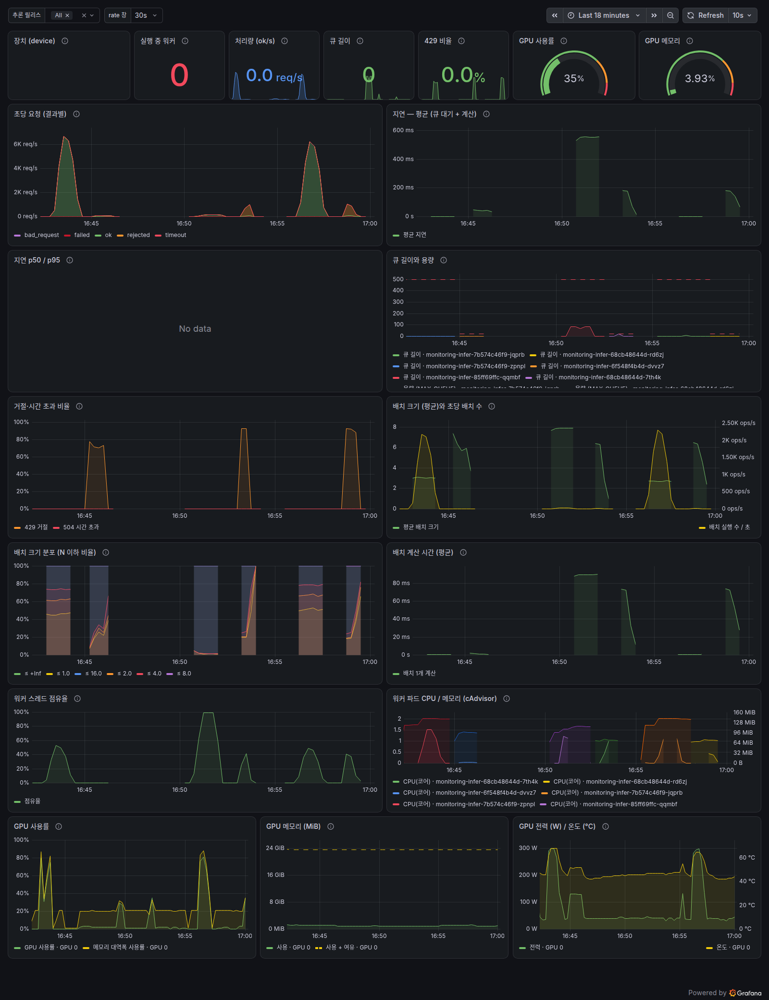
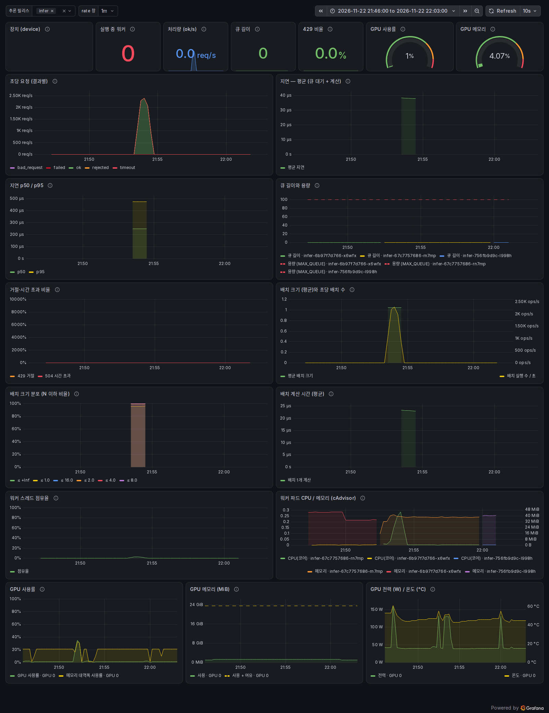

# 최종 보고서 (초안): 연구실 GPU 서버로 만드는 모델 학습·추론 실습 플랫폼

2026학년도 2학기 개별연구 2 · 최종 보고(제안서 일정 15–16주)를 미리 준비한 초안이다. 마지막 갱신 2026-11-23(12주차 첫날).

- **끝난 부분**(인프라~작업 DB, CI/CD, 모니터링)은 측정값과 근거 파일 링크로 채웠다. 수치는 모두 `docs/labs/`의 실행 기록이나 해당 소스 파일에서 가져왔다. 한 번 잰 값은 "1회"라고 적었다.
- **검증 실험**은 13주 몫(점검, 과부하, 잘못된 배포, 추론 파드 강제 종료)을 11/22에, 14주 몫(레지스트리·MySQL 중단, 추론 파드 종료 반복·graceful, GPU 변형, 학습 파드 중단·재개)을 11/23에 앞당겨 실행해 채웠다. 남은 것은 F3 워커 VM 종료(15주 몫)와 재시험이고 `[진행 중]`으로 두었다.
- Jenkins(10–12주), Argo CD(11–13주), 모니터링(12–14주), 검증 실험 시작(13주)은 제안서 일정보다 앞당겨 11주차 안에 했다.
- 제안서와 달라진 점은 [4절](#4-제안서와-달라진-점)에 표로 모았다.

## 작성 상태

| 절 | 내용 | 상태 | 근거 |
|---|---|---|---|
| 1 | 배경과 목표 | 작성 | |
| 2 | 전체 구성 | 작성 (2.1 노드 배치, 2.3 흐름은 11/22 반영. 구성도 그림은 갱신 필요) | `plan-week11-capacity.md` |
| 3.1 | 인프라 코드화 (Packer · Terraform · Ansible) | 작성 | |
| 3.2 | K3s 클러스터와 GPU 호스트 | 작성 | |
| 3.3 | 이미지 · 레지스트리 · Helm | 작성 | |
| 3.4 | 학습 Job | 작성 | |
| 3.5 | 추론 워커 | 작성 | |
| 3.6 | 작업 상태 DB | 작성 | |
| 3.7 | CI/CD (Jenkins · Argo CD) | **완료**. 시험 Jenkins PASS 42/42, Argo CD PASS 23·FAIL 0, 코드 커밋 → 배포 연결 PASS 62·FAIL 0. 작업 폴더 스냅샷 시험 경로는 11/22에 막혔다가 고침 | `labs/jenkins-ci-20261122-1658.md`, `labs/argocd-20261122-1612.md`, `labs/cicd-e2e-20261122-2141.md` |
| 3.8 | 모니터링 (Prometheus · Grafana) | **완료**. 시험 PASS 70·FAIL 0. 학습 Job이 돌 때의 패널 값과 DCGM 값은 11/23 F2 실험에서 확인. 보존 7일은 아직 못 봄 | `labs/monitoring-20261122-1654.md`, `labs/fault-week14-summary-20261123.md` 1.4절 |
| 4 | 제안서와 달라진 점 | 작성 (11/22 반영) | |
| 5 | 검증 실험 | **13·14주 몫 완료**: 점검, F1(CPU 3회·graceful·GPU), F2(force·graceful), F4, F5, F6, F7, F8(CPU·GPU)은 결과 작성. F3과 재시험은 **[진행 중]** | `labs/fault-week13-summary-20261122.md`, `labs/fault-week14-summary-20261123.md` |
| 6 | 결과 | 작성 (CI/CD·모니터링·장애 실험 13·14주 몫 수치 반영). F3은 자리만 | |
| 7 | 한계 | 작성 (11/22 반영, 검증 뒤 보완) | |
| 8 | 결론 | 잠정 작성. 검증 뒤 확정 | |
| 부록 | 일정 대비 실제, 근거 파일 | 작성 | |

## 1. 배경과 목표

### 1.1 문제 (제안서 3번)

모델을 한 번 돌리는 시간보다, 그 모델을 돌릴 환경을 매번 다시 만드는 시간이 더 길다. 제안서는 이를 세 가지로 정리했다.

- 환경이 매번 다르다. 파이썬·라이브러리·CUDA 버전이 조금씩 달라서 다음 학기에는 그대로 재현되지 않는다.
- 손으로 옮기고 손으로 돌린다. 누가 어떤 버전을 올렸는지 기록이 남지 않는다.
- 멈추면 처음부터 다시 한다. 학습이 중간에 끊기면 어디까지 진행됐는지 알 수 없다.

이 연구는 모델 성능을 올리는 대신, 모델을 반복해서 돌릴 수 있는 환경을 처음부터 끝까지 직접 만들어 보는 데 초점을 둔다.

### 1.2 목표와 범위 (제안서 4번)

| 목표 | 이 보고서의 해당 절 |
|---|---|
| ① 직접 구축한다: 데스크톱 한 대 위에 가상머신 3대를 띄우고, 호스트까지 K3s 노드로 묶어 GPU 노드와 CPU 노드를 나눈다 | 3.1, 3.2 |
| ② 자동으로 반영한다: 코드를 고치면 빌드·테스트·이미지 생성·배포까지 사람이 명령어를 치지 않아도 반영된다 | 3.3, 3.7 |
| ③ 눈으로 확인한다: 정상 동작과 일부러 만든 중단 상황을 재현하고, 대시보드와 DB 기록으로 결과를 남긴다 | 3.6, 3.8, 5 |

범위는 가상머신 3대와 호스트로 이루어진 4노드 K3s 클러스터, 학습·추론 이미지와 Helm 양식, 요청 큐를 가진 C++ 추론 워커와 Python 학습 스크립트, 작업 상태·체크포인트의 DB 기록과 이어서 실행, Jenkins·Argo CD·Prometheus·Grafana 연동, 정상 실행과 중단 상황 재현 실험이다.

### 1.3 사용자 시나리오와 구현 (제안서 5번)

연구실의 실험 주제가 아직 정해지지 않았으므로 특정 모델에 맞춘 기능 대신, 모델 버전·입력·작업 상태·결과를 똑같은 방식으로 다루는 공통 흐름을 만들었다. 사용자가 밟는 여섯 단계는 `scripts/job.sh` 하나로 묶었다.

| 단계 | 구현 | 상태 |
|---|---|---|
| 템플릿 선택 | `job.sh submit train\|infer` → `charts/k3slab-workload`의 `values-train.yaml` / `values-infer.yaml` | 완료 |
| 모델 버전 지정 | `--version` (이미지 태그와 함께 DB `model_version`에 남음) | 완료 |
| 입력 파일 등록 | `job.sh upload <파일.npz>` → 학습은 `--dataset npz:/data/<파일>` | 완료 |
| 실행 요청 | `job.sh submit` (DB에 PENDING을 먼저 넣고, 성공했을 때만 Helm으로 실행) | 완료 |
| 진행 상태 확인 | `job.sh status <작업 번호>` (현재 상태 + 상태 이력 + 마지막 체크포인트) | 완료 |
| 결과 확인 | `job.sh result <작업 번호>` (결과 파일 경로 + 로그 끝부분) | 완료 |

## 2. 전체 구성

<p align="center">
  
</p>

### 2.1 노드

| 노드 | 형태 | OS | 자원 | 역할 라벨 | 맡은 일 |
|---|---|---|---|---|---|
| k3s-server | VM | Rocky Linux 9.8 Server (GUI 없음) | 2 vCPU / 3 GB | (없음) | K3s 제어 노드, node-exporter |
| worker-cpu-1 | VM | Rocky Linux 9.8 | 2 vCPU / 6 GB | `k3slab.io/role=platform` | 레지스트리, MySQL, Jenkins 컨트롤러, Prometheus·Grafana·kube-state-metrics, node-exporter |
| worker-cpu-2 | VM | Rocky Linux 9.8 | 2 vCPU / 3 GB | `k3slab.io/role=app` | Argo CD(파드 4개), Gitea(Git 서버), node-exporter, API 대역 파드(echo-api), 노드 중단 실험 대상 |
| gpu-host | 물리 데스크톱(호스트 OS) | Ubuntu 26.04.1 LTS | Ryzen 7 5700X 8C/16T, RTX 3090 24 GB, 호스트 전체 32 GB | `k3slab.io/role=gpu` + taint `nvidia.com/gpu=present:NoSchedule` | 학습·추론, 이미지 빌드(Kaniko), Jenkins 에이전트 파드(한 번에 1개, GPU 요청 없음), dcgm-exporter, node-exporter |

- VM 3대의 설정 합계는 6 vCPU / 12 GB다(`infra/terraform/variables.tf`). 네트워크는 VMware NAT `vmnet8` = 172.16.133.0/24이고, gpu-host의 노드 IP는 vmnet8 주소 172.16.133.1이다.
- GPU는 VM에 넘기지 않고 물리 호스트에서 직접 쓴다. 호스트와 노드는 1대 1이다.
- 구성도 그림(`assets/architecture.svg`)은 CI/CD·모니터링 구성요소를 아직 그리지 않았다. **그림 갱신 필요.**

**배치와 메모리 예산 (배치 계획 B, 2026-11-22)**

- 새로 올릴 Jenkins·Argo CD·모니터링을 어디에 둘지 `scripts/capacity-report.sh`(읽기 전용)로 잰 값으로 정했다. VM 크기는 늘리지 않았다.
- 모니터링의 Prometheus·Grafana·kube-state-metrics를 Argo CD·Gitea와 함께 worker-cpu-2에 두면 그 노드의 메모리 limits 합계가 3,008 MiB로 안전 한도(약 1,860 MiB)의 162%라서 모니터링을 worker-cpu-1로 옮겼다. 안전 한도는 allocatable에서 운영체제 기준선과 여유 300 MiB를 뺀 값이다(계산은 계획 문서 4.3절).
- worker-cpu-2는 여전히 빠듯하다. 계획 때 limits 합계를 1,728 MiB(안전 한도의 93%)로 잡았고, 배포한 값으로 다시 더하면 1,600 MiB(86%)다. 그래서 Argo CD·Gitea의 limits는 더 올리지 않는다.
- VM 증설(worker-cpu-2를 4 GB로)은 필요해지면 쓸 대안으로만 남겼고 적용하지 않았다.

| 노드 | 메모리 requests 합계 (계획) | 메모리 limits 합계 (계획) | 실제 사용 (`kubectl top`, 1회씩) |
|---|---|---|---|
| worker-cpu-1 | 2,016 MiB (allocatable 5,665 MiB의 36%) | 약 3,650 MiB (안전 한도 약 4,840 MiB의 75%) | 기동 직후 939 MiB(16%) → 모두 올린 뒤 2,098~2,196 MiB(37~38%). 계획 때 추정은 약 2.4 GiB |
| worker-cpu-2 | 656 MiB (allocatable 2,712 MiB의 24%) | 1,728 MiB (안전 한도 약 1,860 MiB의 93%) | 998~1,111 MiB(36~40%). 계획 때 추정은 약 1.2 GiB |
| k3s-server | 172 MiB (6%) | 234 MiB | 기동 직후 1,449 MiB(53%) → 1,903~1,982 MiB(70~73%) |
| gpu-host | 최악 합계 5,472 MiB(약 5.3 GiB). 우리가 정한 요청 합계 한도 8 GiB의 67% | — | 파드별 값이 아니라 VM 3대를 포함한 PC 전체 13,720~21,525 MiB |

- gpu-host는 노드의 allocatable(31,997 MiB)이 물리 PC 전체라서, VM이 잡은 메모리를 스케줄러가 모른다. 그래서 gpu-host 파드의 requests 합계를 8 GiB 안으로 직접 지킨다. Jenkins 에이전트를 동시에 1개만 띄우는 것도 이 한도 때문이다.
- 근거: [`plan-week11-capacity.md`](plan-week11-capacity.md), [`labs/argocd-20261122-1612.md`](labs/argocd-20261122-1612.md) 5절, [`labs/jenkins-ci-20261122-1658.md`](labs/jenkins-ci-20261122-1658.md) 5절, [`labs/monitoring-20261122-1654.md`](labs/monitoring-20261122-1654.md) 8절.

### 2.2 버전

| 구분 | 버전 | 정해 둔 곳 |
|---|---|---|
| K3s | v1.36.4+k3s1 | `infra/ansible/inventories/lab/group_vars/all.yml` |
| VMware Workstation Pro / vmrest | 26.0.0 / 1.3.1 | `scripts/lib/pinned-versions.env` |
| Terraform / provider | 1.16.3 / elsudano/vmworkstation 2.0.1 | `infra/terraform/versions.tf` |
| Packer / 플러그인 | 1.16.0 / hashicorp/vmware 2.1.6 | `infra/packer/templates/rocky-golden.pkr.hcl`, `infra/packer/plugins.sha256` |
| ansible-core, Helm | 2.21.4, 4.3.1 | `scripts/lib/pinned-versions.env` |
| NVIDIA 드라이버 / Container Toolkit / device plugin | 580.178.04 (CUDA 13.0) / 1.20.1-1 / v0.20.1 | `docs/gpu-host-join-prep.md` |
| 레지스트리 / Kaniko | registry 3.1.2 / martizih/kaniko v1.28.6 | `scripts/lib/pinned-versions.env` |
| 학습 베이스 이미지 | pytorch 2.14.1 + CUDA 13.0 + cuDNN 9 (runtime) | `apps/train/Dockerfile` |
| MySQL | 8.4.13 | `infra/k8s/mysql.yaml` |
| Jenkins | 차트 5.13.3 / 컨트롤러 2.580.2-jdk25 / 플러그인 73개 고정 | `infra/k8s/jenkins/values.yaml` |
| Argo CD / Gitea | v3.6.2(공식 `install.yaml`) / 28.3.0-rootless | `infra/k8s/argocd/` |
| Prometheus / Grafana / kube-state-metrics / node-exporter / dcgm-exporter | v3.16.0 / 13.3.1 / v2.20.0 / v1.13.1 / 4.6.1-4.8.4 | `infra/k8s/monitoring/` |

### 2.3 작업이 흐르는 길

```text
scripts/job.sh submit ──▶ MySQL jobs (PENDING) ──▶ Helm (charts/k3slab-workload) ──▶ 학습 Job / 추론 Deployment (gpu-host)
        ▲                       ▲                                                        │
        └── status / result ────┴────────── 상태·체크포인트 기록 ◀──────────────────────┘

이미지(손으로): scripts/image-build.sh (Kaniko, 클러스터 안) ──▶ registry.k3slab.local:5000 (worker-cpu-1) ──▶ 각 노드가 pull
```

코드를 고치면 사람이 명령을 치지 않아도 추론 서비스가 새 이미지로 바뀌는 길은 아래와 같다(11/22에 클러스터에서 확인, 3.7).

```text
코드 커밋 ──▶ Gitea main (클러스터 안 Git 서버, 저장소 k3slab/k3s-vmware-lab)
                 │  Jenkins가 1분마다 폴링 (웹훅 없음)
                 ▼
   Jenkins 컨트롤러 (worker-cpu-1, 네임스페이스 ci)
                 ▼
   검사 파드 (gpu-host): C++ → Python → 쉘 → Helm      ← 하나라도 실패하면 여기서 끝 (이미지·배포 없음)
                 ▼
   빌드 파드 (gpu-host, 이미지마다 1개): Kaniko ──▶ registry.k3slab.local:5000/<이름>:git-<커밋 7자리>
                 ▼
   배포 값 단계: charts/k3slab-workload/values-infer-argocd.yaml 의 image.tag 한 줄을 새 태그로 커밋 (작성자 k3slab ci, 제목에 [skip ci])
                 ▼
   Gitea main ──(Argo CD가 30초마다 확인)──▶ 자동 sync ──▶ 추론 Deployment의 새 파드 (gpu-host, 네임스페이스 k3slab-apps)

모니터링: node-exporter · kube-state-metrics · cAdvisor · dcgm-exporter · 추론 워커 /metrics ──▶ Prometheus ──▶ Grafana ◀── MySQL jobs·job_events (읽기 전용 계정)
```

- Argo CD는 추론 서비스(Deployment·Service)만 관리한다. 학습 Job은 위쪽의 `job.sh` 흐름이 맡는다(이유는 4절).
- 이 그림은 글로 그린 것이다. SVG 구성도에 같은 경로를 넣는 일은 **그림 갱신 필요**다.

## 3. 구현

### 3.1 인프라 코드화 (Packer → Terraform → Ansible)

<p align="center">
  
</p>

| 단계 | 도구 | 하는 일 |
|---|---|---|
| 기준 이미지 | Packer | Rocky 9.8 DVD ISO로 무인 설치(Kickstart)해 GUI 없는 Server 골든 이미지를 만든다. 완료 뒤 VMX·VMDK의 SHA-256을 기록하고 읽기 전용(0444)으로 잠근다 |
| VM 생성 | Terraform | 골든 이미지를 복제해 VM 3대를 만들고 전원을 켠다. 상태 파일로 관리한다 |
| UI 등록 | `scripts/register-vms.sh` | provider 복제만으로는 Workstation 목록에 안 나오는 VM을 vmrest 등록 API로 중복 없이 등록한다 |
| 노드 구성 | Ansible | Terraform 출력에서 인벤토리를 만들어 공통 설정, SELinux enforcing 유지, K3s 설치·조인, 노드 라벨을 적용한다 |
| 한 번에 실행 | `scripts/entry.sh` | 9단계(vmrest 시작 → Rocky ISO 확인 → 사전 점검 → 골든 이미지 → Terraform 준비 → VM 생성·전원·UI 등록 → IP 목록(인벤토리) 생성 → SSH 확인 → OS + K3s)를 순서대로 부르고 단계별 시간을 표로 낸다 |

**재현성을 위한 규칙**

- 도구·provider·ISO·이미지 버전을 고정하고 `scripts/preflight.sh`(14개 항목)가 어긋나면 FAIL로 멈춘다. 필수 파일과 Bash 문법은 `scripts/verify-project.sh`가 점검한다.
- 골든 이미지는 불변이다. 같은 버전 폴더가 있으면 다시 빌드하지 않는다.
- 모든 단계는 다시 실행해도 같은 결과가 되도록(멱등) 만들었다. 정상 상태에서 다시 돌리면 Terraform `No changes`, Ansible `changed=0`이다.
- 비밀값(vmrest 자격증명, SSH 키, 콘솔 비밀번호 해시, K3s 토큰, kubeconfig)과 Terraform 상태는 저장소 밖(`~/.config/k3s-vmware-lab/secrets`, `~/.local/state/k3s-vmware-lab`)에 두고 권한을 0600/0700으로 한다. 상태 파일은 변경 명령 전에 30개까지 순환 백업한다.
- provider 2.0.1의 제약은 Terraform 안에서 피했다. 부모 VM의 NIC를 `custom/vmnet8`로 두고, VM을 꺼진 채로 만든 뒤 두 번째 apply에서 켠다.

**측정값**

| 항목 | 값 | 근거 |
|---|---|---|
| 골든 이미지 빌드(첫 성공) | 10분 45초 | `docs/vmware-iac-handoff.md` 13.7 |
| 처음부터 구축(ISO 첫 다운로드 제외) | 약 16분 (이 중 골든 이미지 약 11분) | `docs/vmware-iac-handoff.md` 13.11 |
| 정상 상태에서 `entry.sh` 재실행 | 1분 59초 (Terraform No changes, UI 등록 0 added/3 already present, Ansible changed=0) | `docs/vmware-iac-handoff.md` 13.11 |
| 꺼진 VM 3대를 다시 켜고 재실행 | 2분 53초 (10/6) | `docs/plan-week05-06.md` |

근거: [`docs/vmware-iac-handoff.md`](vmware-iac-handoff.md), [`docs/README.md`](README.md)(스크립트 단계별 흐름), [`README.md`](../README.md)의 워크플로우.

### 3.2 K3s 클러스터와 GPU 호스트

**물리 GPU 호스트 합류 (2026-10-06)**

- `playbooks/gpu-host.yml`이 NVIDIA Container Toolkit 1.20.1-1(키 해시 고정, 버전 hold), NetworkManager 예외, ufw 규칙, k3s-agent, NVIDIA device plugin v0.20.1을 설치한다. 호스트 네트워크를 바꾸므로 `-e host_changes_allowed=true -K`를 주고 호스트 콘솔에서만 실행하도록 막아 두었다(없으면 sudo를 쓰기 전에 멈춘다).
- 노드 IP와 flannel 인터페이스를 vmnet8로 고정했다. 기본 경로가 LAN이라 그대로 두면 VM과의 통신이 꼬이기 때문이다.
- 스모크 테스트에서 파드 안의 `nvidia-smi`가 RTX 3090(드라이버 580.178.04, CUDA 13.0)을 보여 주었고 클러스터 DNS 조회도 성공했다.
- Ubuntu 26.04 대응: sudo-rs 프롬프트 문제는 `sudo.ws`로, HashiCorp 저장소 키 교체로 apt 전체 갱신이 실패하는 문제는 NVIDIA 저장소만 갱신하게 해서 피했다.
- 근거: [`docs/gpu-host-join-prep.md`](gpu-host-join-prep.md)

**K3s 실습 5개: PASS 11/11 (2026-10-30)**

| 실습 | 수행 내용 | 결과 |
|---|---|---|
| 노드 조인 | `kubectl get nodes` | 4대 모두 Ready (VM 3대 Rocky 9.8, gpu-host Ubuntu 26.04) |
| 작업 배치 | gpu-host taint, GPU 파드 2개 + 일반 파드 4개 | GPU 파드 a는 gpu-host에서 RTX 3090 인식. GPU가 1개뿐이라 b는 `Insufficient nvidia.com/gpu`로 Pending. 일반 파드는 gpu-host를 피함 |
| 복제본 조정 | echo-api replicas 1 → 3, 요청 60개 | 1개일 때 한 파드가 60개 응답, 3개일 때 30/12/18개로 나뉨 |
| 파드 재시작 | 파드 강제 삭제 / 컨테이너 강제 종료 | 2초 뒤 새 파드로 3개 복구 / 같은 파드에서 RESTARTS 1 |
| 노드 중단 | worker-cpu-2를 `vmrun ... hard`로 강제 종료 → `entry.sh`로 복구 | 44초 뒤 NotReady, 이어서 308초 뒤 다른 노드에서 Ready(합계 352초), 복구 뒤 다시 Ready |

- 노드 중단에서 자동으로 되는 것: NotReady 표시와 taint, toleration 시간이 지난 뒤 남은 노드에 파드 다시 띄우기, 복구된 노드를 Ready로 받아들이기.
- 자동으로 안 되는 것: 꺼진 VM 켜기(`entry.sh`), `tolerationSeconds` 결정(기본 300초가 대부분의 지연), 노드가 돌아온 뒤 파드를 원래 노드로 되돌리기(자동 재균형 없음).
- 근거: [`docs/labs/k3s-lab-20261030-1646.md`](labs/k3s-lab-20261030-1646.md), 매니페스트 `infra/k8s/labs/`, 실행 `scripts/k3s-lab.sh`

### 3.3 이미지 · 레지스트리 · Helm

- **레지스트리**: registry 3.1.2를 worker-cpu-1에 올렸다(`infra/k8s/registry.yaml`, 20 Gi PVC). 노드 IP가 DHCP라 바뀔 수 있어서 Service의 ClusterIP를 10.43.0.50으로 고정했다. 노드는 `registry.k3slab.local:5000`을 `/etc/rancher/k3s/registries.yaml`로 이 주소에 연결한다. 클러스터 안에서만 열려 있고 HTTP다. 노드 4대에서 pull을 확인했다.
- **빌드**: 호스트 Docker는 sudo가 필요해서 쓰지 않고, `scripts/image-build.sh`가 Kaniko Job으로 클러스터 안에서 빌드해 push한다(gpu-host에서 실행, CUDA 베이스 이미지가 약 8 GB라서). 빌드 폴더는 ConfigMap으로 넘기므로 하위 폴더 없이 900 KB 이하여야 한다.
- **태그는 덮어쓰지 않는다.** 이미 있는 태그면 빌드를 거부한다. 결함이 있던 태그는 지우고 사유를 남긴 뒤 새 태그로 빌드한다. 빌드마다 digest·git 커밋·빌드 폴더 해시를 기록한다.
- **Helm 차트** `charts/k3slab-workload`: `kind: train`은 Job, `kind: infer`는 Deployment + Service가 된다. 값 파일은 `values-train.yaml`, `values-infer.yaml`이고 작업 번호·모델 버전·이미지 태그·배치 크기만 `--set`으로 바꿔 같은 템플릿을 다시 쓴다. Dockerfile·이미지 태그·values를 한 묶음으로 기록한다(제안서 9번).

| 이미지 | 빌드일 | 상태 | 비고 |
|---|---|---|---|
| train-worker:v0.1 | 10/30 | 삭제 | `train.py`가 ConfigMap 심볼릭 링크로 들어가 실행 불가. 빌드 전 실제 파일로 복사하게 수정 |
| train-worker:v0.2 | 10/30 | 삭제 | GPU에서 이어서 학습할 때 난수 상태 복원 실패. 체크포인트를 CPU로 읽게 수정 |
| infer-worker:v0.1 | 10/30 | 삭제 표시 없음 | CPU 계산 + 배치당 고정 비용(WORK_MS) |
| train-worker:v0.3 | 10/30 | 삭제 표시 없음 | 중단·재개 시험 통과 |
| infer-worker:v0.2 | 11/7 | **현재 사용** (`values-infer.yaml`) | 모듈 분리 + CUDA 경로 |
| train-worker:v0.4 | 11/7 | **현재 사용** (`values-train.yaml`) | Dataset 인터페이스 분리, PyMySQL 해시 고정 설치 |

- 이미지 안의 구성요소도 버전을 고정했다. 추론 빌드는 `gcc:15.3.0-trixie`(cpp-httplib v0.64.0을 SHA-256으로 확인) → `nvidia/cuda:13.0.3-devel-ubuntu24.04`로 컴파일 → `debian:trixie-20261027-slim`에서 실행한다. 학습 이미지의 PyMySQL 1.2.3은 `--require-hashes`로 설치한다.
- 근거: [`docs/image-builds.md`](image-builds.md), `infra/k8s/registry.yaml`, `scripts/image-build.sh`, `charts/k3slab-workload/`

### 3.4 학습 Job

- `apps/train/train.py`는 특정 모델이 아니라 플랫폼의 약속을 따른다: 작업 번호 하나가 Job 하나이고, 끝난 작업 번호로 다시 요청하면 학습하지 않는다.
- 에폭마다 체크포인트를 저장하고(원자적 쓰기, 최근 3개 유지) SIGTERM을 받으면 그 시점의 체크포인트를 남기고 `INTERRUPTED`로 끝난다. Job이 새 파드로 다시 시도하면 마지막 체크포인트에서 이어서 학습한다(`resumed_from`).
- 체크포인트에는 모델, 옵티마이저, 난수 상태가 들어 있다. 로컬(CPU) 비교에서 끊었다가 이어서 학습한 모델이 한 번에 학습한 모델과 비트 단위로 같았다.
- 체크포인트와 내보낸 모델은 gpu-host의 `/var/lib/k3slab/checkpoints/<작업 번호>/`에 둔다(hostPath, 파드가 죽어도 남음). 내보내는 `model.k3sm`은 float32 가중치 파일이라 추론 워커가 PyTorch 없이 읽는다.
- 데이터는 `apps/train/datasets.py`로 분리했다. 학습 코드는 `batch()`만 부르므로 실험 주제가 정해지면 Dataset 하나를 추가하면 된다. 지금은 `synthetic`(시드 고정 10클래스 합성 데이터)과 `npz:/data/<파일>`(업로드한 표 데이터)이 있다. 모델 크기는 `--hidden`으로 바꾼다.
- 잘못된 요청(없는 데이터 파일)은 재시도 없이 바로 실패하도록 `podFailurePolicy`를 걸었다.

| 시험 | 이미지 | 결과 | 근거 |
|---|---|---|---|
| 중단·재개 (GPU) | v0.2 | **실패**: 재시도 파드가 `RNG state must be a torch.ByteTensor`로 모두 실패. 원인은 체크포인트를 GPU로 읽은 것 | [`train-resume-20261030-1702.md`](labs/train-resume-20261030-1702.md) |
| 중단·재개 (GPU) | v0.3 | PASS 6/6. 4 에폭 1번째 스텝의 체크포인트를 남기고 INTERRUPTED → 이어서 GPU에서 DONE → 같은 번호 재요청은 학습하지 않음 | [`train-resume-20261030-1716.md`](labs/train-resume-20261030-1716.md) |
| 중단·재개 (GPU) | v0.4 | PASS 6/6. 3 에폭 1번째 스텝에서 INTERRUPTED → 이어서 DONE | [`train-resume-20261107-1253.md`](labs/train-resume-20261107-1253.md) |

### 3.5 추론 워커 (C++)

- **API**: `POST /infer`(64개 숫자 입력 → 클래스·확률·배치 크기·대기 시간·장치·모델 버전), `GET /healthz`, `GET /metrics`(Prometheus 형식).
- **정책** (제안서 10번): 큐가 차면 새 요청을 HTTP 429로 즉시 거절하고, 큐에서 여러 요청을 한 번에 꺼내 배치로 계산하고, 대기 시간이 상한(`TIMEOUT_MS`)을 넘으면 504로 실패 처리하고, 워커 스레드 수를 설정값으로 고정한다. 기본값은 큐 100, 배치 8, 스레드 2, 타임아웃 2000 ms다(`values.yaml`).
- **구조**: 한 파일 404줄이던 `main.cpp`를 역할별 파일(설정, 모델, 큐, CPU/GPU 계산, 워커 스레드, 메트릭, HTTP)로 나눴다. 빌드 폴더가 ConfigMap으로 넘어가서 하위 폴더를 쓸 수 없으므로 `apps/infer/` 한 폴더에 둔다.
- **GPU 계산**: 직접 작성한 CUDA 커널이다(출력 뉴런 하나를 워프 하나가 맡는 방식). 가중치는 시작할 때 한 번만 GPU로 올린다. CUDA 런타임을 정적으로 링크해서 실행 이미지에는 CUDA 라이브러리가 없다. GPU가 없으면 CPU로 계산한다(`DEVICE=auto`).
- **정확도 점검**: 시작할 때 같은 입력 8개를 GPU와 CPU로 계산해 비교한다. 최대 상대 오차는 작은 모델 4.19e-07, 큰 모델 1.33e-06이었다.
- **Deployment 설정**: GPU를 쓰는 Deployment는 하나뿐인 GPU를 놓지 않는 문제 때문에 예전 파드를 먼저 내린다(`maxSurge: 0`). 롤링 재배포 때 종료된 파드로 연결이 가는 문제는 `preStop sleep 5`로 줄였다.

**시험 결과**

| 시험 | 조건 | 결과 | 근거 |
|---|---|---|---|
| 배치 처리 | 요청 400개, 동시 100개, MAX_BATCH 1 vs 8, WORK_MS 20 | 8.08 s vs **1.28 s** (약 6.3배). 10/30 v0.1은 8.05 s vs 1.31 s | [`infer-bench-20261107-1257.md`](labs/infer-bench-20261107-1257.md), [`infer-bench-20261030-1720.md`](labs/infer-bench-20261030-1720.md) |
| 과부하 거절 | 큐 20, 요청 300개(동시 150개) | **211개가 즉시 HTTP 429**, 89개 성공. 10/30 v0.1은 207개 거절 | 같은 파일 |
| CPU vs GPU, 작은 모델 (64→128→10, 요청당 곱셈 9,472) | 요청 400개, 동시 100개, MAX_BATCH 8, WORK_MS 0 | CPU 1.27 s (배치 계산 시간 합 0.003 s), GPU 1.21 s (0.076 s). 작은 모델에서는 GPU가 계산 시간이 더 길다 | [`infer-gpu-bench-20261107-1246.md`](labs/infer-gpu-bench-20261107-1246.md) |
| CPU vs GPU, 큰 모델 (64→4096→4096→10, 요청당 곱셈 17,080,320) | 같은 조건 | CPU 2.30 s (4.488 s), GPU 1.25 s (**0.111 s**). 배치 계산 시간은 약 1/40 | 같은 파일 |

- 전체 걸린 시간이 1.2초 밑으로 내려가지 않는 것은 부하 클라이언트(curl, 요청마다 새 연결) 쪽 한계로 설명했다(`docs/progress-week09.md`). 요청 400개는 모두 성공(200)했다.
- 근거 소스: `apps/infer/`, `scripts/infer-bench.sh`, `scripts/infer-gpu-bench.sh`

### 3.6 작업 상태 DB (MySQL)

- **배치**: MySQL 8.4.13을 worker-cpu-1에 올렸다(`infra/k8s/mysql.yaml`: 요청 CPU 100m / 메모리 512 Mi, 메모리 상한 1 Gi, InnoDB 버퍼 풀 256 MB, 5 Gi PVC(local-path)). 클러스터 안에서만 접근한다.
- **배포**: `scripts/mysql-deploy.sh` 한 번으로 비밀번호 생성, 배포, 테이블 생성까지 한다. 비밀번호는 무작위로 만들어 클러스터 Secret과 `~/.config/k3s-vmware-lab/secrets/mysql.env`(권한 600)에만 둔다. 다시 실행해도 데이터와 비밀번호는 그대로다.
- **테이블** (`infra/k8s/mysql-schema.sql`):
  - `jobs`: 제안서 11번의 컬럼(job_id, job_type, model_version, status, checkpoint_path, result_path, updated_at)에 `attempts`(파드 시도 횟수)와 `detail`(에폭·loss 등 JSON), `created_at`을 더했다.
  - `job_events`: 상태가 바뀔 때마다 한 줄씩 남는 이력이다. 중단과 재개가 나중에도 보인다.
- **중복 방지**: `jobs`의 PRIMARY KEY로 한다. 등록(PENDING)이 성공했을 때만 Helm으로 Job을 만들고, 같은 번호로 다시 요청하면 새로 실행하지 않고 기존 상태를 돌려준다.
- **DB가 멈춰도 학습은 계속된다**: 못 쓴 기록은 보류해 두었다가 DB가 돌아오면 한꺼번에 채운다. 마지막 상태(DONE/FAILED)는 정해 둔 대기 시간 안에 쓰이지 않으면 오류를 낸다.
- 상태 값은 PENDING / RUNNING / INTERRUPTED / DONE / FAILED다(제안서에 INTERRUPTED를 더함, 4절).

**시험 결과: PASS 18/18** (`scripts/job-db-test.sh`, [`job-db-20261107-1258.md`](labs/job-db-20261107-1258.md))

| 시험 | 결과 |
|---|---|
| 등록 | submit 직후 PENDING이 이력의 첫 상태. 파드가 뜨면 RUNNING, attempts 1 |
| 실행 중 같은 번호로 다시 요청 | 새 Job을 만들지 않고 기존 상태를 돌려줌 (Helm 리비전 1 유지) |
| 학습 중단·재개 | 파드 삭제 → INTERRUPTED → 재시도 파드가 RUNNING + `resumed_from`, attempts 2 |
| 학습 중 DB 중단 | MySQL을 11초 내림(12:59:10~12:59:21). 학습은 멈추지 않고 에폭 3 → 5 진행, 못 쓴 기록은 DB가 돌아온 뒤 채워져 에폭 1~8 기록이 빠짐없이 남음. 최종 DONE |
| 완료된 번호로 다시 요청 | 다시 학습하지 않음, 새 파드 없음 |
| 잘못된 요청(없는 데이터 파일) | DB에 FAILED와 오류 문구. Job은 재시도 없이 바로 실패(파드 1개) |
| 입력 파일 등록 후 학습 | `.npz` 업로드 → 그 파일로 학습해 DONE, dataset이 DB에 남음 |
| 추론 작업 | 학습 결과를 서빙 → RUNNING, 응답에 클래스·모델 버전 → stop → DONE |

### 3.7 CI/CD (Jenkins · Argo CD)

제안서 일정은 Jenkins 10–12주, Argo CD 11–13주이고, 둘 다 11/22에 클러스터에서 확인했다(일정보다 앞당김). 제안서 12번의 흐름 `Git push → Jenkins(빌드·테스트·이미지 생성·태그) → 레지스트리 push → 배포 설정의 태그 수정 → Argo CD 동기화 → K3s 반영`을 구현했다. 코드와 배포 설정의 출처는 클러스터 안 Git 서버(Gitea)다(4절). 전체 흐름은 2.3절에 있다.

**Jenkins**

| 항목 | 내용 |
|---|---|
| 설치 | 네임스페이스 `ci`. 공식 Helm 차트 `jenkins` 5.13.3(내려받은 파일의 SHA-256 확인), 값 파일 `infra/k8s/jenkins/values.yaml`. 컨트롤러 `jenkins/jenkins:2.580.2-jdk25`, 에이전트 `jenkins/inbound-agent:3395.v6e5377b_0fb_3c-5-jdk25`. 플러그인 73개를 전부 정확한 버전으로 고정 |
| 컨트롤러 | worker-cpu-1, StatefulSet `jenkins-0`. 요청 CPU 250m·메모리 768Mi, 한도 CPU 1·메모리 1Gi, JVM 힙 256~512 MB, PVC `jenkins` 5Gi(local-path). 빌드는 컨트롤러에서 돌리지 않는다(`numExecutors: 0`) |
| 에이전트 파드 | gpu-host에서 한 번에 하나만 뜨고 빌드가 끝나면 사라진다. GPU는 요청하지 않는다. 검사 파드(jnlp/gcc/torch): 요청 CPU 1,050m·메모리 1,152Mi. 빌드 파드(jnlp/kaniko/tools, 이미지마다 새 파드): 요청 CPU 1,100m·메모리 2,240Mi, Kaniko 메모리 한도 8Gi |
| 파이프라인 정의 | 저장소 최상위 [`Jenkinsfile`](../Jenkinsfile). 단계별 명령은 `scripts/jenkins-stage-*.sh`, 단위 시험은 `tests/` |
| 도구 | ShellCheck 0.11.0, Helm 4.3.1, Kaniko v1.28.6(`scripts/image-build.sh`와 같은 버전), `gcc:15.3.0-trixie`, `pytorch/pytorch:2.14.1-cuda13.0-cudnn9-runtime` |

파이프라인 단계:

| 단계 | 하는 일 | 실패하면 |
|---|---|---|
| 소스 | Gitea main을 체크아웃하고 이미지 태그를 정한다. 봇이 만든 커밋이면 건너뛴다(아래 "고리 막기") | 뒤 단계 전부 건너뜀 |
| C++ | `apps/infer`를 `make CUDA=0`으로 빌드하고, 워커를 띄워 `/healthz`, `/infer`, 잘못된 입력(400), `/metrics`, SIGTERM 종료, 모델 없음 거부를 확인한다. `/metrics` 단위 시험(`tests/infer/`)도 돌린다 | 〃 |
| Python | `py_compile`, Dockerfile이 모든 모듈을 COPY하는지, `requirements.txt` 해시 고정, 단위 시험 37개(`tests/train/`) | 〃 |
| 쉘 | 모든 `*.sh`를 `bash -n`, ShellCheck(warning 이상이면 실패) | 〃 |
| Helm | `helm lint`와 `helm template`(학습 → Job, 추론 → Deployment + Service, 필수 값 누락 거부) | 이미지 단계 건너뜀 |
| 이미지 | 이미지마다 레지스트리에 태그가 있으면 다시 빌드하지 않고 그 digest를 쓴다. 없으면 Kaniko로 빌드해 push하고 레지스트리에 digest를 다시 물어 같은지 확인한다 | 빌드 실패 |
| 결과 기록 | 빌드 산출물 `ci-result.json`과 ConfigMap `ci-latest`에 태그·커밋·digest를 남긴다 | 빌드 실패 |
| 배포 값 | `values-infer-argocd.yaml`의 `image.tag`를 새 태그로 바꿔 Gitea main에 커밋·push한다(`src-` 태그는 거부) | 빌드 실패(이미지는 이미 push됨, 태그 커밋만 없음) |

- **태그 규칙**: `git-<커밋 7자리>`. 같은 커밋은 같은 태그라서 다시 돌려도 덮어쓰지 않는다(이미 있으면 건너뛰고 같은 digest를 기록한다). 작업 폴더 스냅샷으로 만든 시험용은 `src-<해시 12자리>`이고 배포에 쓰지 않는다.
- **자격 증명**:
  - 관리자 비밀번호는 무작위로 만들어 클러스터 Secret `ci/jenkins-admin`과 `~/.config/k3s-vmware-lab/secrets/jenkins.env`(권한 600)에만 둔다. 익명은 읽기도 안 된다(HTTP 403). 비밀번호가 저장소 파일 어디에도 없는 것을 시험으로 확인했다.
  - Jenkins가 Git에 쓰는 계정은 제한된 Gitea 계정 `k3slab-ci`(관리자 아님, 이 저장소의 write 협력자, 토큰 범위 `write:repository` 하나)다. 토큰은 Secret `ci/gitea-ci`와 `~/.config/k3s-vmware-lab/secrets/gitea-ci.env`(권한 600)에만 있다. 에이전트 파드의 권한은 ConfigMap 읽기·쓰기뿐이고 클러스터에는 GitHub 자격증명이 없다.
  - Gitea에 올린 파일 146개의 목록에 `*.env`, kubeconfig, secrets, 키·인증서 파일이 없는 것을 확인했다.

시험 결과 (`scripts/jenkins-ci-test.sh`, **PASS 42/42**, 2026-11-22 16:58, [`labs/jenkins-ci-20261122-1658.md`](labs/jenkins-ci-20261122-1658.md), 모두 1회):

| 시험 | 결과 |
|---|---|
| 배포 상태 | 컨트롤러 Ready, worker-cpu-1에서 실행, 이미지 고정 태그, 자원이 승인안과 같음, PVC 5Gi Bound, 로그인 화면 HTTP 200, 익명 API HTTP 403, 플러그인 73개가 모두 그 버전으로 로드 |
| 파이프라인 성공 | 검사 4단계 PASS, `infer-worker`·`train-worker` 이미지 생성, 레지스트리 digest = 결과 기록 = ConfigMap. 에이전트 파드가 gpu-host에 배정되고 빌드 뒤 사라짐. 시험 스크립트 로그 기준 약 3분 50초 |
| 같은 소스 재실행 | 같은 태그라서 두 이미지를 다시 빌드하지 않고 digest가 처음과 같음 |
| **검사 실패: Python 문법 오류** | FAILURE. `[python] FAIL: py_compile found a syntax error`. 쉘·Helm·이미지 단계가 건너뛰어졌고 레지스트리에 새 태그가 생기지 않음 |
| **검사 실패: 단위 시험 실패** | FAILURE. `[python] FAIL: unit tests failed`. 이미지 단계 건너뜀, 레지스트리에 새 태그 없음 |

- 11/21에는 클러스터 없이 같은 파이프라인을 이 컴퓨터의 Jenkins 2.580.2에서 시험했다(에이전트 파드와 Kaniko는 대역). 성공 1회, 같은 소스 재실행, 실패 6종(C++ 컴파일 오류, Python 문법 오류, 단위 시험 실패, 쉘 문법 오류, ShellCheck 경고, 차트 오류)이 모두 의도대로 이미지 단계를 건너뛰었다([`labs/jenkins-offline-20261121-1300.md`](labs/jenkins-offline-20261121-1300.md)).
- 클러스터에서 처음 돌릴 때 실패한 것과 고친 것은 보고서 10절에 모았다(시행 7회 중 6회가 실패). 플러그인 의존 버전 불일치, 플러그인 받는 init 컨테이너의 메모리 부족, AppArmor, Kaniko의 두 번째 이미지 실패가 주요 원인이었다. 중간 보고서는 지우지 않고 남겼다.
- 위 시험은 작업 폴더 스냅샷 경로로 돌렸다. 이 경로(`scripts/jenkins-run.sh`)는 연결 작업 중에 스냅샷이 커져 막혔다가(`kubectl apply`의 annotation 한도 256KB) 같은 날 고쳤다. 고친 뒤 검사만 하는 빌드가 1회 SUCCESS였다([`labs/cicd-e2e-20261122-2141.md`](labs/cicd-e2e-20261122-2141.md) 14절). 아래 연결 시험은 Gitea 경로를 쓰므로 영향이 없다.

시간과 자원 (모두 1회씩 잰 값):

| 항목 | 값 | 근거 |
|---|---|---|
| 컨트롤러 첫 시작 (플러그인 73개 내려받기) | 약 10분 (계획한 3~6분보다 김) | 보고서 6절 |
| 빌드 한 번 (Gitea 경로, 성공) | 212~233초. 봇 커밋 때문에 건너뛴 빌드는 7~9초, 일부러 실패시킨 빌드는 21초 | [`labs/cicd-e2e-20261122-2141.md`](labs/cicd-e2e-20261122-2141.md) 13절 |
| 메모리 최대 (15초 간격 표본) | 컨트롤러 606 MiB, 검사 파드 658 MiB, 빌드 파드 363 MiB | 보고서 5·6절 |
| worker-cpu-1 사용 메모리 | 배포 전 979 MiB(17%) → 시험 중 최대 2,196 MiB. 같은 시간에 모니터링도 올라와서 Jenkins만의 증가분이 아니다(컨트롤러 자체는 571~606 MiB) | 보고서 5절 |
| 레지스트리 | 시험 뒤 `du` 3.1 GB, 노드 디스크 여유 25.9 GB | 보고서 7절 |

**Argo CD**

| 항목 | 내용 |
|---|---|
| 설치 | 네임스페이스 `argocd`, worker-cpu-2. Helm 차트가 아니라 공식 `install.yaml` v3.6.2(내려받은 파일의 SHA-256을 매번 확인)에 kustomize 패치를 얹었다. dex·notifications·ApplicationSet 컨트롤러는 뺐다(설치 객체 60개 → 39개, 파드 7개 → 4개). 이미지 `argocd:v3.6.2`, `redis:8.10.1-alpine` |
| 자원 | 파드 4개 합계 요청 CPU 225m·메모리 448Mi, 메모리 한도 1,280Mi(controller 512 + repo-server 384 + server 256 + redis 128). 내부 Git 서버 Gitea 28.3.0-rootless(네임스페이스 `k3slab-system`, PVC 1Gi)는 요청 50m / 96Mi, 한도 256Mi |
| 배포 설정 위치 | Gitea 저장소 `k3slab/k3s-vmware-lab`의 `charts/k3slab-workload`. Argo CD가 읽는 값 파일은 `values-infer.yaml` + `values-infer-argocd.yaml`(뒤 파일이 이김). 이미지 태그는 뒤 파일의 `image.tag` 한 줄이다 |
| Application | AppProject `k3slab`(Deployment·Service만 허용)과 Application `infer`(`infra/k8s/argocd/application-infer.yaml`). 대상 네임스페이스 `k3slab-apps`. 자동 동기화(prune, self-heal), 확인 주기 30초(웹훅 없음) |

시험 결과 (`scripts/argocd-test.sh`, **PASS 23, FAIL 0**, 2026-11-22 16:12, [`labs/argocd-20261122-1612.md`](labs/argocd-20261122-1612.md), 모두 1회):

| 시험 | 결과 |
|---|---|
| 처음 sync | Application 생성 21초 만에 Synced + Healthy. 추론 파드가 gpu-host에서 `/healthz`·`/infer`에 응답(`device: cuda`) |
| 자가 치유 (손으로 바꾼 값을 되돌림) | `replicas` 1→2는 2초 만에 1로, 지운 Service는 1초 만에 다시 만들어졌다. 원래 파드는 재시작 없음. 되돌린 것은 Argo CD의 자동 동기화(`initiatedBy.automated`)였다 |
| 새 리비전 (값 커밋 → 반영) | `maxBatch` 8→4를 Git에 커밋하자 55초 만에 새 파드(`MAX_BATCH=4`)가 떴고 배포 이력에 두 리비전이 남았다 |
| rollback | `argocd app rollback`으로 22초 만에 이전 값(`MAX_BATCH=8`)의 새 파드가 떴다. Git은 그대로라 OutOfSync로 표시됐다. 이어서 Git revert 커밋으로 Git과 다시 맞췄다 |
| 정리 | Application을 지우자 추론 파드가 0개가 되고 GPU가 반환됨 |

- `argocd app rollback`은 자동 동기화가 켜져 있으면 거부된다. 시험은 자동 동기화를 잠시 끄고 롤백한 뒤 Git revert로 맞추고 다시 켰다. 운영에서는 Git revert 한 번이 롤백이다(이력이 Git에 남는다).
- 위 21초와 55초에는 클러스터 DNS의 `localdomain` 지연(7절)이 들어 있을 수 있다. DNS를 고친 뒤 다시 쟀다: 처음 sync는 3.9초(깨끗한 비교, 1회). 새 리비전은 성공 경로 25.7초, 되돌림 경로 9.5초지만 Argo CD의 30초 확인 주기가 섞여 있어서 방향(빨라졌다)만 말할 수 있다([`labs/cicd-e2e-20261122-2141.md`](labs/cicd-e2e-20261122-2141.md) 10절).
- 메모리(1회, 최대값 아님): Argo CD 4개 파드 합계 226 MiB(limits 합계 1,280 MiB 안), Gitea 109 MiB(limit 256 MiB).
- 학습 Job(`kind: train`)은 Argo CD 대상에서 뺐다. 이유는 4절에 있다.
- 한계: 확인 주기가 폴링 30초라서 커밋이 반영되기까지 최대 약 1분 걸린다. Gitea 데이터는 worker-cpu-2 디스크(local-path)에 있어서 VM을 다시 만들면 저장소 이력이 사라진다. 관리자 계정을 그대로 쓰고 클러스터 밖으로는 열지 않는다(port-forward만). 근거: [`infra/k8s/argocd/README.md`](../infra/k8s/argocd/README.md) 9절.

**코드 커밋 → Jenkins → 태그 커밋 → Argo CD (연결, 11주차)**

코드를 Gitea에 커밋하면 사람이 명령을 치지 않아도 새 파드가 뜬다. 제안서 12–13주 몫을 앞당겨 11/22에 `scripts/cicd-e2e-test.sh`로 확인했다(**PASS 62, FAIL 0**, [`labs/cicd-e2e-20261122-2141.md`](labs/cicd-e2e-20261122-2141.md), 각 경로 1회).

성공 경로: 지연 히스토그램을 추가한 커밋 `ab7b937`을 올렸다. 빌드 #7이 "Started by an SCM change"로 시작됐고, 이미지 `git-ab7b937`을 만들었고, 봇이 태그 커밋 `d0dc84e`를 올렸고, Argo CD가 자동 동기화로 배포했다. 새 파드가 실제로 도는 digest가 CI가 기록한 digest와 같았다. 이전 태그 `git-1cd3df2`의 digest는 그대로였다(태그를 덮어쓰지 않음).

| 단계 | 커밋부터 (초) | 직전 단계부터 (초) |
|---|---|---|
| 커밋 | 0.0 | – |
| Jenkins가 변경을 찾아 빌드 예약 (1분 폴링) | 63.6 | 63.6 |
| 검사 끝 (소스·C++·Python·쉘·Helm) | 109.0 | 45.3 |
| 이미지 push 끝 (Kaniko 두 이미지, digest 확인, 결과 기록) | 278.8 | 169.8 |
| 태그 커밋 push | 291.5 | 12.7 |
| Argo CD sync 끝 | 310.3 | 18.7 |
| 새 파드 Ready | 317.3 | 7.0 |
| 새 digest 확인 | **320.1** | 2.9 |

- 폴링 지연(63.6초)은 0~60초 사이에 흩어지는 값이고 폴링 간격 60초에 빌드 예약까지의 몇 초가 더해졌다. 세 경로의 값은 63.6, 4.6, 19.5초다.
- 이 경로의 새 파드는 노드에 이미지가 없어서 처음 받는 시간(101 ms)이 들어 있다.

**검사가 실패하는 커밋은 배포되지 않는다.** 경계값을 한 칸 어긋나게 한 커밋 `9542768`은 빌드와 실행 검사는 통과하고 단위 시험만 잡는 변경이었다. 빌드 #9가 C++ 단계의 단위 시험에서 FAILURE로 끝났다(커밋부터 25.9초).

- 나머지 검사 단계, 이미지 단계, 배포 값 단계가 건너뛰어졌다. 레지스트리에 새 태그가 생기지 않았고 태그 커밋이 없었다.
- 기존 파드는 같은 uid·재시작 0·같은 digest였고 Argo CD 배포 이력도 그대로였다.
- 이 커밋을 revert한 `760a534`는 같은 파이프라인을 통과해 커밋부터 243.0초에 새 태그 `git-760a534`로 배포됐다.

**고리 막기.** 봇의 태그 커밋도 Gitea main을 움직여서 폴링이 빌드를 하나 만든다. 소스 단계가 HEAD 커밋의 작성자가 `k3slab ci`이거나, 메시지에 `[skip ci]`가 있거나, 바뀐 파일이 `values-infer-argocd.yaml` 하나뿐이면 건너뛴다(`NOT_BUILT`, 7~9초). 태그 커밋마다 건너뛴 빌드가 하나씩 생겼고(#4, #6, #8, #11), 그 뒤 75초 동안 다른 빌드는 생기지 않았다.

**p50 / p95.** 이 시험이 모니터링의 알려진 한계 "지연 p50/p95 없음"을 풀었다. 새 파드가 지연 히스토그램을 내보내고 대시보드 패널이 처음으로 값을 낸다(캡처는 3.8절). 요청 132000개 중 131962개(99.971%)가 첫 버킷(≤ 0.5 ms)에 들어서 p50 ≈ 0.25 ms, p95 ≈ 0.475 ms는 그 버킷 안의 보간 값이다. "99.97%가 0.5 ms 이하"로 읽어야 하고 평균 38.2 µs가 실제 크기를 더 잘 말해 준다(같은 보고서 9절).

**한계와 남은 것**

- 작업 폴더 스냅샷 시험 경로(`scripts/jenkins-run.sh`)는 고쳤고 바뀐 `Jenkinsfile`이 그 경로에서 검사 4단계를 통과했다(이미지 없이 1회). `--source-dir`에 최상위 폴더(`infra` 등)가 없으면 메시지 없이 멈추는 문제는 남아 있다.
- 폴링 지연 0~60초와 Argo CD의 30초 확인 주기가 더해진다. 줄이려면 웹훅이 필요한데 Gitea 설정 변경이 따른다(4절).
- 봇 커밋마다 건너뛴 빌드가 하나 생긴다. Jenkins 빌드 목록의 절반 가까이가 `NOT_BUILT`다.
- 첫 버킷(≤ 0.5 ms)이 작은 모델에는 너무 굵어서 작은 모델의 p50/p95는 해상도가 없다.
- 값 파일 `values-infer-argocd.yaml`은 이제 CI가 쓰는 파일이다. 사람이 `scripts/argocd-source.sh push`로 `charts/` 전체를 올리면 CI가 넣은 태그가 옛 값으로 돌아간다. CI를 켠 뒤에는 `tree … --keep <값 파일>`을 쓴다.
- 사람이 값 파일만 고친 커밋 바로 아래의 코드 커밋은 빌드되지 않을 수 있다(HEAD만 본다). 그때는 `FORCE_BUILD=true`로 시작한다.
- Kaniko는 빌드마다 베이스 이미지(CUDA devel, PyTorch 각 약 3.3GB 압축)를 새로 받는다(캐시 없음). 노드에 이미지가 없으면 이미지 하나에 10분 이상 걸릴 수 있다.
- 폴링이 클러스터에서 처음 돌 때 폴링 제외 확장과 와일드카드 브랜치가 에이전트 파드와 맞지 않았다. 같은 규칙을 `Jenkinsfile` 소스 단계 안으로 옮겼고, 작업에 이미 빌드가 있었다면 `scripts/jenkins-run.sh --git`으로 한 번 직접 시작해야 폴링이 돈다(보고서 13절).
- 잘못된 배포 시나리오와 복구는 5.2절 2번에 있다. Jenkins·Argo CD·모니터링이 worker-cpu-1·2에 준 메모리 영향은 2.1절과 7절에 있다.
- 근거: [`infra/k8s/jenkins/README.md`](../infra/k8s/jenkins/README.md), [`infra/k8s/argocd/README.md`](../infra/k8s/argocd/README.md).

### 3.8 모니터링 (Prometheus · Grafana)

제안서 일정은 12–14주이고 11/22에 앞당겨 클러스터에 배포해 시험했다. 제안서 13번의 관측 대상 네 가지를 모두 수집하고 대시보드 3장으로 본다. 13–16주 검증 실험은 이 값을 측정 근거로 쓴다.

| 구성요소 | 이미지 (고정 버전) | 위치 | 요청 (CPU / 메모리) | 메모리 한도 |
|---|---|---|---|---|
| Prometheus | `quay.io/prometheus/prometheus:v3.16.0` | worker-cpu-1 | 100m / 384Mi | 768Mi |
| Grafana | `docker.io/grafana/grafana:13.3.1` | worker-cpu-1 | 50m / 192Mi | 512Mi |
| kube-state-metrics | `registry.k8s.io/kube-state-metrics/kube-state-metrics:v2.20.0` | worker-cpu-1 | 20m / 64Mi | 128Mi |
| node-exporter | `quay.io/prometheus/node-exporter:v1.13.1` | 노드마다 1개(4개) | 10m / 32Mi | 64Mi |
| dcgm-exporter | `nvcr.io/nvidia/k8s/dcgm-exporter:4.6.1-4.8.4` | gpu-host | 25m / 128Mi | 768Mi |

- 네임스페이스 `monitoring`. 직접 쓴 매니페스트(kustomize)이고 Helm·Operator·CRD는 쓰지 않았다(이유는 4절). 올리기·내리기는 `scripts/monitoring-deploy.sh`, 확인은 `scripts/monitoring-test.sh`다.
- 저장소: PVC `prometheus-data` 3Gi(local-path, worker-cpu-1), 보존 7일·상한 2GB. Grafana는 PVC가 없고 화면은 Git의 JSON에서 다시 만들어진다. CPU limit은 두지 않는다.
- dcgm-exporter는 `nvidia.com/gpu`를 요청하지 않는다. device plugin이 GPU를 세지 않으므로 GPU 1장은 학습·추론이 그대로 쓴다. 시험 내내 gpu-host의 GPU 할당은 0이었다.

| 관측 대상 | 제안서의 지표 | 수집 방법 | 대시보드 패널 |
|---|---|---|---|
| 노드·파드 | CPU·메모리 사용률, 파드 재시작 횟수 | node-exporter, cAdvisor(kubelet을 API 서버 프록시로 읽음), kube-state-metrics. 모두 15초 간격. 재시작은 `kube_pod_container_status_restarts_total` | 노드 대시보드: 노드별 CPU 사용률, 메모리 사용률·사용량, 디스크, load1, 노드별 파드 수, 수집 대상 up. 학습 대시보드: 학습 파드 재시작. 노드·추론 파드의 재시작 패널은 없고 F1 보고서가 Prometheus 쿼리로 읽었다 |
| GPU | GPU 사용률, VRAM 사용량(24 GB 기준) | dcgm-exporter. 사용률·메모리 사용/여유·전력·온도 5종. Prometheus가 5초마다 읽고 exporter는 1초마다 갱신 | 추론 대시보드: GPU 사용률·메모리(요약 게이지와 시계열), 전력·온도 |
| 추론 요청 | 초당 요청 수, 성공·실패 수, 큐 길이, 처리 시간 | 워커 `/metrics`를 5초마다 읽는다. 파드 라벨 `k3slab.io/kind=infer`로 자동 발견한다(차트는 고치지 않았다) | 추론 대시보드(패널 20개): 초당 요청(결과별), 큐 길이와 용량, 429·504 비율, 배치 크기, 배치 계산 시간, 평균 지연, 지연 p50/p95 |
| 작업 상태 | 대기·실행·완료·실패 작업 수 | Grafana의 MySQL 데이터소스. `jobs`·`job_events` 두 테이블에 SELECT만 되는 읽기 전용 계정 `k3slab_ro`(시험으로 INSERT·UPDATE·DELETE·DROP과 `mysql.user` 조회가 거부되는 것을 확인) | 학습 대시보드(패널 13개): 작업 상태별 개수, 종류×상태, 진행률, 작업 목록, 진행 에폭, 상태 변화 이력 |

대시보드는 3장, 패널 49개다(추론 워커 20, 학습 작업 13, 노드 16). Grafana가 시작할 때 폴더 `k3s-vmware-lab`에 자동으로 넣고, 화면에서 고쳐도 저장되지 않는다(Git의 JSON `infra/k8s/monitoring/dashboards/*.json`이 기준).

시험 결과 (`scripts/monitoring-test.sh --with-gpu`, **PASS 70, FAIL 0**, 2026-11-22 16:54, [`labs/monitoring-20261122-1654.md`](labs/monitoring-20261122-1654.md), 1회):

| 시험 | 결과 |
|---|---|
| 배포 | 파드 8개 모두 Running·Ready, 재시작 0, OOMKilled 없음. gpu-host의 node-exporter는 ufw를 바꾸지 않고 호스트 네트워크 없이 파드 IP로 읽는다(호스트 네트워크 카드 지표는 빠진다) |
| 수집 대상 | 11개 모두 up (prometheus 1, kube-state-metrics 1, node-exporter 4, cadvisor 4, dcgm-exporter 1). 노드마다 `/` 디스크 지표가 들어옴 |
| Grafana | 데이터소스 둘(Prometheus, MySQL) 정상. 대시보드 3개가 손으로 만든 것 없이 자동으로 등록됨. 대시보드 쿼리 61개를 Grafana를 거쳐 실행해 오류 0 |
| 보통 부하 (GPU 워커, 60초) | 요청 346000개, 초당 5766.7. Prometheus 카운터 증가량이 클라이언트가 센 200 응답 수와 같음. 평균 배치 크기 2.71. GPU 사용률 평균 46.93%(최대 81%) > 쉬는 구간 최댓값 2.00%. GPU 전력 평균 252.52 W > 쉬는 구간 최댓값 133.53 W. GPU 메모리는 모델을 올리자 885 → 1,219 MiB |
| 과부하 (큐 20, CPU 워커, 30초) | 요청 32000개 중 429가 29562개(92.4%), 200이 2438개. Prometheus의 429 증가량이 클라이언트가 센 429 응답 수와 같음. 큐 길이 최대 20/20. 부하 설정은 `--parallel-max 300`이고 추론 파드가 실제로 받은 최대 연결은 229개(Prometheus 수집 연결 1개 포함) |

- 과부하 단계는 `--with-gpu`여도 CPU 워커로 돌렸다. GPU 워커는 배치 하나를 0.43~0.48 ms에 끝내서 이 부하 도구로는 큐 20을 채우지 못했기 때문이다("GPU가 느려서"가 아니라 "너무 빨라서 포화되지 않는다").
- **메모리**: monitoring 네임스페이스 실사용 합계 **944 MiB**(Grafana 343, dcgm-exporter 446, Prometheus 87, kube-state-metrics 19, node-exporter 4개 합 46). 모두 limit 안이다. Prometheus는 시계열 9,336개, 블록+WAL 5.8 MiB였다(1회). worker-cpu-1에 준 영향은 2.1절에 있다.
- 시행은 6번 했다(PASS/FAIL 60/4 → 64/0 → 68/2 → 69/1 → 65/0 → 70/0). 앞의 FAIL은 Grafana가 Prometheus에 못 붙은 DNS 지연(7절), 과부하에서 429·큐 길이가 안 잡힌 부하 조건이었다. 고치기 전 보고서도 지우지 않고 남겼다. 발견한 것은 보고서 9.3절에 있다.

대시보드 화면 (실제 클러스터 값):

<p align="center">
  
</p>

- 위는 모니터링 시험 직후의 추론 워커 대시보드다. 초당 요청이 두 번 솟은 것이 보통 부하이고, 429 비율이 세 번 솟은 것이 과부하 구간이다. GPU 사용률·전력도 보통 부하 때 솟았다. 지연 p50/p95 패널은 이때 "No data"였다. 맨 위 숫자 카드는 촬영 시점 값이라 시험 파드가 이미 지워져 0이다.
- 아래는 코드 커밋 → 배포 시험(3.7절) 때의 같은 대시보드다. 지연 p50/p95 패널이 처음으로 값을 낸다(21:53 부하 30초 구간). 워커 파드 CPU/메모리 패널에는 파드가 바뀐 시각이 보인다.

<p align="center">
  
</p>

- 노드 대시보드와 학습 대시보드 캡처는 [`labs/monitoring-20261122-dashboard-nodes.png`](labs/monitoring-20261122-dashboard-nodes.png), [`labs/monitoring-20261122-dashboard-training.png`](labs/monitoring-20261122-dashboard-training.png)에 있다. 학습 대시보드는 MySQL의 작업 11건(DONE 8, FAILED 3)과 11/7의 상태 변화 이력만 보인다.
- 장애 실험(5절)의 시나리오별 Grafana 화면은 아직 저장하지 않았다. 5.2절의 첫 실험 세 건은 Prometheus 쿼리 결과를 보고서에 붙였다.

한계와 못 본 것

- 학습 Job이 돌 때의 학습 대시보드 패널(진행률·진행 에폭·학습 파드 CPU/메모리)은 값을 보지 못했다. 이 시험 동안 학습 Job을 돌리지 않았고 쿼리가 오류 없이 실행되는 것까지만 확인했다. GPU 학습 중의 DCGM 값, 보존 7일이 오래된 블록을 지우는 것도 확인하지 못했다.
- 큐 길이는 5초 간격으로 읽는 순간값이라 몇 초짜리 포화를 놓친다. 장애 실험 F7에서도 0.2초 샘플은 20/20을 잡았는데 Prometheus 최댓값은 16이었다. 그래서 큐 길이는 429 비율과 함께 읽고, 코드별 개수를 1차 근거로 쓴다.
- Prometheus의 `increase()`는 구간에 맞춘 어림값이다(F7에서 실제 200 101개가 114.2로 나옴).
- gpu-host는 사용자의 데스크톱이기도 해서 GPU가 쉬는 동안에도 사용률이 흔들린다(시험 중 쉬는 구간 최대 16%, 전력 최대 133 W). 그래서 판정을 "부하 중 평균 > 쉬는 구간 최댓값"으로 했다.
- 알림(Alertmanager)은 없다. Prometheus 데이터는 local-path PVC라서 worker-cpu-1 VM을 다시 만들면 사라진다.
- 근거: [`infra/k8s/monitoring/README.md`](../infra/k8s/monitoring/README.md).

## 4. 제안서와 달라진 점

### 4.1 바뀐 것

| 항목 | 제안서 | 구현 | 이유·근거 |
|---|---|---|---|
| 하이퍼바이저 | KVM / libvirt | VMware Workstation Pro 26 + vmrest + Terraform provider | 이 데스크톱에 이미 설치·사용 중이다. vmrest API와 provider로 VM 생성·전원·삭제를 코드로 관리할 수 있다. KVM 모듈과 함께 동작하는 것도 확인했다. (`docs/progress-week08.md`, 인계서 13.2) |
| 노드 중단 실험 명령 | `virsh destroy` | `vmrun -T ws stop <vmx> hard` | 하이퍼바이저 변경에 따른 대체. 복구는 `entry.sh`(Terraform이 꺼진 VM을 다시 켬) (`docs/labs/k3s-lab-20261030-1646.md`) |
| 레지스트리 위치 | 연구실 내부 레지스트리 | 클러스터 안(worker-cpu-1), 고정 ClusterIP 10.43.0.50, 클러스터 내부 HTTP | 노드 IP가 DHCP라 바뀔 수 있어서 Service IP를 고정했다. 호스트에 서비스를 추가하지 않았다 (`infra/k8s/registry.yaml`) |
| 이미지 빌드 | Jenkins가 빌드 | Jenkins 에이전트 파드(gpu-host)의 Kaniko 컨테이너가 빌드하고 push한다. 이미지마다 파드를 새로 만든다. 손으로 빌드할 때는 `scripts/image-build.sh`(같은 Kaniko 버전) | 호스트 Docker는 sudo가 필요하다. 에이전트를 gpu-host에 둔 것은 물리 PC라 메모리가 넉넉하고 CUDA 베이스 이미지(약 8GB)를 둘 디스크가 있어서다. Kaniko는 빌드가 끝나면 자기 파일시스템을 지워서 같은 컨테이너로 두 번째 이미지를 못 빌드해 이미지마다 파드를 쓴다 ([`infra/k8s/jenkins/README.md`](../infra/k8s/jenkins/README.md), [`labs/jenkins-ci-20261122-1658.md`](labs/jenkins-ci-20261122-1658.md) 10절) |
| 학습 데이터 | (실험 주제 미정) | 시드 고정 합성 데이터 + 업로드한 `.npz` | 네트워크 다운로드 없이 재현된다. 실험 주제가 정해지면 `datasets.py`에 Dataset 하나만 추가한다 |
| 추론 계산 | GPU | 8주차에는 CPU + 배치당 고정 비용(WORK_MS)으로 구조만 검증, 9–11주차에 CUDA(직접 작성한 커널) 경로를 추가하고 GPU가 없으면 CPU로 대체 | 큐·배치·타임아웃 구조를 먼저 검증한 뒤 GPU를 붙였다 (`docs/progress-week09.md`) |
| 작업 상태 값 | PENDING / RUNNING / DONE / FAILED | `INTERRUPTED`를 추가 | SIGTERM으로 끊긴 시도와 진짜 실패를 구분한다. 재개 판단 기준은 그대로다(다시 RUNNING) |
| DB 컬럼·테이블 | 7개 컬럼 | `attempts`, `detail`, `created_at` 컬럼 추가, 상태 이력 테이블 `job_events` 추가 | 재시도 횟수와 중단·재개 이력을 남기기 위해서다 |
| 작업 등록 창구 | 요청마다 작업 번호를 발급(구체적인 창구는 명시 없음, API 파드 구성) | `scripts/job.sh`(명령줄), 웹 API 없음 | 사용자 시나리오 여섯 단계를 명령 하나로 확인할 수 있다. 웹 API는 CI/CD 연동 뒤 필요하면 추가한다 |
| GPU 사용 | GPU 공유(학습·추론이 3090을 함께 사용하는 구성) | GPU 1개를 둘 중 하나만 쓴다 | device plugin이 GPU를 통째로 하나씩 나눠 준다. 학습 중에는 `--device cpu`로 추론을 띄운다 |
| API 파드 ×3 | 요청을 받는 API·전처리 파드 | 실제 API 구현 없이 `traefik/whoami` 기반 echo-api를 대역으로 써서 복제본·재시작·노드 중단 실습을 수행 | 실습의 목적은 클러스터 동작 확인이다 (`infra/k8s/labs/20-echo-api.yaml`) |
| 다중 파드 분배 요청 수 | 300건 | 실습에서는 60건 | 13–16주 검증 실험에서 제안서 기준(300건)으로 다시 측정할 계획이다 (5.1) |
| 학습 이미지 예시 | `python:3.11` + torch 2.x | `pytorch/pytorch:2.14.1-cuda13.0-cudnn9-runtime` | 제안서의 값은 예시였다. 호스트 드라이버 580의 최대 CUDA가 13.0이라 거기에 맞췄다 |
| 배포 설정을 두는 Git 저장소 | 배포 설정(YAML)을 별도 디렉터리에 두고 Argo CD가 읽음 | 클러스터 안 Git 서버(Gitea)의 저장소 `k3slab/k3s-vmware-lab`. Argo CD가 읽는 값은 `charts/k3slab-workload/values-infer-argocd.yaml` | GitHub 저장소는 공개이고, Jenkins가 태그 커밋을 push하려면 클러스터에 GitHub 쓰기 자격증명이 필요하다. Gitea는 쓰기가 클러스터 안에서 끝난다. 일부러 깨뜨린 시험 커밋도 공개 저장소에 올리지 않는다. 나중에 GitHub로 바꾸려면 `repoURL`만 바꾸면 된다 ([`infra/k8s/argocd/README.md`](../infra/k8s/argocd/README.md) 4절, [`infra/k8s/jenkins/README.md`](../infra/k8s/jenkins/README.md)) |
| Jenkins 빌드 시작 | Git push → Jenkins | Jenkins가 Gitea를 1분마다 폴링한다(웹훅 없음). 커밋 뒤 0~60초 늦게 시작한다. 실측 63.6 / 4.6 / 19.5초(각 1회) | Gitea는 사설 주소로 보내는 웹훅을 기본으로 막는다(`ALLOWED_HOST_LIST`). 바꾸려면 Gitea 설정을 바꾸고 다시 띄워야 하는데 worker-cpu-2는 메모리 limits가 안전 한도의 93%(계획 값)라 피했다. Jenkins 쪽 웹훅 주소(`/git/notifyCommit`)는 로그인 없이 부르는 주소라서 익명 접근을 모두 막은 설정과 맞지 않고, 토큰으로 막는 설정은 시험하지 않았다 ([`labs/cicd-e2e-20261122-2141.md`](labs/cicd-e2e-20261122-2141.md) 11절) |
| 노드별 배치 | worker-cpu-1(6 GB)에 Jenkins·Argo CD·모니터링·MySQL, worker-cpu-2(3 GB)에 API·전처리 파드(중단 실험 대상) (제안서 3절 "VM, 노드 구성") | 배치 계획 B: VM 크기 그대로(증설 없음). Jenkins 컨트롤러·모니터링은 worker-cpu-1, Argo CD·Gitea는 worker-cpu-2, Jenkins 에이전트는 gpu-host. worker-cpu-2 메모리 limits 합계는 안전 한도의 93%(계획 값, 배포 뒤 합계는 86%)라 더 올리지 않는다 | 모니터링까지 worker-cpu-2에 두면 limits 합계가 안전 한도의 162%다. VM 증설은 필요해지면 쓸 대안으로 남겼다. 제안서와 달리 Argo CD를 worker-cpu-2에 둔 이유는 기록 없음(계획 문서는 그 배치를 전제로 계산했다) ([`plan-week11-capacity.md`](plan-week11-capacity.md) 1·4.5·5절) |
| Argo CD 관리 범위 | 배포 설정을 Argo CD가 반영 (대상 범위는 제안서에 정하지 않음) | 추론 서비스(Deployment·Service)만. 학습 Job은 `scripts/job.sh`가 계속 맡는다 | MySQL에 PENDING을 먼저 등록하고 성공했을 때만 Job을 만드는 흐름과 같은 번호는 두 번 학습하지 않는 약속을 Git 기반 배포가 우회한다. Job은 요청마다 다르고 끝나는 객체라 prune·self-heal과 부딪친다 ([`infra/k8s/argocd/README.md`](../infra/k8s/argocd/README.md) 3절) |
| Argo CD 설치 방식 | 제안서에 정하지 않음 | 공식 `install.yaml` v3.6.2에 kustomize 패치(dex·notifications·ApplicationSet 컨트롤러 제거) | 공식 설치 파일은 컨테이너 `resources`가 모두 비어 있어(BestEffort) 메모리 값을 패치로 준다. Helm 차트를 쓰지 않은 이유와 세 구성요소를 뺀 이유는 이유 기록 없음 ([`infra/k8s/argocd/README.md`](../infra/k8s/argocd/README.md), [`plan-week11-capacity.md`](plan-week11-capacity.md) 4.2절) |
| 모니터링 설치 방식 | Prometheus가 지표를 모으고 Grafana 대시보드 한 장으로 본다 (설치 방식은 제안서에 정하지 않음) | 직접 쓴 매니페스트(kustomize). kube-prometheus-stack은 쓰지 않음 | 메모리가 빠듯하다(비교 때 Operator·사이드카가 200–300 MiB 더 드는 것으로 추정, 재지는 않음). 수집 대상 여섯 가지가 고정이라 Operator의 동적 디스커버리가 필요 없다. Argo CD가 폴더 하나로 관리할 수 있다. 대신 기본 대시보드·알림 규칙은 없다 ([`infra/k8s/monitoring/README.md`](../infra/k8s/monitoring/README.md) "설치 방식 비교") |
| 작업 상태 수집 | 대기·실행·완료·실패 작업 수를 대시보드에 | Grafana의 MySQL 데이터소스(읽기 전용 계정, SELECT만). mysqld-exporter는 쓰지 않음 | mysqld-exporter는 테이블 안의 값(상태별 작업 수, 진행 에폭, 중단·재개 이력)을 셀 수 없다. 추가 파드도 필요 없다 ([`infra/k8s/monitoring/README.md`](../infra/k8s/monitoring/README.md)) |
| GPU 지표 수집기 | GPU 사용률, VRAM 사용량 | dcgm-exporter 4.6.1-4.8.4. `nvidia.com/gpu`를 요청하지 않음 | 4.9.0은 기본 지표 이름과 단위를 바꾸므로 실험 도중 단위가 바뀌지 않게 4.8.4로 고정했다. GPU 요청을 빼서 GPU 1장을 학습·추론이 그대로 쓴다 ([`infra/k8s/monitoring/README.md`](../infra/k8s/monitoring/README.md)) |

### 4.2 제안서에 없던 것을 추가한 것

| 추가한 것 | 이유 |
|---|---|
| 사전 점검 `preflight.sh`와 파일 점검 `verify-project.sh` | 버전·모듈·네트워크·비밀 파일이 어긋나면 이후 단계로 넘어가기 전에 멈추기 위해서 |
| 실습·시험 스크립트가 실행 기록을 `docs/labs/`에 자동 저장 (`k3s-lab.sh`, `train-resume-test.sh`, `job-db-test.sh`, `infer-*-bench.sh`) | 제안서 검증 계획의 "명령 기록" 방식을 따르고 PASS/FAIL을 남기기 위해서 |
| 학습 Job의 `podFailurePolicy` | 잘못된 요청은 재시도해도 같은 결과라서 바로 실패시키기 위해서 |
| DB 쓰기 보류와 나중 채움 | DB가 잠깐 멈춰도 학습을 멈추지 않기 위해서 |
| CoreDNS의 `localdomain` 존 처리 (`infra/k8s/coredns-custom.yaml`, Ansible `k3s_server` 역할) | 파드에서 점이 4개인 서비스 이름을 푸는 데 6~10초 걸렸다. VM의 검색 도메인 `localdomain`이 파드로 넘어와 상위 DNS에서 시간 초과가 났다. 적용 뒤 0.01초 ([`labs/dns-localdomain-20261122-1625.md`](labs/dns-localdomain-20261122-1625.md)) |
| Jenkins `gcc` 컨테이너 하나의 AppArmor `Unconfined` | gpu-host(Ubuntu)의 기본 AppArmor 프로파일이 컨테이너 안에서 자식 프로세스에 신호를 보내는 것을 막아 C++ 단계의 SIGTERM 시험이 실패했다. 다른 격리는 유지하고 그 컨테이너 하나만 풀었다. 호스트에 프로파일을 올리는 대안은 sudo가 필요해 사용자 결정으로 남겼다 ([`labs/jenkins-ci-20261122-1658.md`](labs/jenkins-ci-20261122-1658.md) 8절) |
| node-exporter의 SELinux `spc_t` | Rocky VM에서 기본 라벨로는 `/proc/1/mountinfo`를 읽지 못해 디스크 지표가 빠졌다. 이 파드 하나의 SELinux 격리를 포기하고 4노드 디스크 지표를 얻었다 ([`infra/k8s/monitoring/README.md`](../infra/k8s/monitoring/README.md)) |
| CI의 봇 커밋 건너뛰기 규칙, 제한된 Gitea 계정 `k3slab-ci`, 읽기 전용 MySQL 계정 `k3slab_ro` | 태그 커밋이 다시 빌드를 만드는 고리를 막고, 토큰이나 계정이 새도 영향이 이 저장소·두 테이블의 읽기 범위를 넘지 않게 하기 위해서 |
| 장애 실험 스크립트 `scripts/fault-test.sh`와 설계 문서 `docs/plan-week13-verification.md` | 제안서 14번의 중단 시나리오를 하나씩 일으키고 복구 시간과 실패 요청 수를 같은 방식으로 재기 위해서 |

### 4.3 일정

3~4주차(9/21~10/4)는 시험 기간과 겹쳐 진행이 없었고, 10/15~10/30에는 커널 업데이트로 VMware 모듈이 빠져 클러스터가 멈춰 있었다. 그래서 4–8주차 항목을 10/30에 몰아서 실행·검증했고, 9주차부터 원래 일정으로 돌아와 9–11주차 항목(MySQL, 추론 GPU 경로, 학습 Dataset)을 11/7에 끝냈다.

11/20에 커널 7.0.0-43에서 같은 이유로 클러스터를 켜지 못했다. 11/22에 사용자가 VMware 모듈을 다시 빌드하고 Rocky ISO 확인 단계(보관 경로로 확인하도록 변경)와 사전 점검의 순서 문제를 풀어 클러스터를 다시 띄웠다. 그날 Jenkins(10–12주), Argo CD(11–13주), 모니터링(12–14주)을 올려 시험했고 검증 실험은 13주 몫(점검, 과부하, 잘못된 배포, 추론 파드 강제 종료)까지 했다. 제안서 일정보다 앞당겨 11주차 안에 한 것이다. 11/23(12주차 첫날)에는 검증 실험의 14주 몫(F6, F4, F1 반복·graceful, GPU 변형 F5·F1·F8, F2)을 앞당겨 했다. 자세한 표는 [부록 A](#부록-a-일정-대비-실제)에 있다.

## 5. 검증 실험

**13·14주 몫 완료, F3은 [진행 중]** 제안서 일정은 13–16주이고, 제안서 14·15번의 시험을 그대로 따른다. 설계는 [`plan-week13-verification.md`](plan-week13-verification.md)(실험 번호 F1~F8은 그 문서 3절의 표를 따른다)이고 실행 스크립트는 `scripts/fault-test.sh`다. 11/22에 13주 몫인 읽기 전용 점검(`inspect`), F7 과부하, F8 잘못된 배포(CPU), F1 추론 파드 강제 종료(CPU, `force`)를 CPU 전용으로 실행했다. 11/23에 14주 몫을 앞당겨 F6 레지스트리 중단, F4 MySQL 중단, F1 CPU 반복(force 2회 더)·graceful, GPU 변형(F5 GPU 사용 불가, F1·F8 `--gpu 1`), F2 학습 파드 중단(force·graceful)을 실행했다([`fault-week14-summary-20261123.md`](labs/fault-week14-summary-20261123.md)). GPU 실험의 추론 이미지는 CI가 만든 `git-760a534`, CPU 실험은 `v0.2`다. 실험마다 승인을 받고 명령 줄 그대로 실행했다. 아래 표의 "사전 시험"은 앞선 주차에 해 본 같은 종류의 측정이다. 최종 검증이 아니며, 남은 실험과 반복 측정은 13–16주에 같은 방식으로 기록한다.

기록 방식: 스크립트가 실험마다 `docs/labs/fault-<실험>-<날짜시각>.md`를 만들어 명령 줄, 측정값, PASS/FAIL 판정, 실험 뒤 되돌리기 확인(실험용 네임스페이스가 사라졌는지, 노드 4개 Ready, MySQL·레지스트리 1/1)을 남긴다. 이미지 태그와 모델 작업 번호도 적는다(git 커밋과 values 파일은 아직 적지 않았다). Prometheus 쿼리 결과를 보조 근거로 붙였다. Grafana 화면은 11/23 실험부터 실험마다 한 장씩 저장했다(`docs/labs/fault-*-dashboard*.png` 6장, 시간 범위는 각 보고서에 있다). 11/22 실험의 화면은 없다.

### 5.1 정상 실행 시나리오 (제안서 14번 ①)

| 실험 | 방법 | 성공 기준 | 최종 검증 | 사전 시험 |
|---|---|---|---|---|
| 전체 흐름 | 템플릿 선택부터 결과 확인까지 1회 | 사람 개입 없이 결과 파일과 상태 기록이 남는다 | 예정 | `job.sh`로 submit → status → result → 추론 서빙까지 확인 ([`job-db-20261107-1258.md`](labs/job-db-20261107-1258.md) 1, 5, 7, 8절) |
| 다중 파드 분배 | API·전처리 파드 3개로 요청 300건 | 세 파드에 나뉘고 실패가 없다 | 예정 | 요청 60건: 30/12/18로 나뉨 ([`k3s-lab-20261030-1646.md`](labs/k3s-lab-20261030-1646.md) 3절) |
| 배치 처리 | 배치 크기 1과 8, 같은 요청 수 | 배치 8이 더 짧은 시간에 끝난다 | 예정 | 8.08 s vs 1.28 s ([`infer-bench-20261107-1257.md`](labs/infer-bench-20261107-1257.md)) |
| 과부하 거절 (F7) | 큐 크기를 넘는 요청을 동시에 전송 | 초과분이 지연이 아니라 거절 응답으로 돌아온다 | **11/22 1회: PASS 11 / FAIL 0.** 큐 20·배치 4·스레드 1·WORK_MS 50(CPU)에 요청 300개, 동시 150개(설정값)를 1.32초 동안 보냈다. 200 = 101, 429 = 199, 그 밖의 응답 0. 429 응답 시간 중앙값 0.004초, 200은 0.294초. 부하 뒤 큐가 비고 파드 재시작 0. 실제 연결은 최대 25개였다 ([`fault-overload-20261122-1943.md`](labs/fault-overload-20261122-1943.md)) | 300개 중 211개가 즉시 429 (같은 파일) |

- F7의 "동시 150"은 설정값이고 실제 연결은 최대 25개였다(부하 Job 쪽과 추론 파드 쪽이 같았다). 요청마다 curl을 새로 띄우고 429가 0.004초 만에 돌아와서 부하 전체가 1.32초에 끝났고, 그래서 연결이 150개까지 겹치지 못한 것으로 보인다(원인을 따로 확인하지는 않았다). "동시 150개가 들어왔다"가 아니라 "300개를 1.3초에 쏟아 최대 25개 연결이 겹쳤다"로 읽어야 한다. 429는 큐(용량 20)가 넘쳐서 났고 워커의 HTTP 스레드 풀(40개)은 한도가 아니었다.
- 11/7 측정(3.5)과 비교하면 같은 설정에서 200이 89개에서 101개로 달랐다. 요청이 들어오는 타이밍 차이로 보지만 두 번만 재서 분산은 모른다. 11/7 측정의 "동시 150개"도 설정값이다. 그때는 실제 연결 수를 재지 않았다.

### 5.2 중단 상황 시나리오 (제안서 14번 ②)

제안서의 순서: 파드 종료 → 잘못된 배포 → 학습 중단 → 배치 추론 중단 → DB 재시작 → 워커 VM 종료. 하나씩 재현한다. 11/22에는 1번과 2번을 CPU로 한 번씩, 11/23에는 1번(반복·graceful·GPU), 2번(GPU), 3번, 5번을 했다. 6번(F3)은 15주 몫이다.

| 순서 | 실험 | 기대하는 자동 동작 | 최종 검증 | 사전 시험 |
|---|---|---|---|---|
| 1 | 파드 종료 (F1) | Deployment가 새 파드를 만든다 | **11/22 1회: PASS 8 / FAIL 0** (CPU, `force`: `--grace-period=0 --force`). 새 파드가 사람 개입 없이 Ready, 복구 시간 1.4초(1초 간격 확인이 만든 상한), 실패 요청 1 / 179(T0+0.6초), 시도한 새 파드 1개·재시작 0, 복구 뒤 마지막 30개 요청이 모두 200 ([`fault-infer-kill-20261122-2041.md`](labs/fault-infer-kill-20261122-2041.md)). **11/23 반복: 각 PASS 8 / FAIL 0.** force 1.5초·1.4초(실패 0 / 183, 0 / 176), `graceful`(SIGTERM + preStop 5초) 1.3초(0 / 175). **GPU(`--gpu 1`, force): PASS 9 / FAIL 0**, 복구 1.5초, 실패 0 / 177, 장치 cuda, 예상했던 Pending·배정 실패 없음. 이 결과로 판정 기준을 10초로 정했다(작은 모델, 이미지가 노드에 있을 때) ([`0357`](labs/fault-infer-kill-20261123-0357.md), [`0358`](labs/fault-infer-kill-20261123-0358.md), [`0359`](labs/fault-infer-kill-20261123-0359.md), [`0407`](labs/fault-infer-kill-20261123-0407.md)) | 강제 삭제 2초 뒤 3개 복구, 컨테이너 종료는 RESTARTS 1 (`k3s-lab` 4절) |
| 2 | 잘못된 배포 (F8) | 잘못된 배포가 드러나고 복구되는지 | **11/22 1회: PASS 9 / FAIL 0** (CPU). 레지스트리에 없는 태그 `v0.0.0-fault-missing`으로 `helm upgrade`하자 7.4초 만에 새 파드가 `ErrImagePull`이 됐다. 예전 파드가 계속 Ready라서 배포~롤백 중 실패 요청은 0 / 509였다. `helm rollback` 한 번으로 정상 복귀(0.3초), 롤백 뒤 Ready 1/1 ([`fault-bad-deploy-20261122-2038.md`](labs/fault-bad-deploy-20261122-2038.md)). **GPU 변형(11/23, 관찰만): PASS 8 / FAIL 0.** GPU 배포는 `maxSurge 0`이라 예전 파드가 먼저 내려가서 **서비스가 46.8초 끊겼다**(실패 90 / 299). 새 파드 `ErrImagePull`까지 11.7초, 롤백 9.8초(정상 파드를 새로 띄운 시간) ([`fault-bad-deploy-20261123-0409.md`](labs/fault-bad-deploy-20261123-0409.md)) | 잘못된 *요청*(없는 데이터 파일)은 FAILED로 기록되고 재시도 없이 끝나는 것을 확인함 ([`job-db`](labs/job-db-20261107-1258.md) 6절). Argo CD 경로(Git에 없는 태그를 커밋)로는 아직 시험하지 않았다 |
| 3 | 학습 중단 (F2) | 마지막 체크포인트부터 이어서 학습 | **11/23 1회씩: force PASS 8 / FAIL 0, graceful PASS 9 / FAIL 0.** force(SIGKILL): 중단→재개 15.8초, 마지막 에폭 끝 체크포인트(`ckpt-e0002-s00200`)에서 재개, 끝난 에폭 손실 0(진행 중이던 에폭 3은 다시), DONE. graceful(SIGTERM): 14.1초, 중단 시점 체크포인트(`ckpt-e0003-s00001`)에서 재개, 손실 0 ([`fault-train-kill-20261123-0413.md`](labs/fault-train-kill-20261123-0413.md), [`0416`](labs/fault-train-kill-20261123-0416.md), [`train-resume-20261123-0416.md`](labs/train-resume-20261123-0416.md)) | PASS 6/6 (v0.3), PASS 6/6 (v0.4) |
| 4 | 배치 추론 중단 | 제안서 15번 기준: 중단된 지점 이후부터 처리가 이어진다(구체적인 기준은 아래 "채울 것") | 예정. 설계는 이어서 실행이 아니라 F1이 실패 요청 수와 복구 시간을 재는 것이다 | 없음 |
| 5 | DB 재시작 (F4) | 학습은 계속되고 기록이 나중에 채워진다 | **11/23 1회: PASS 11 / FAIL 0** (학습은 다시 돌리지 않았고 11/7 기록을 쓴다). DB가 없는 약 196초 동안 추론 실패 0 / 1932, 새 작업 등록(`job.sh submit`)은 종료 코드 1로 실패하고 Job·릴리스·행이 생기지 않음, 복구(replicas 1 → 쿼리 응답) 6.9초, 행 수 14 → 14·`job_events` 84 → 84. 다만 `job.sh`가 약 120초 멈추고 "이미 있는 작업"이라는 틀린 메시지를 찍었다(7절 알려진 결함) ([`fault-mysql-down-20261123-0351.md`](labs/fault-mysql-down-20261123-0351.md)) | MySQL 11초 중단 중 학습 계속, 기록 보류 후 채워짐 ([`job-db`](labs/job-db-20261107-1258.md) 4절) |
| 6 | 워커 VM 종료 (F3) | 파드가 남은 노드로 옮겨진다 | 예정(15주 몫). 기본 대상 worker-cpu-2에 Argo CD와 Gitea가 있고 둘 다 그 노드에만 뜰 수 있어서(`role=app`) 시점과 조건을 따로 정한다 | 44초 뒤 NotReady, 308초 뒤 다른 노드에서 Ready ([`k3s-lab`](labs/k3s-lab-20261030-1646.md) 5절) |

제안서의 여섯 가지 밖에 설계 문서가 더한 실험은 F5 `gpu-busy`(GPU를 못 쓰는 상황과 CPU 대체 경로), F6 `registry-down`(레지스트리 중단), F7 `overload`(5.1)이다. 11/23 결과는 다음과 같다.

| 실험 | 결과 | 핵심 |
|---|---|---|
| F5 `gpu-busy` | PASS 11 / FAIL 0 (첫 실행은 스크립트 타이밍 결함으로 FAIL 1, 고친 뒤 다시 실행) | GPU를 다른 파드가 쥐고 있으면 GPU를 요청한 추론 파드는 **Pending**(`Insufficient nvidia.com/gpu`)이고 저절로 CPU로 넘어가지 않는다. `gpu=0`으로 다시 배포하면(사람 개입) 약 1.7초에 CPU로 서비스. GPU가 비면 GPU 배포로 되돌리는 전환 12.5초(Service 대기 5초 포함), 전환 중 실패 3 / 154 ([`fault-gpu-busy-20261123-0404.md`](labs/fault-gpu-busy-20261123-0404.md), 첫 실행 [`0402`](labs/fault-gpu-busy-20261123-0402.md)) |
| F6 `registry-down` (60초) | PASS 8 / FAIL 0 | 이미지가 노드에 있으면(`IfNotPresent`) 레지스트리가 없어도 1.4초에 Running. 레지스트리 확인이 필요한 파드(`Always`)는 `ErrImagePull` → `ImagePullBackOff`. 레지스트리 복구 1.6초, 그 뒤 실패하던 파드가 사람 개입 없이 Running까지 40.7초(재시도 간격 포함, 1회). 카탈로그 보존 ([`fault-registry-down-20261123-0346.md`](labs/fault-registry-down-20261123-0346.md)) |

**11/22·23 실험에서 자동으로 된 것과 사람이 해야 했던 것** (제안서 기대 효과 3번, F3을 뺀 실험의 중간 구분표)

| 실험 | 자동으로 된 것 | 사람이 해야 했던 것 |
|---|---|---|
| F1 파드 강제 종료 | 새 파드가 같은 초에 만들어지고 Ready까지 1.4초 안에 돌아왔다 | 없음. 죽는 순간 처리 중이던 요청이거나 새 파드가 Ready가 되기 직전의 요청으로 보이는 1개는 실패했다(코드 `000`만으로는 원인을 구분하지 못했다). 그런 요청은 클라이언트가 다시 보내야 한다 |
| F8 잘못된 배포 | 새 파드는 Ready가 되지 못하고 멈췄고, 예전 파드가 서비스를 이어 갔다(실패 요청 0) | 이상을 알아차리는 것(파드 상태나 Prometheus `kube_pod_container_status_waiting_reason`)과 롤백 명령 한 번. 자동으로 롤백되지는 않았다(새 파드는 롤백할 때까지 Pending) |
| F8 잘못된 배포 (GPU) | 새 파드가 Ready가 되지 못하고 멈춤 | 예전 파드가 먼저 내려가서(`maxSurge 0`) 롤백할 때까지 서비스가 끊긴다(46.8초). 알아차리는 것과 롤백이 사람 몫이고, 공백의 길이는 롤백을 언제 하느냐가 정한다 |
| F7 과부하 | 큐가 차자 즉시 429로 거절하고 받아들인 요청만 처리했다. 부하가 끝나자 큐가 비고 정상으로 돌아왔다 | 없음(실험하지 않았지만 증설 여부의 결정은 사람 몫이다. 설계 문서 2.3절) |
| F2 학습 중단 | Job이 새 파드를 만들고 마지막 체크포인트에서 이어서 끝냈다(14~16초). 작업 상태 DB에 중단과 재개가 기록됐다 | 없음. SIGKILL이면 진행 중이던 에폭은 다시 계산한다 |
| F4 DB 중단 | 추론은 DB와 무관하게 계속 200. MySQL은 replicas를 되돌리자 6.9초에 응답, 데이터 보존 | 새 작업 등록은 실패한다(종료 코드 1). DB가 돌아온 뒤 다시 등록해야 한다. `job.sh`가 약 2분 멈추고 틀린 메시지를 찍는다 |
| F5 GPU 사용 불가 | 없음. GPU를 요청한 파드는 Pending으로 기다린다 | CPU로 서비스하려면 `gpu=0`으로 다시 배포해야 하고, GPU가 비면 GPU 배포로 다시 바꿔야 한다 |
| F6 레지스트리 중단 | 노드에 이미지가 있는 파드는 그대로 시작. 레지스트리가 돌아오면 이미지 받기 실패 파드가 재시도로 스스로 Running | 없음(그동안 빌드·push는 실패한다) |

**읽는 법과 한계**

- F1의 복구 시간 1.4초는 정확한 값이 아니라 상한이다(확인 간격 1초 + `kubectl` 응답 시간). 쿠버네티스가 적은 시각은 1초 단위라 스케줄·시작·Ready가 모두 `+0초`로만 나왔다. 작은 모델(`model.k3sm` 38,468바이트)의 CPU 파드이고 이미지가 노드에 이미 있었다. 11/23에 두 번 더 재서(1.5초, 1.4초) 판정 기준을 10초로 정했다(실측 최댓값 1.5초의 약 6.7배, 임시 기준 60초는 너무 느슨했다). GPU(CUDA 초기화 포함)도 1.5초였다. 큰 모델이나 이미지를 새로 받는 경우는 이 기준을 쓰지 않고 다시 잰다.
- F8의 롤백 0.3초(CPU)는 새 파드가 뜨는 시간이 아니다. 예전 파드가 계속 Ready여서 Deployment 설정만 되돌린 시간이다. 예전 파드가 없는 GPU 변형은 11/23에 재서 롤백 9.8초, 서비스 공백 46.8초였다. 이미지는 맞지만 시작하자마자 죽는 경우와 readiness 실패는 하지 않았다.
- F7과 모니터링: 큐 길이 게이지는 짧은 포화를 놓친다(0.2초 샘플 20/20, Prometheus 최댓값 16). Prometheus `increase()`는 어림값이다(200이 실제 101개인데 114.2). 그래서 클라이언트가 센 코드별 개수를 1차 근거로 썼다. 워커가 히스토그램 버킷을 내보내기 전이라 지연 p50/p95는 쓰지 못하고 클라이언트가 잰 응답 시간만 적었다.
- 모든 실험의 시작 때 `ci` 네임스페이스에는 `jenkins-0`(컨트롤러)만 있었고 gpu-host에 Jenkins 에이전트 파드는 없었다. 11/22 세 실험의 gpu-host CPU는 1,056~1,553m(6~9%)였다. 그래서 빌드가 부하 시험에 CPU를 쓰지 않았다.
- 11/23 Grafana 화면은 같은 PC에서 헤드리스 브라우저로 찍었다. 촬영 중에는 모든 노드 CPU가 약 60%까지 오른다. 측정이 끝난 뒤나 판정과 무관한 구간에서 찍었지만 영향이 없었다고 단정하지는 않는다(요약 2절 9번).
- F2 force는 에폭 기록 직후에 죽여서 손실이 가장 작은 조건이다. 에폭이 길거나 에폭 중간에 죽이면 손실이 늘 수 있다(재 보지 않았다). F5의 GPU 복귀 판정은 배포가 Ready인지만 보고 장치가 cuda인지는 Grafana 화면으로 확인했다.
- `kubectl delete pod --force`는 gpu-host AppArmor에 걸리지 않았다. 7절의 AppArmor 제약은 컨테이너 안에서 자식 프로세스에 신호를 보내는 경우의 문제이고, kubelet이 밖에서 보내는 신호는 영향이 없다.
- F1 CPU force(3회)를 빼면 모두 1회 실행이다. 분산은 모른다.

**막을 수 없는 장애의 근거** (`inspect`, 11/22, 읽기 전용, [`fault-inspect-20261122-1940.md`](labs/fault-inspect-20261122-1940.md)): 컨트롤 플레인 노드 1개, GPU를 요청하는 파드 0개(시험 시점), PV 5개가 모두 VM 노드(worker-cpu-1 4개, worker-cpu-2 1개)의 local-path에 묶여 있고, 복제본 1개짜리 Deployment가 13개다(argocd 3, k3slab-system 3, kube-system 4, monitoring 3). 막을 수 없는 장애와 막을 수 있는 장애의 구분은 설계 문서 2절에 있고 7절 한계와 연결된다.

채울 것 (남은 것)

- [x] F2 학습 중단, F4 DB 재시작, F5·F6, F1 `graceful`과 GPU 변형, F8 GPU 변형, F1 CPU 반복의 명령 기록, 작업 상태, 대시보드 화면, 걸린 시간 (11/23)
- [ ] F3 워커 VM 종료(기본 → `--spread` → `--toleration-seconds 30`, 15주 몫)
- [ ] 재시험 후보: F6 중단을 길게 해서 재시도 간격 확인, F2 force를 에폭 중간에, F1을 큰 모델로 (요약 4절)
- [ ] 배치 추론 중단에서 "이어서 실행"이 무엇을 뜻하는지 정하기. 지금 추론 워커의 요청 큐는 메모리에만 있어서(`apps/infer/queue.h`) 워커 파드가 죽으면 큐에 있던 요청은 사라진다. 설계 문서는 이를 "이어서 실행"이 아니라 "실패 요청 수와 복구 시간"으로 재는 것으로 정했다(F1). 제안서 기준과 다르므로 확정할 때 이 차이를 적는다
- [ ] 위 구분표에 F3 더하기 (제안서 기대 효과 3번)
- [x] 실험마다 Grafana 화면 저장 (제안서 14번 기록 방식, 11/23 실험부터)
- [ ] Argo CD 경로의 잘못된 배포: Git에 없는 태그를 커밋했을 때와 Git revert로 복구하는 것

### 5.3 평가 기준 (제안서 15번)

| 평가 항목 | 확인 방법 | 판단 기준 | 최종 검증 | 사전 시험 |
|---|---|---|---|---|
| 재현성 | 같은 템플릿과 태그로 2회 실행 | 두 실행의 환경과 결과 구조가 같다 | 예정 | 없음 (같은 `job.sh` 명령은 같은 values로 같은 Job을 만든다) |
| 자동 배포 | 코드 수정 후 반영까지 관찰 | 사람이 배포 명령을 치지 않는다 | **11/22 1회 확인** (3.7). 커밋 `ab7b937`부터 새 파드의 digest 확인까지 320.1초, 사람 손 없음. 반복 측정은 예정 | Argo CD 시험 PASS 23·FAIL 0 (자가 치유, 새 리비전, rollback) |
| 자동 복구 | 파드·노드 중단 실험 | 재시작 또는 재배치가 자동으로 일어난다 | 파드 중단은 확인(F1 CPU 3회·graceful·GPU 모두 1.3~1.5초, 기준 10초, 5.2). 노드 중단(F3)은 예정 | `k3s-lab` 4, 5절 |
| 이어서 실행 | 학습·배치 중단 실험 | 체크포인트 이후부터 처리가 이어진다 | 학습은 11/23 확인(F2 force·graceful, 끝난 에폭 손실 0). 배치 추론은 큐가 메모리에만 있어 이어서 실행하지 않는다(아래 정할 것) | `train-resume` PASS 6/6 |
| 관측 | 모든 실험 | 발생한 상황이 대시보드에 나타난다 | 11/23 실험마다 화면 저장: MySQL이 끊긴 구간(학습 대시보드 MySQL 패널 "No data"), 장치 전환, 학습 진행률·에폭·학습 파드 메모리·GPU 메모리와 전력. 수집 간격(15초)보다 짧게 산 학습 파드의 CPU는 나타나지 않았다 | 모니터링 시험 PASS 70·FAIL 0 |

## 6. 결과

### 6.1 지금까지 측정한 값

| 영역 | 항목 | 값 | 근거 |
|---|---|---|---|
| 인프라 | 처음부터 구축 / 정상 상태 재실행 | 약 16분 / 1분 59초 | 인계서 13.11 |
| 인프라 | 11/22 기동 복구 후 `entry.sh` 9단계 | 모두 통과, 총 1분 51초, Ansible `changed=0`, 노드 4개 Ready | [`plan-week11-capacity.md`](plan-week11-capacity.md) 2절 |
| 클러스터 | K3s 실습 5개 | PASS 11/11 (노드 4대 Ready) | [`k3s-lab-20261030-1646.md`](labs/k3s-lab-20261030-1646.md) |
| 클러스터 | 파드 강제 삭제 후 복구 | 2초 | 같은 파일 4절 |
| 클러스터 | 노드 강제 종료 후 NotReady / 다른 노드에서 Ready | 44초 / 이어서 308초 | 같은 파일 5절 |
| 클러스터 | 파드의 긴 서비스 이름 풀이 (VM 노드, `localdomain` 처리 전 → 후) | 6.01 s → 0.01 s | [`dns-localdomain-20261122-1625.md`](labs/dns-localdomain-20261122-1625.md) |
| 학습 | 중단·재개 시험 | 10/30 PASS 6/6, 11/7 PASS 6/6 | [`train-resume-20261030-1716.md`](labs/train-resume-20261030-1716.md), [`train-resume-20261107-1253.md`](labs/train-resume-20261107-1253.md) |
| 추론 | 배치 1 vs 8 (요청 400개) | 8.08 s vs 1.28 s | [`infer-bench-20261107-1257.md`](labs/infer-bench-20261107-1257.md) |
| 추론 | 큐 20에 요청 300개(동시 150개) | 211개 즉시 429 (11/7) | 같은 파일 |
| 추론 | 큰 모델 배치 계산 시간 합, CPU vs GPU | 4.488 s vs 0.111 s (약 1/40) | [`infer-gpu-bench-20261107-1246.md`](labs/infer-gpu-bench-20261107-1246.md) |
| 추론 | 작은 모델 배치 계산 시간 합, CPU vs GPU | 0.003 s vs 0.076 s (GPU가 더 느림) | 같은 파일 |
| 추론 | GPU vs CPU 결과 차이(최대 상대 오차) | 4.19e-07 (작은 모델), 1.33e-06 (큰 모델) | 같은 파일 |
| 작업 DB | 시험 | PASS 18/18. DB 11초 중단 중에도 학습 계속, 기록 빠짐없이 채워짐 | [`job-db-20261107-1258.md`](labs/job-db-20261107-1258.md) |
| CI | Jenkins 시험 | PASS 42/42. 빌드 한 번(검사 4단계 + 이미지 2개) 약 3분 50초. 일부러 실패시킨 두 건 모두 이미지 단계 건너뜀 | [`jenkins-ci-20261122-1658.md`](labs/jenkins-ci-20261122-1658.md) |
| CD | Argo CD 시험 | PASS 23·FAIL 0. 처음 sync 21초(DNS 수정 뒤 3.9초), 자가 치유 2초·1초, 새 리비전 55초, rollback 22초 | [`argocd-20261122-1612.md`](labs/argocd-20261122-1612.md), [`cicd-e2e-20261122-2141.md`](labs/cicd-e2e-20261122-2141.md) 6절 |
| CI/CD | 코드 커밋 → 새 파드의 digest 확인 | **320.1초** (폴링 대기 63.6초 포함, 이미지 단계 169.8초가 가장 김). 사람 손 없이 이어짐. revert 경로 243.0초 | [`cicd-e2e-20261122-2141.md`](labs/cicd-e2e-20261122-2141.md) 4·5절 |
| CI/CD | 단위 시험이 실패하는 커밋 | 커밋부터 25.9초에 FAILURE. 이미지·태그 커밋·배포 없음, 기존 파드 그대로 | 같은 파일 3·5절 |
| CI/CD | 연결 시험 | PASS 62·FAIL 0 | 같은 파일 |
| 모니터링 | 시험 | PASS 70·FAIL 0. 수집 대상 11개 up, 대시보드 쿼리 61개 오류 0 | [`monitoring-20261122-1654.md`](labs/monitoring-20261122-1654.md) |
| 모니터링 | 보통 부하(GPU 워커, 60초) | 요청 346000개(초당 5766.7). Prometheus 카운터 증가량 = 클라이언트가 센 200 응답 수. GPU 사용률 평균 46.93%(쉬는 구간 최댓값 2.00%) | 같은 파일 7절 |
| 모니터링 | 과부하(큐 20, CPU 워커) | 32000개 중 429가 29562개(92.4%), 큐 길이 20/20 | 같은 파일 7절 |
| 모니터링 | monitoring 네임스페이스 실사용 메모리 합계 | 944 MiB | 같은 파일 8절 |
| 장애 실험 | F7 과부하 | 300개(동시 150개, 설정값, 실제 최대 연결 25개) → 200 = 101, 429 = 199. 429 중앙값 0.004초 | [`fault-overload-20261122-1943.md`](labs/fault-overload-20261122-1943.md) |
| 장애 실험 | F8 잘못된 배포 (CPU) | 이미지 받기 실패까지 7.4초. 배포~롤백 중 실패 요청 0 / 509. 롤백 0.3초 | [`fault-bad-deploy-20261122-2038.md`](labs/fault-bad-deploy-20261122-2038.md) |
| 장애 실험 | F1 추론 파드 강제 종료 (CPU, force) | 복구 시간 1.4초(상한). 실패 요청 1 / 179 | [`fault-infer-kill-20261122-2041.md`](labs/fault-infer-kill-20261122-2041.md) |
| 장애 실험 | F1 반복 (CPU force 2회 / graceful / GPU force) | 1.5초·1.4초 / 1.3초 / 1.5초. 실패 요청 모두 0. 판정 기준 10초 | [`fault-week14-summary-20261123.md`](labs/fault-week14-summary-20261123.md) 1.1절 |
| 장애 실험 | F8 잘못된 배포 (GPU) | 서비스 공백 46.8초(실패 90 / 299), 롤백 9.8초 | [`fault-bad-deploy-20261123-0409.md`](labs/fault-bad-deploy-20261123-0409.md) |
| 장애 실험 | F2 학습 파드 중단 (force / graceful) | 중단→재개 15.8초 / 14.1초. 끝난 에폭 손실 0 / 0 | [`fault-train-kill-20261123-0413.md`](labs/fault-train-kill-20261123-0413.md), [`0416`](labs/fault-train-kill-20261123-0416.md) |
| 장애 실험 | F4 MySQL 중단 | 추론 실패 0 / 1932, 등록 요청 종료 코드 1, 복구 6.9초, 행 보존 | [`fault-mysql-down-20261123-0351.md`](labs/fault-mysql-down-20261123-0351.md) |
| 장애 실험 | F5 GPU 사용 불가 | GPU 요청 파드 Pending, CPU 대체 배포 약 1.7초, GPU 복귀 전환 12.5초(실패 3 / 154) | [`fault-gpu-busy-20261123-0404.md`](labs/fault-gpu-busy-20261123-0404.md) |
| 장애 실험 | F6 레지스트리 중단 (60초) | 노드에 이미지가 있으면 1.4초에 Running. 레지스트리 복구 1.6초, 받기 실패 파드 Running까지 40.7초 | [`fault-registry-down-20261123-0346.md`](labs/fault-registry-down-20261123-0346.md) |
| 모니터링 | GPU 학습 중 DCGM (F2) | GPU 메모리 +270~580 MiB, 전력 약 47 → 103~152 W. 사용률은 작은 모델이라 학습 부하로 읽을 수 없음(4~17%) | [`fault-train-kill-20261123-0413.md`](labs/fault-train-kill-20261123-0413.md) 4.3절 |

- F1 CPU force(3회)를 빼면 모두 1회 실행 결과이고 반복 측정으로 분산을 구하지는 않았다.
- 시험 스크립트가 집계한 PASS 수는 실습 11, 학습 재개 6(10/30), 학습 재개 6(11/7), 작업 DB 18, Jenkins 42, Argo CD 23, 코드 → 배포 연결 62, 모니터링 70, 장애 실험 F7 11·F8 9·F1 8(11/22), F6 8·F4 11·F1 8·8·8·9·F5 11·F8(GPU) 8·F2 8·9(11/23)이고 위 각 시험의 마지막 실행은 FAIL이 0이다. 11/23 F5 첫 실행은 스크립트 결함으로 FAIL 1이 났고 고친 뒤 다시 실행했다. 고치기 전 실행에는 FAIL이 있었다. 10/30 17:02의 학습 v0.2 시험은 재개 단계에서 실패했고(3.4) 원인을 고쳐 v0.3으로 다시 통과했다. 11/22 Jenkins는 시행 7번 중 6번이 도중에 실패했고, 모니터링은 시행 6번 중 3번이 FAIL을 냈다(3.7, 3.8). 중간 보고서는 지우지 않고 남겼다.
- 11/22 장애 실험 보고서의 시각은 이 PC(gpu-host)의 시계 기준이고 확인 간격(약 1초) 안팎의 오차가 있다. 연결 시험은 단계 사이 값에 최대 1초 오차가 있다.

### 6.2 남은 결과

CI/CD, 모니터링, 자원 사용은 위 6.1과 3.7, 3.8, 2.1에 채웠다.

- [x] CI/CD: 코드 수정부터 클러스터 반영까지 320.1초. 성공 경로에서 사람이 한 일은 코드 커밋을 올린 것뿐이고, 빌드 시작, 이미지 push, 태그 커밋, 배포는 자동이었다 (3.7)
- [x] 모니터링: 대시보드 캡처 (3.8)
- [x] 자원 사용: Jenkins·Argo CD·모니터링을 올린 뒤의 노드별 메모리 사용 (2.1, 7절 "메모리")
- [x] 모니터링: 장애 실험 시나리오마다의 화면 (11/23 실험부터, 5절)
- [ ] 검증 실험: 정상 실행 4종 중 1종(F7), 중단 상황 6종 중 4종(F1, F8, F2, F4)과 F5·F6을 했다. F3, 나머지 정상 실행, 평가 기준 5개의 최종 판정은 예정 (5절)
- [ ] CI/CD 반복 측정: 경로마다 한 번씩만 재서 시간의 분산을 모른다

## 7. 한계

| 한계 | 내용 | 영향·근거 |
|---|---|---|
| 단일 물리 호스트 | VM 3대와 gpu-host가 한 데스크톱(32 GB) 위에 있다. 호스트 OS 재부팅, 절전, 커널 업데이트가 4노드를 동시에 멈춘다 | 노드 중단 실험은 VM 한 대를 끄는 것으로 한정되고, 호스트 전체 장애나 노드 사이 네트워크 분리는 재현하지 못한다. 실제로 10/15~10/30에 커널 업데이트로 VMware 모듈이 빠져 클러스터가 멈췄고(`docs/progress-week08.md`), 11/20에 커널 7.0.0-43에서 다시 모듈이 없어 기동하지 못했다. 11/22에 사용자가 콘솔에서 모듈을 다시 빌드해 복구했다 |
| 호스트 도구의 불안정 | Workstation 커널 모듈은 커널 업데이트 때 자동으로 다시 빌드되지 않는다. 복구는 sudo가 필요한 콘솔 작업이라 사용자가 해야 한다. vmrest는 사용자 프로세스라 재부팅하면 멈춘다. provider 2.0.1은 VM 설정을 바꿀 때마다 강제 전원 차단을 한다 | 인계서 14장 위험 1, 3, 11 |
| 기준 ISO 고정 | 11/20 `entry.sh`가 2/9단계(ISO 확인)에서 멈췄다. 고정해 둔 Rocky 9.8 ISO가 공식 경로의 CHECKSUM에서 빠졌다(9.9로 교체). 11/22에 CHECKSUM과 서명을 보관 경로(vault)에서 읽게 바꿔 풀었다(서명 키 지문, `gpgv`, 고정 SHA-256 확인은 그대로) | 처음부터 다시 구축할 때의 ISO 확인이 보관 경로에 의존하게 됐다. 골든 이미지가 이미 있으면 빌드는 필요 없다 ([`plan-week11-capacity.md`](plan-week11-capacity.md) 2.1절) |
| GPU 1장 | 학습과 추론이 GPU를 동시에 쓸 수 없다. 두 번째 GPU 파드는 Pending이다. 24 GB VRAM을 데스크톱의 다른 GPU 사용(게임 등)과도 나눈다. 모니터링의 GPU 값도 쉬는 동안 흔들린다(사용률 최대 16%, 전력 최대 133 W) | `k3s-lab` 2절, `docs/gpu-host-join-prep.md`, [`monitoring-20261122-1654.md`](labs/monitoring-20261122-1654.md) 9.3절 |
| 데이터 보존 | 레지스트리(20 Gi), MySQL(5 Gi), Jenkins(5 Gi), Prometheus(3 Gi)는 worker-cpu-1의, Gitea(1 Gi)는 worker-cpu-2의 local-path 볼륨이라 파드 재시작은 견디지만 그 VM을 다시 만들거나 디스크가 고장 나면 사라진다. 체크포인트와 입력 파일은 gpu-host의 hostPath다. 복제나 백업 구성은 저장소에 없다 | `infra/k8s/registry.yaml`, `infra/k8s/mysql.yaml`, [`fault-inspect-20261122-1940.md`](labs/fault-inspect-20261122-1940.md)(PV 5개). 레지스트리는 `image-build.sh`나 Jenkins로 다시 채울 수 있고 Gitea 저장소는 작업 폴더에서 다시 채울 수 있지만, DB 기록과 체크포인트는 다시 만들 수 없다 |
| 제어 노드 1대 | k3s-server가 하나다. 제안서의 중단 시나리오 6종에 제어 노드 장애는 들어 있지 않다 | 검증 범위 밖. 복제본 1개짜리 Deployment가 13개다(`inspect`) |
| 메모리 | VM 설정 합계 12 GB. worker-cpu-1(6 GB)은 모두 올린 뒤 2,098~2,196 MiB(37~38%)를 쓴다. worker-cpu-2(3 GB)는 limits 합계가 안전 한도의 93%(계획 값, 배포 뒤 합계 86%)라서 Argo CD·Gitea의 limits를 더 올릴 수 없다. k3s-server(3 GB)는 사용량이 53%에서 70~73%로 올랐다(이유는 확인하지 않음). 사용량은 모두 `kubectl top`으로 잰 값이다(Jenkins 시험 중에는 15초 간격 표본의 최대값, 그 밖에는 1회 읽은 값). 학습과 빌드가 동시에 도는 경우의 기록은 없다 | 2.1절, [`plan-week11-capacity.md`](plan-week11-capacity.md), [`jenkins-ci-20261122-1658.md`](labs/jenkins-ci-20261122-1658.md) 5절. 올려야 하면 worker-cpu-2를 4 GB로 늘리는 대안이 있다(적용하지 않음) |
| 노드 IP | vmnet8 DHCP 임대라 서버 IP가 바뀔 수 있다. 바뀌면 인벤토리를 다시 만들고 gpu-host 합류를 다시 해야 한다 | 인계서 위험 5, `docs/gpu-host-join-prep.md` |
| 노드 장애 대응 지연 | 기본 toleration 300초 때문에 파드 이동까지 약 5분 걸렸고, 노드가 돌아와도 자동 재균형이 없다. `tolerationSeconds`는 바꾸지 않았다 | `k3s-lab` 5절 |
| 보안 | 레지스트리는 HTTP이고 인증이 없다(클러스터 내부 주소만). 작업 창구 `job.sh`는 kubeconfig를 가진 사용자만 쓸 수 있고, 그 밖의 사용자 인증·권한 구분은 없다. Terraform provider는 TLS 인증서를 검증하지 않는다(vmrest는 루프백 전용). Argo CD는 관리자 계정을 그대로 쓰고(SSO 없음) Jenkins·Argo CD·Grafana 화면은 클러스터 밖으로 열지 않는다(port-forward만) | 인계서 위험 4, [`infra/k8s/argocd/README.md`](../infra/k8s/argocd/README.md) 9절 |
| 일부러 푼 격리 | Jenkins의 `gcc` 컨테이너 하나는 AppArmor `Unconfined`다(gpu-host의 기본 프로파일이 컨테이너 안 신호 전달을 막아서). node-exporter 파드 하나는 SELinux 라벨 `spc_t`다. 둘 다 다른 격리(seccomp, `privileged: false`, 읽기 전용 마운트 등)는 유지했다 | gpu-host의 다른 파드도 같은 AppArmor 제약을 받을 수 있다(`kill`, `timeout`, 셸 `trap` 정리 등). VM 노드(Rocky)는 AppArmor가 아니라 SELinux라 없을 것으로 보지만 확인하지 않았다. 호스트에 프로파일을 올리는 대안은 사용자 결정으로 남겼다 ([`jenkins-ci-20261122-1658.md`](labs/jenkins-ci-20261122-1658.md) 8절, [`infra/k8s/monitoring/README.md`](../infra/k8s/monitoring/README.md)) |
| CI/CD의 한계 | 코드 커밋 뒤 0~60초(Jenkins 폴링)에 Argo CD의 30초 확인 주기가 더해진다. 봇 커밋마다 건너뛴 빌드가 하나 생긴다. 작업 폴더 스냅샷 시험 경로(`scripts/jenkins-run.sh`)는 `--source-dir`에 최상위 폴더가 없으면 메시지 없이 멈춘다. 각 경로를 한 번씩만 재서 분산을 모른다 | 3.7절, [`cicd-e2e-20261122-2141.md`](labs/cicd-e2e-20261122-2141.md) 14절 |
| 알려진 결함 | `apps/train/train.py`는 이미 DONE인 작업 번호에 다른 `model_version`을 주면 버전 충돌 검사보다 "already DONE" 검사가 먼저라서 오류 없이 종료 코드 0으로 끝난다. 새 버전의 모델은 만들어지지 않았는데 Job은 성공으로 보인다. `scripts/job.sh submit`은 DB가 없을 때 종료 코드 1로 실패하지만, 약 120초 멈추고(`kubectl exec` 대기 60초 × 2) 등록 실패를 "이미 있는 작업"으로 잘못 알린다 | 어느 쪽으로 고칠지는 작업 DB 설계가 정할 일이라 고치지 않았다 ([`jenkins-ci-20261122-1658.md`](labs/jenkins-ci-20261122-1658.md) 9절, [`fault-mysql-down-20261123-0351.md`](labs/fault-mysql-down-20261123-0351.md)) |
| 워크로드의 현실성 | 학습은 합성 데이터 또는 업로드한 표 데이터와 작은 MLP, 추론 입력은 64개 숫자다. 연구실의 실제 모델·데이터셋으로는 검증하지 않았다 | 교체 지점(`datasets.py`)만 만들어 두었다 |
| 측정의 한계 | 부하 도구가 curl이고 모든 값이 1회 실행 결과다. "동시 N개"는 설정값이고 실제 연결은 더 적었다(F7에서 150 → 25, 모니터링 과부하에서 300 → 229). 큐 길이 게이지는 5초 수집이라 짧은 포화를 놓치고, Prometheus `increase()`는 어림값이다. 지연 p50/p95는 첫 버킷(≤ 0.5 ms) 안의 보간 값이다. 큰 모델에서도 전체 시간이 1.2초 밑으로 줄지 않는 것은 클라이언트 쪽 한계로 설명했다 | `docs/progress-week09.md`, [`fault-overload-20261122-1943.md`](labs/fault-overload-20261122-1943.md) 5.2절, [`monitoring-20261122-1654.md`](labs/monitoring-20261122-1654.md) 9.3절 |
| 검증 실험의 범위 | F3 워커 VM 종료는 아직 하지 않았다(15주 몫). F1 CPU force만 3회 쟀고 나머지는 1회다. 11/22 실험(F1·F7·F8 CPU)은 Grafana 화면이 없다. GPU 파드가 죽고 새 파드가 같은 초에 GPU를 받은 것(F1 GPU)은 한 번 본 결과다 | 5절, [`fault-week14-summary-20261123.md`](labs/fault-week14-summary-20261123.md) 2·4절 |
| 관측의 빈틈 | 학습 파드 CPU 패널은 cAdvisor 수집 간격(15초)보다 짧게 산 파드를 보여 주지 못한다(F2에서 강제 종료된 약 8초짜리 파드는 선이 없었다). GPU 사용률은 데스크톱 사용이 섞여 작은 학습의 부하로 읽을 수 없다. 보존 7일은 확인하지 않았다 | [`fault-train-kill-20261123-0413.md`](labs/fault-train-kill-20261123-0413.md) 4.2·4.3절 |

## 8. 결론

**잠정 (끝난 구현 기준)**

- 데스크톱 한 대에서 VM 3대와 물리 GPU 호스트를 코드(Packer·Terraform·Ansible)로 묶어 4노드 K3s 클러스터를 만들었다. 처음부터 약 16분이면 구축되고, 정상 상태에서 다시 실행하면 1분 59초에 변경 없이 끝난다.
- 같은 Helm 템플릿으로 학습 Job과 추론 워커를 실행한다. 학습은 중간에 끊겨도 마지막 체크포인트에서 이어서 끝나고(PASS 6/6), 끝난 작업 번호는 다시 학습하지 않는다.
- 작업 상태를 MySQL 한 곳에 기록해 같은 작업 번호의 중복 실행을 막고, DB가 잠깐 멈춰도 학습이 계속되고 기록이 나중에 채워진다(PASS 18/18).
- C++ 추론 워커는 큐 크기 제한(즉시 429), 배치, 타임아웃, 고정 스레드를 갖추고 GPU에서 계산한다. 큰 모델에서 GPU 배치 계산 시간은 CPU의 약 1/40이었고, 계산이 작은 모델에서는 GPU가 이점이 없었다.
- 한계는 단일 물리 호스트, GPU 1장, 로컬 볼륨의 데이터 보존이다(7절).

**[진행 중] 확정할 때 채울 것**

- [ ] 자동 배포와 모니터링까지 포함해 "코드 수정 → 반영 → 관측"이 사람 개입 없이 이어졌는가 (3.7, 3.8)
- [ ] 중단 상황 6종에서 자동으로 복구된 것과 수동 개입이 필요했던 것 (5.2)
- [ ] 제안서 기대 효과 4가지(인수인계 간소화, 플랫폼·모델 계층 분리, 자동 복구 범위와 수동 개입 지점의 구분, 자원 포화 지점의 실측)에 대한 판정
- [ ] 이후 과제: 실제 모델·데이터셋 적용, 데이터 백업·복제, 호스트 장애 대비

## 부록 A. 일정 대비 실제

1주차 = 9/7. 11주차 = 11/16~11/22(2026-11-22는 11주차 마지막 날이고 12주차는 11/23부터).

| 일정 항목 | 계획 주차 | 실제 | 비고 |
|---|---|---|---|
| 요구사항 정리·전체 구성도 설계 | 1–2 | 완료 (2주차 진행보고) | |
| 가상머신 3대·호스트 노드 등록 | 2–4 | VM 3대 9/18, 물리 호스트 합류 10/6 | 3~4주차 진행 없음 |
| K3s 클러스터 구축·노드 조인 | 4–6 | 10/30 (실습 PASS 11/11) | 10/15~10/30 클러스터 정지 |
| Docker 이미지·레지스트리·Helm | 5–7 | 10/30 | |
| Python 학습 흐름·체크포인트 저장 | 6–9 | 핵심 10/30, 데이터 로더 분리 11/7 | |
| C++ 추론 워커 (큐·배치·타임아웃) | 8–11 | 큐·배치·타임아웃 10/30, GPU 경로 11/7 | |
| MySQL 작업 상태 연동·중복 방지 | 9–11 | 11/7 (PASS 18/18) | |
| Jenkins 빌드·테스트 자동화 | 10–12 | 11/22 완료 (PASS 42/42) | 11주차 안에 끝냄. 11/20~21 클러스터 기동이 막혀 있어서 11/21에는 클러스터 없이 검증만 했다([`labs/jenkins-offline-20261121-1300.md`](labs/jenkins-offline-20261121-1300.md)) |
| Argo CD 배포 자동화 | 11–13 | 11/22 완료 (PASS 23·FAIL 0) | **일정보다 앞당김**. 코드 커밋 → Jenkins → 태그 커밋 → Argo CD 연결도 11/22에 확인(PASS 62·FAIL 0) |
| Prometheus·Grafana 대시보드 | 12–14 | 11/22 완료 (PASS 70·FAIL 0) | **일정보다 앞당김** |
| 정상 실행·중단 상황 검증 실험 | 13–16 | **착수** 11/22. 13주 몫(점검, 과부하, 잘못된 배포 CPU, 추론 파드 강제 종료 CPU)을 11/22에, 14주 몫(F6, F4, F1 반복·graceful, GPU 변형 F5·F1·F8, F2)을 11/23에 완료 | **일정보다 앞당김**. F3 워커 VM 종료(15주 몫)와 재시험이 남음(5절) |
| 결과 정리·보고서 및 발표 준비 | 15–16 | 이 문서(초안, 11/23 갱신) | 검증 실험 결과로 5·6·8절을 확정한다 |

## 부록 B. 근거 파일

| 구분 | 파일 |
|---|---|
| 요약 | [`README.md`](../README.md), [`progress-week08.md`](progress-week08.md), [`progress-week09.md`](progress-week09.md), [`progress-week11.md`](progress-week11.md) |
| 인프라 | [`vmware-iac-handoff.md`](vmware-iac-handoff.md), [`gpu-host-join-prep.md`](gpu-host-join-prep.md), [`plan-week05-06.md`](plan-week05-06.md), [`README.md`](README.md)(스크립트 단계별 흐름) |
| 자원 배치·검증 설계 | [`plan-week11-capacity.md`](plan-week11-capacity.md)(배치 계획 B, 노드별 메모리), [`plan-week13-verification.md`](plan-week13-verification.md)(장애 실험 설계) |
| 이미지 | [`image-builds.md`](image-builds.md) (손으로 빌드한 이미지. Jenkins가 만든 `git-` 태그 이미지는 레지스트리와 `ci-result.json`에 기록됨) |
| 실행 기록 (10/30~11/7) | [`labs/k3s-lab-20261030-1646.md`](labs/k3s-lab-20261030-1646.md), [`labs/train-resume-20261030-1702.md`](labs/train-resume-20261030-1702.md), [`labs/train-resume-20261030-1716.md`](labs/train-resume-20261030-1716.md), [`labs/train-resume-20261107-1253.md`](labs/train-resume-20261107-1253.md), [`labs/infer-bench-20261030-1720.md`](labs/infer-bench-20261030-1720.md), [`labs/infer-bench-20261107-1257.md`](labs/infer-bench-20261107-1257.md), [`labs/infer-gpu-bench-20261107-1246.md`](labs/infer-gpu-bench-20261107-1246.md), [`labs/job-db-20261107-1258.md`](labs/job-db-20261107-1258.md) |
| 실행 기록 (클러스터 DNS) | [`labs/dns-localdomain-20261122-1625.md`](labs/dns-localdomain-20261122-1625.md) |
| 실행 기록 (Jenkins) | 최종 [`labs/jenkins-ci-20261122-1658.md`](labs/jenkins-ci-20261122-1658.md), 클러스터 없이 한 검증 [`labs/jenkins-offline-20261121-1300.md`](labs/jenkins-offline-20261121-1300.md), 시행 기록 [`labs/jenkins-ci-20261122-1634.md`](labs/jenkins-ci-20261122-1634.md), [`1647`](labs/jenkins-ci-20261122-1647.md), [`1653`](labs/jenkins-ci-20261122-1653.md), [`1655`](labs/jenkins-ci-20261122-1655.md) |
| 실행 기록 (Argo CD, 연결) | [`labs/argocd-20261122-1612.md`](labs/argocd-20261122-1612.md), [`labs/cicd-e2e-20261122-2141.md`](labs/cicd-e2e-20261122-2141.md), 캡처 [`labs/cicd-e2e-20261122-dashboard-infer.png`](labs/cicd-e2e-20261122-dashboard-infer.png) |
| 실행 기록 (모니터링) | 최종 [`labs/monitoring-20261122-1654.md`](labs/monitoring-20261122-1654.md), 시행 기록 [`labs/monitoring-20261122-1612.md`](labs/monitoring-20261122-1612.md), [`1627`](labs/monitoring-20261122-1627.md), [`1634`](labs/monitoring-20261122-1634.md), [`1641`](labs/monitoring-20261122-1641.md), [`1649`](labs/monitoring-20261122-1649.md), 캡처 `labs/monitoring-20261122-dashboard-{infer,nodes,training}.png` |
| 실행 기록 (장애 실험) | 요약 [`labs/fault-week13-summary-20261122.md`](labs/fault-week13-summary-20261122.md), [`labs/fault-inspect-20261122-1940.md`](labs/fault-inspect-20261122-1940.md), [`labs/fault-overload-20261122-1943.md`](labs/fault-overload-20261122-1943.md), [`labs/fault-bad-deploy-20261122-2038.md`](labs/fault-bad-deploy-20261122-2038.md), [`labs/fault-infer-kill-20261122-2041.md`](labs/fault-infer-kill-20261122-2041.md). 14주 몫 요약 [`labs/fault-week14-summary-20261123.md`](labs/fault-week14-summary-20261123.md)과 보고서 `labs/fault-*-20261123-*.md` 11개, [`labs/train-resume-20261123-0416.md`](labs/train-resume-20261123-0416.md), 화면 `labs/fault-*-20261123-*-dashboard*.png` 6장 |
| 구성요소 설명 | [`infra/k8s/jenkins/README.md`](../infra/k8s/jenkins/README.md), [`infra/k8s/argocd/README.md`](../infra/k8s/argocd/README.md), [`infra/k8s/monitoring/README.md`](../infra/k8s/monitoring/README.md) |
| 소스 | `apps/train/`, `apps/infer/`, `charts/k3slab-workload/`, `Jenkinsfile`, `tests/`, `infra/k8s/registry.yaml`, `infra/k8s/mysql.yaml`, `infra/k8s/mysql-schema.sql`, `infra/k8s/jenkins/`, `infra/k8s/argocd/`, `infra/k8s/monitoring/`, `infra/k8s/coredns-custom.yaml`, `scripts/` (`jenkins-*.sh`, `argocd-*.sh`, `cicd-*.sh`, `monitoring-*.sh`, `fault-test.sh`, `capacity-report.sh`) |
| 제안서 | 연구제안서(슬라이드 3~16번), 9주차 진행보고 |
