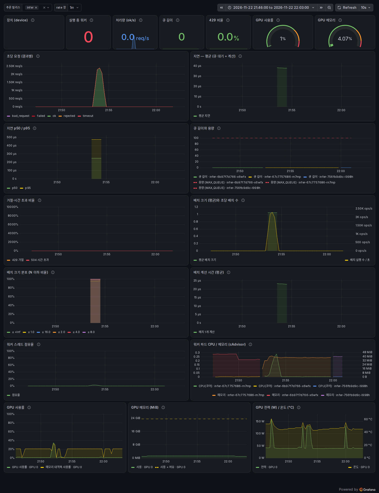

# CI/CD 연결 시험: 코드 변경에서 Argo CD 배포까지 (2026-11-22 21:41)

- 생성: `scripts/cicd-e2e-test.sh` (11주차, 제안서 12–13주 몫을 앞당겨 진행)
- 흐름: Gitea 커밋 → Jenkins 폴링(1분) → 검사(C++·Python·쉘·Helm) → Kaniko 이미지 → 태그 커밋(`k3slab ci`) → Argo CD sync → 새 파드
- 코드·배포 값의 출처: 클러스터 안 Gitea `k3slab/k3s-vmware-lab` (`http://gitea.k3slab-system.svc.cluster.local:3000/k3slab/k3s-vmware-lab.git`)
- 시험할 변경: 지연 히스토그램(`apps/infer/metrics.cpp apps/infer/metrics.h tests/infer/test_metrics.cpp scripts/jenkins-stage-cpp.sh`). 변경 전 = `HEAD`(ae51880)의 이 파일들, 나머지는 작업 폴더
- 시간은 이 컴퓨터의 시간대(KST). Jenkins는 밀리초, Argo CD·Kubernetes·Git은 초 단위라 단계 사이 값에 최대 1초 오차가 있다.

## 0. 사전 확인

- ✅ **PASS** — Jenkins 컨트롤러(jenkins-0)가 Ready

- ✅ **PASS** — 운영 작업 k3slab-ci이 클러스터 안 Gitea(k3slab/k3s-vmware-lab)를 본다

- ✅ **PASS** — 작업 정의에 GitHub 주소가 없다

- ✅ **PASS** — Jenkins 자격증명 gitea-ci가 있다 (Secret ci/gitea-ci의 토큰)

- ✅ **PASS** — Gitea가 Ready

- ✅ **PASS** — Argo CD 구성요소 4개가 Ready

- ✅ **PASS** — Prometheus가 응답

- ✅ **PASS** — Jenkins에 돌고 있거나 대기 중인 빌드가 없다

- ✅ **PASS** — Jenkins가 Gitea main의 맨 위 커밋까지 따라잡았다 (마지막 빌드 #4가 그 커밋을 봤다)

- 시계 차이(노드 시각 − 이 컴퓨터, ms): Jenkins 컨트롤러(worker-cpu-1) **40**, Argo CD(worker-cpu-2) **45**. 이 값이 1000ms를 넘으면 아래 단계 사이 시간을 그대로 믿지 않는다.
- 지금 ConfigMap ci-latest: tag `git-67f933b`, commit `67f933b`, built_at `2026-11-22T12:40:30Z`

## 1. 기준선 (변경 전 코드가 CI로 만들어져 배포된 상태)
- Gitea main의 코드가 기준선과 달라 기준선 커밋 `1cd3df2`을 올렸다 (이전 head `5257603`).
- 기준선 빌드 #5: SUCCESS, 커밋부터 빌드 끝까지 243.1초 (태그 커밋 포함)

- ✅ **PASS** — 태그 커밋(f4e54ae)이 만든 빌드 #6은 건너뛰기(NOT_BUILT)로 끝났다 (결과 NOT_BUILT)

- ✅ **PASS** — 빌드 #6의 이유는 CI 봇 커밋이고 그 커밋을 봤다 (로그 'CI-SKIP: the commit is a CI bot commit', commit=f4e54ae)

- ✅ **PASS** — 건너뛴 빌드에서 검사·이미지·배포 값 단계가 돌지 않았다

- ✅ **PASS** — 태그 커밋 뒤 75초가 지나도 건너뛴 빌드(#6) 말고는 새 빌드가 없다 (고리가 막혔다)

- ✅ **PASS** — Gitea 저장소 main의 파일 목록(146개)에 *.env, kubeconfig, secrets, .generated, 키·인증서 파일이 없다

**Gitea 저장소 main의 최상위 경로별 파일 수**

```text
     23 apps
      8 charts
     71 infra
      1 Jenkinsfile
     40 scripts
      3 tests
```
- CI가 마지막으로 만든 이미지: `infer-worker:git-1cd3df2` (sha256:f7efc43540d7280b16eb8798abc95017073ecdc1d00096c1afc10c144bd1c16b), GitOps 값의 image.tag: `git-1cd3df2`

- ✅ **PASS** — 배포 값의 image.tag가 CI가 만든 태그다 (사람이 넣은 v0.2 같은 태그가 아니다)

- ✅ **PASS** — ConfigMap ci-latest의 digest가 레지스트리와 같다
- Application이 없어 만들었다: 만든 뒤 Synced + Healthy + 파드 Ready까지 4.0초 (이미지를 노드로 처음 받는 시간이 들어 있다)

- ✅ **PASS** — 기준선 파드(infer-6b97f7d766-x6wfx)가 Ready, 노드 gpu-host, 이미지 태그 git-1cd3df2

- ✅ **PASS** — 기준선 파드의 digest가 CI가 기록한 digest와 같다

- ✅ **PASS** — 기준선 파드의 /metrics에 지연 버킷(k3slab_infer_request_seconds_bucket)이 없다

**시험 시작 상태**

```text
Gitea head   : f4e54ae578fd490a6e772d4b31fd8aca507b3358
Application  : sync=Synced health=Healthy revision=f4e54ae5 phase=Succeeded
파드         : infer-6b97f7d766-x6wfx (uid 98a40208-b10c-4899-afc0-080f46481cd8)
이미지       : infer-worker:git-1cd3df2 @ sha256:f7efc43540d7280b16eb8798abc95017073ecdc1d00096c1afc10c144bd1c16b
레지스트리   : infer-worker 태그 = git-1cd3df2 git-67f933b src-6c928df39c1a src-ca7bcab78492 v0.1 v0.2 
```

## 2. 성공 경로: 지연 히스토그램 변경 커밋 하나
- 커밋 `ab7b937` (변경: apps/infer/metrics.cpp apps/infer/metrics.h tests/infer/test_metrics.cpp scripts/jenkins-stage-cpp.sh) 를 Gitea main에 올렸다. 시각 21:47:01

- ✅ **PASS** — 빌드 #7가 사람 손 없이 시작됐다 (원인: Started by an SCM change)

- ✅ **PASS** — Jenkins가 빌드한 커밋이 올린 커밋(ab7b9377652b7fda8bf2388e19cea4a95f9dd538)과 같다

- ✅ **PASS** — 이미지 태그가 git-<커밋 7자리> (git-ab7b937)이고 이전 태그(git-1cd3df2)와 다르다

- ✅ **PASS** — 레지스트리의 새 태그 digest가 ConfigMap ci-latest의 digest와 같다 (sha256:53ba64f70794f417b98c9ca959984e7f38833992107234a551542e2d96163a34)

- ✅ **PASS** — 이전 태그(git-1cd3df2)의 digest는 그대로다 (태그를 덮어쓰지 않았다)

- ✅ **PASS** — 새 digest가 이전 digest와 다르다

- ✅ **PASS** — Gitea main 맨 위가 CI 봇(k3slab ci)의 태그 커밋(d0dc84e)이고 제목에 새 태그와 [skip ci]가 있다

- ✅ **PASS** — 태그 커밋의 바로 아래가 올린 커밋(ab7b937)이다

- ✅ **PASS** — 배포 값 파일의 image.tag가 새 태그(git-ab7b937)로 바뀌었다

**Gitea main 최근 커밋 (커밋, 작성자, 시각, 제목)**

```text
d0dc84e7d64c48835a94b8c384ae34b894401fdf	k3slab ci	2026-11-22T12:51:52Z	ci: deploy infer-worker git-ab7b937 [skip ci]
ab7b9377652b7fda8bf2388e19cea4a95f9dd538	k3slab argocd source	2026-11-22T21:47:01+09:00	metrics: export request latency as a histogram (k3slab_infer_request_seconds_bucket)
f4e54ae578fd490a6e772d4b31fd8aca507b3358	k3slab ci	2026-11-22T12:45:37Z	ci: deploy infer-worker git-1cd3df2 [skip ci]
```
- Gitea에 기록된 태그 커밋의 시각: 2026-11-22T12:51:52Z (초 단위). Jenkins 단계 기록의 '배포 값' 끝: 21:51:53

- ✅ **PASS** — 태그 커밋(d0dc84e)이 만든 빌드 #8은 건너뛰기(NOT_BUILT)로 끝났다 (결과 NOT_BUILT)

- ✅ **PASS** — 빌드 #8의 이유는 CI 봇 커밋이고 그 커밋을 봤다 (로그 'CI-SKIP: the commit is a CI bot commit', commit=d0dc84e)

- ✅ **PASS** — 건너뛴 빌드에서 검사·이미지·배포 값 단계가 돌지 않았다

- ✅ **PASS** — 태그 커밋 뒤 75초가 지나도 건너뛴 빌드(#8) 말고는 새 빌드가 없다 (고리가 막혔다)

- ✅ **PASS** — Argo CD가 자동 동기화로 태그 커밋(d0dc84e)을 배포했다 (initiatedBy.automated)

- ✅ **PASS** — 새 파드(infer-67c7757686-rn7mp)가 Ready이고 gpu-host에서 돈다, 예전 파드는 사라지고 파드는 1개

- ✅ **PASS** — 새 파드의 이미지 태그가 git-ab7b937

- ✅ **PASS** — 새 파드가 실제로 도는 digest(imageID)가 CI가 기록한 digest와 같다

- ✅ **PASS** — 새 파드의 /metrics가 지연 히스토그램(버킷 13개, TYPE histogram)을 낸다

- ✅ **PASS** — 예전 지표 이름(info, queue_length, requests_total, batch_size, batch_compute_seconds, request_seconds_sum/_count)이 그대로 있다

### 2-2. 새 파드에 부하를 주고 Prometheus에서 p50/p95 읽기
- 부하: `curl --parallel-max 64`로 30초 (port-forward 경유). 요청 132000개, 응답 200 **132000**개. 시각 21:53:11 – 21:53:41

**새 파드의 버킷 (le, 누적 개수; /metrics)**

```text
0.0005 131962
0.001 131993
0.002 131999
0.005 131999
0.01 131999
0.025 131999
0.05 132000
0.1 132000
0.25 132000
0.5 132000
1 132000
2 132000
+Inf 132000
```

**Prometheus 쿼리 (대시보드 패널과 같은 식)**

```text
p50  = histogram_quantile(0.5, sum by (le)(rate(k3slab_infer_request_seconds_bucket{release="infer"}[1m])))  → 0.000250071990421485 s
p95  = histogram_quantile(0.95, sum by (le)(rate(k3slab_infer_request_seconds_bucket{release="infer"}[1m])))  → 0.00047513678180082143 s
평균 = sum(rate(k3slab_infer_request_seconds_sum{release="infer"}[1m])) / sum(rate(k3slab_infer_request_seconds_count{release="infer"}[1m]))  → 0.00003816957575757575 s
_count (새 파드, 카운터)  = 132000   le=+Inf = 132000   _sum = 5.038384 s
```
- 참고(비교용, 판정에 쓰지 않음): 클라이언트가 port-forward를 거쳐 잰 응답 시간 p50 7.50 ms, p95 13.82 ms (네트워크·port-forward 시간이 들어 있어 서버 값보다 크다)

- ✅ **PASS** — Prometheus의 지연 _count(132000)와 le="+Inf"(132000)가 클라이언트가 센 200 응답 수(132000)와 같다

- ✅ **PASS** — 대시보드의 p50/p95 쿼리가 값을 낸다 (p50 0.000250071990421485 s, p95 0.00047513678180082143 s: 0 < p50 ≤ p95 ≤ 2.5 s)

- ✅ **PASS** — 버킷 누적 개수가 줄지 않고 le=+Inf가 _count와 같다

## 3. 차단 경로: 단위 시험이 실패하는 커밋
- 커밋 `9542768`: `apps/infer/metrics.cpp`에 `sed 's/us > kBoundsUs\[i\]/us >= kBoundsUs[i]/'` (경계값이 한 칸 위 버킷으로 가는 실수, 빌드와 실행 검사는 통과하고 단위 시험만 잡는다). 시각 21:54:00

- ✅ **PASS** — 빌드 #9가 FAILURE로 끝났다 (FAILURE)

- ✅ **PASS** — C++ 단계가 단위 시험 실패로 멈췄다 (로그: '[cpp] FAIL: metrics unit test failed')

- ✅ **PASS** — 나머지 검사 단계(Python, 쉘, Helm)가 건너뛰어졌다

- ✅ **PASS** — 이미지 단계와 배포 값 단계가 건너뛰어졌다

- ✅ **PASS** — 레지스트리에 infer-worker:git-9542768, train-worker:git-9542768가 생기지 않았다

- ✅ **PASS** — 레지스트리의 태그 목록이 그대로다 (infer-worker, train-worker)

- ✅ **PASS** — 태그 커밋이 없다: Gitea main의 맨 위가 실패한 커밋(9542768)이고 배포 값의 태그는 git-ab7b937 그대로

- ✅ **PASS** — ConfigMap ci-latest가 바뀌지 않았다 (built_at 2026-11-22T12:51:40Z, tag git-ab7b937)

**실패한 빌드 #9 로그 끝부분**

```text
[Pipeline] // stage
[Pipeline] stage
[Pipeline] { (Declarative: Post Actions)
[Pipeline] echo
[2026-11-22T12:54:26.574Z] CI failed: see the first failing stage above; the image stage is skipped when a check fails
[Pipeline] }
[Pipeline] // stage
[Pipeline] }
[Pipeline] // timeout
[Pipeline] }
[Pipeline] // timestamps
[Pipeline] End of Pipeline
ERROR: script returned exit code 1
Finished: FAILURE
```

- ✅ **PASS** — 실패한 커밋 뒤 75초가 지나도 새 빌드가 없다(마지막 빌드는 #9)

- ✅ **PASS** — 기존 파드(infer-67c7757686-rn7mp)가 그대로다 (같은 uid, 재시작 0, 같은 digest, 파드 1개)

- ✅ **PASS** — Deployment 세대(2)와 Argo CD 배포 이력(마지막 id 1)이 그대로다

**차단 뒤 상태**

```text
Application : sync=Synced health=Healthy revision=9542768a phase=Succeeded
파드        : infer-67c7757686-rn7mp  (uid 5cdab6a7-e80d-4dab-b0bf-a92972f3318e)
Gitea 최근 커밋:
9542768a1c6467687560d790f90b4d8c506de811	k3slab argocd source	2026-11-22T21:53:59+09:00	e2e: break the latency bucket boundary (the unit test must fail)
d0dc84e7d64c48835a94b8c384ae34b894401fdf	k3slab ci	2026-11-22T12:51:52Z	ci: deploy infer-worker git-ab7b937 [skip ci]
ab7b9377652b7fda8bf2388e19cea4a95f9dd538	k3slab argocd source	2026-11-22T21:47:01+09:00	metrics: export request latency as a histogram (k3slab_infer_request_seconds_bucket)
```

### 3-2. 실패한 커밋을 되돌린다 (git revert) — 되돌린 커밋도 같은 파이프라인을 통과하는지
- revert 커밋 `760a534` (실패한 커밋 `9542768`을 되돌림). 시각 21:55:45

- ✅ **PASS** — revert 뒤 apps/infer/metrics.cpp이 성공 커밋(ab7b937)의 내용과 같다

- ✅ **PASS** — revert 커밋의 빌드 #10가 SUCCESS (SUCCESS)

- ✅ **PASS** — 태그 커밋(0d261b1)이 만든 빌드 #11은 건너뛰기(NOT_BUILT)로 끝났다 (결과 NOT_BUILT)

- ✅ **PASS** — 빌드 #11의 이유는 CI 봇 커밋이고 그 커밋을 봤다 (로그 'CI-SKIP: the commit is a CI bot commit', commit=0d261b1)

- ✅ **PASS** — 건너뛴 빌드에서 검사·이미지·배포 값 단계가 돌지 않았다

- ✅ **PASS** — 태그 커밋 뒤 75초가 지나도 건너뛴 빌드(#11) 말고는 새 빌드가 없다 (고리가 막혔다)

- ✅ **PASS** — 되돌린 커밋이 새 태그(git-760a534)로 배포됐고 새 파드의 digest가 CI 기록(sha256:6f01815ce2d9974dfd9ee19a8a2909c0c1d899d2d064859295e09ba27db81ba8)과 같다

## 4. 성공 경로의 단계별 시각과 걸린 시간

### 4-1. 커밋 → 새 digest 확인 (빌드 #7, 새 태그 `git-ab7b937`)

| # | 단계 | 시각 | 커밋부터(초) | 직전 단계부터(초) | 무엇을 재나 |
|---|---|---|---|---|---|
| 1 | 커밋 | 21:47:01 | 0.0 | – | 스크립트가 Gitea에 push를 끝낸 시각 |
| – | 폴링 지연: 변경을 찾아 빌드 예약 | 21:48:05 | 63.6 | 63.6 | Jenkins가 Gitea를 1분마다 폴링해서 새 커밋을 찾고 빌드를 만든 시각 (웹훅 없음) |
| 2 | 빌드 시작 | 21:48:05 | 63.7 | 0.1 | 빌드가 실행을 시작한 시각 (wfapi startTimeMillis, 대기열 시간 포함) |
| 3 | 검사 끝 | 21:48:50 | 109.0 | 45.3 | 소스·C++·Python·쉘·Helm 중 가장 늦게 끝난 단계의 끝 (에이전트 파드 준비 시간 포함) |
| 4 | 이미지 push 끝 | 21:51:40 | 278.8 | 169.8 | 이미지 단계(infer-worker·train-worker Kaniko 빌드, push, digest 확인, 결과 기록) 끝 |
| 5 | 태그 커밋 | 21:51:53 | 291.5 | 12.7 | 배포 값 단계 끝 = Gitea에 태그 커밋 push 완료 (에이전트 파드 준비 포함) |
| 6 | Argo CD sync 끝 | 21:52:12 | 310.3 | 18.7 | 동기화 작업 finishedAt (Argo CD가 커밋을 알아채는 시간 + 매니페스트 생성 + 적용) |
| 7 | 새 파드 Ready | 21:52:19 | 317.3 | 7.0 | 새 파드의 Ready 조건 시각 (GPU 파드는 maxSurge 0이라 예전 파드를 먼저 내린다) |
| 8 | 새 digest 확인 | 21:52:21 | 320.1 | 2.9 | 파드 imageID의 digest = CI가 기록한 digest 확인 |

전체: 커밋부터 새 digest 확인까지 **320.1초**.

| Jenkins 단계 | 시작 | 걸린 시간(초) |
|---|---|---|
| 소스 | 21:48:10 | 1.5 |
| C++ | 21:48:12 | 13.3 |
| Python | 21:48:25 | 12.4 |
| 쉘 | 21:48:37 | 11.4 |
| Helm | 21:48:49 | 1.5 |
| 이미지 | 21:48:50 | 169.6 |
| 배포 값 | 21:51:40 | 12.7 |

### 4-2. 나누어 본 구간

| 구간 | 초 | 설명 |
|---|---|---|
| 커밋 → Jenkins 빌드 예약 | 63.6 | 폴링 간격(1분)이 만드는 지연. 0~60초 사이 값이 나온다 |
| 예약 → 빌드 시작 | 0.1 | 대기열 |
| 빌드 시작 → 소스 단계 시작 | 5.2 | 검사 에이전트 파드가 gpu-host에 뜨는 시간 |
| 태그 커밋 → 봇 커밋의 건너뛴 빌드 #8 예약 | 12.1 | CI 봇의 태그 커밋도 폴링에 잡힌다. 소스 단계가 건너뛰어 NOT_BUILT로 끝난다(이 빌드가 파드를 하나 쓰는 시간: 7.5초) |
| 태그 커밋 → Argo CD sync 시작 | 18.7 | Argo CD가 새 커밋을 알아채는 시간(확인 주기 30초 + 저장소 읽기) |
| Argo CD sync 작업 (시작 → 끝) | 0.0 | 매니페스트를 그려 적용하기까지 |
| sync 끝 → 새 파드 Ready | 7.0 | 예전 파드 종료 + 새 파드 시작 (이미지 pull 포함) |
| 태그 커밋 → 새 파드 Ready | 25.7 | DNS 수정 전의 "values 커밋 → 새 파드 Ready 55초"와 같은 구간 |

**새 파드의 이미지 pull 이벤트 (노드에 이미지가 없었으므로 처음 받는다)**

```text
FailedScheduling   0/4 nodes are available: 1 Insufficient nvidia.com/gpu, 3 node(s) didn't match Pod's node affinity/selector. no new claims to deallocate, preemption: 0/4 nodes are available: 1 No preemption victims fo
Scheduled          Successfully assigned k3slab-apps/infer-67c7757686-rn7mp to gpu-host
Pulling            Pulling image "registry.k3slab.local:5000/infer-worker:git-ab7b937"
Pulled             Successfully pulled image "registry.k3slab.local:5000/infer-worker:git-ab7b937" in 101ms (101ms including waiting). Image size: 31062668 bytes.
Created            Container created
Started            Container started
Unhealthy          Readiness probe failed: Get "http://10.42.2.134:8080/healthz": dial tcp 10.42.2.134:8080: connect: connection refused
Killing            Stopping container worker
```

**Argo CD 배포 이력 (id, 커밋, 배포 시각)**

```text
0  f4e54ae578fd490a6e772d4b31fd8aca507b3358  2026-11-22T12:46:55Z
1  d0dc84e7d64c48835a94b8c384ae34b894401fdf  2026-11-22T12:52:12Z
2  0d261b12908c6584ac854e6c864fabe6980c9bd6  2026-11-22T12:59:40Z
```

## 5. 차단 경로와 되돌림의 시간

- 실패한 커밋 `9542768`: 커밋부터 빌드 끝(FAILURE)까지 25.9초 (폴링 대기 4.6초 + 시작부터 실패까지 21.3초)

| Jenkins 단계 | 시작 | 걸린 시간(초) |
|---|---|---|
| 소스 | 21:54:10 | 1.6 |
| C++ | 21:54:12 | 13.6 |
| Python | 21:54:26 | 0.1 |
| 쉘 | 21:54:26 | 0.0 |
| Helm | 21:54:26 | 0.0 |
| 이미지 | 21:54:26 | 0.0 |
| 배포 값 | 21:54:26 | 0.0 |

### 5-2. revert 커밋도 같은 파이프라인으로 배포된다 (빌드 #10, 새 태그 `git-760a534`)

| # | 단계 | 시각 | 커밋부터(초) | 직전 단계부터(초) | 무엇을 재나 |
|---|---|---|---|---|---|
| 1 | 커밋 | 21:55:45 | 0.0 | – | 스크립트가 Gitea에 push를 끝낸 시각 |
| – | 폴링 지연: 변경을 찾아 빌드 예약 | 21:56:05 | 19.5 | 19.5 | Jenkins가 Gitea를 1분마다 폴링해서 새 커밋을 찾고 빌드를 만든 시각 (웹훅 없음) |
| 2 | 빌드 시작 | 21:56:05 | 19.5 | 0.1 | 빌드가 실행을 시작한 시각 (wfapi startTimeMillis, 대기열 시간 포함) |
| 3 | 검사 끝 | 21:56:50 | 64.4 | 44.9 | 소스·C++·Python·쉘·Helm 중 가장 늦게 끝난 단계의 끝 (에이전트 파드 준비 시간 포함) |
| 4 | 이미지 push 끝 | 21:59:32 | 226.5 | 162.2 | 이미지 단계(infer-worker·train-worker Kaniko 빌드, push, digest 확인, 결과 기록) 끝 |
| 5 | 태그 커밋 | 21:59:37 | 231.6 | 5.1 | 배포 값 단계 끝 = Gitea에 태그 커밋 push 완료 (에이전트 파드 준비 포함) |
| 6 | Argo CD sync 끝 | 21:59:40 | 234.1 | 2.5 | 동기화 작업 finishedAt (Argo CD가 커밋을 알아채는 시간 + 매니페스트 생성 + 적용) |
| 7 | 새 파드 Ready | 21:59:47 | 241.1 | 7.0 | 새 파드의 Ready 조건 시각 (GPU 파드는 maxSurge 0이라 예전 파드를 먼저 내린다) |
| 8 | 새 digest 확인 | 21:59:48 | 243.0 | 1.9 | 파드 imageID의 digest = CI가 기록한 digest 확인 |

전체: 커밋부터 새 digest 확인까지 **243.0초**.

| Jenkins 단계 | 시작 | 걸린 시간(초) |
|---|---|---|
| 소스 | 21:56:10 | 1.5 |
| C++ | 21:56:12 | 13.4 |
| Python | 21:56:25 | 11.4 |
| 쉘 | 21:56:37 | 11.7 |
| Helm | 21:56:48 | 1.4 |
| 이미지 | 21:56:50 | 161.9 |
| 배포 값 | 21:59:32 | 5.1 |

## 6. Argo CD sync 시간: DNS 수정 전과 후

- ✅ **PASS** — Application 삭제 뒤 추론 파드가 모두 사라졌다 (GPU 반환)

- ✅ **PASS** — 다시 만든 Application의 파드(infer-756fb9d9c-s5zqx)가 이미지 태그 git-760a534로 Ready

**다시 만든 파드의 이미지 pull 이벤트**

```text
Scheduled   Successfully assigned k3slab-apps/infer-756fb9d9c-s5zqx to gpu-host
Pulled      Container image "registry.k3slab.local:5000/infer-worker:git-760a534" already present on machine and can be accessed by the pod
Created     Container created
Started     Container started
Unhealthy   Readiness probe failed: Get "http://10.42.2.142:8080/healthz": dial tcp 10.42.2.142:8080: connect: connection refused
```

- ✅ **PASS** — 다시 만든 Application도 지웠고 추론 파드가 없다 (GPU 반환)

| 측정 | DNS 수정 전 (`docs/labs/argocd-20261122-1612.md`) | DNS 수정 후 (이 시험) | 비고 |
|---|---|---|---|
| 처음 sync: Application 생성 → Synced + Healthy (+ 파드 Ready) | 21초 (이미지가 노드에 있었다) | Synced+Healthy 3.9초, 파드 Ready까지 4.1초 | 이미지가 노드에 있는 상태로 다시 만들어 쟀다 (이 시험이 처음 만든 때의 시간은 위 1절, 이미지 pull 포함) |
| 새 리비전: values 커밋 → 새 파드 Ready | 55초 (maxBatch 8→4 커밋) | 성공 경로 25.7초, 되돌림 경로 9.5초 | 구간의 정의는 같다(Git에 값 커밋이 들어간 뒤 새 파드 Ready). 이번에는 새 이미지를 노드가 처음 받는 시간이 더 들어 있다 |
| (참고) 태그 커밋 → Argo CD sync 시작 | 재지 않음 | 성공 경로 18.7초 | 확인 주기 30초 + 저장소 읽기 |

- GPU: Application을 지워서(`scripts/argocd-deploy.sh app-down`) 추론 파드가 없다. gpu-host가 할당한 GPU: `0`

## 결과 요약

PASS 62, FAIL 0

---

아래 7절 이후는 시험 뒤에 사람이 덧붙인 부분이다 (위 0~6절은 `scripts/cicd-e2e-test.sh`가 쓴 것). 주차는 11주차(제안서 12–13주 몫을 앞당겨 진행)다.

## 7. 한눈에 보기

| 확인 | 결과 | 근거 |
|---|---|---|
| 흐름 전체 성공 1회 | 커밋 `ab7b937`(지연 히스토그램) → 빌드 #7 → 이미지 `git-ab7b937` → 태그 커밋 `d0dc84e` → Argo CD sync → 새 파드 `infer-67c7757686-rn7mp`가 CI가 기록한 digest(`sha256:53ba64f7…3a34`)로 동작. 커밋부터 새 digest 확인까지 **320.1초** | 2·4절 |
| 실패 차단 1회 | 커밋 `9542768`(경계값 off-by-one) → 빌드 #9가 C++ 단계 단위 시험에서 FAILURE(25.9초). 이미지·태그 커밋·배포 없음, 기존 파드는 같은 uid·재시작 0·같은 digest, 배포 이력 그대로. revert 커밋 `760a534`는 같은 파이프라인을 통과해 243.0초에 새 태그 `git-760a534`로 배포 | 3·5절 |
| 태그 덮어쓰기 없음 | 이전 태그 `git-1cd3df2`의 digest는 새 빌드 뒤에도 같다 | 2절 |
| 고리 막힘 | 봇의 태그 커밋마다 폴링이 빌드를 하나 만들었고(#4, #6, #8, #11) 모두 소스 단계가 건너뛰어 `NOT_BUILT`(7~9초), 그 뒤 75초 동안 다른 빌드 없음 | 1·2·3-2절 |
| p50 / p95 | Prometheus에서 **p50 ≈ 0.25 ms, p95 ≈ 0.475 ms** (7-3절: 둘 다 첫 버킷 안의 보간 값이다), 평균 38.2 µs | 2-2절 |
| 스크립트 판정 | **PASS 62 / FAIL 0** | 결과 요약 |
| GPU | 시험 시작 때 Application을 만들어 쓰고, 끝에 지워서 반납. gpu-host `nvidia.com/gpu` 할당 0 확인 | 6절 |

**폴링 지연(커밋 → 빌드 예약)은 단계별 시간표의 별도 줄이다** (4-1절의 "–" 줄): 성공 경로 63.6초, 차단 경로 4.6초, revert 경로 19.5초. Jenkins가 Gitea를 1분 간격으로 보므로 0~60초 사이에 흩어지는 값이고(63.6초는 폴링 간격 60초에 빌드 예약까지의 몇 초가 더해진 것), 평균은 29.2초다(표본 3개라 기댓값 30초와 맞는지는 말할 수 없다).

## 8. 대시보드 화면



- 촬영: 임시 `kubectl port-forward`(Grafana)와 Playwright(시스템에 있는 Chromium, 헤드리스)로 `k3slab-infer` 대시보드를 로그인해서 찍었다(로그인 값은 화면·로그에 남기지 않았다). 시간 범위 21:46–22:03, `release=infer`, `rate 창=1m`. 실제 클러스터 값이다.
- **지연 p50 / p95 패널**(가운데 왼쪽)이 처음으로 값을 낸다. 21:53 부하 30초 구간에서 p50 약 250 µs, p95 약 475 µs. 시험 전에는 "No data"였다(`infra/k8s/monitoring/README.md`의 알려진 한계). 평균 지연 패널은 약 38 µs다.
- 맨 위 숫자 카드(실행 중 워커 0, 처리량 0)는 촬영 시점 값이다. 파드를 이미 내려서 0이다.
- 워커 파드 CPU/메모리 패널(아래)에 파드가 세 종류 보인다: 기준선 `infer-6b97…`, 성공 경로 `infer-67c7…`, revert 경로 `infer-756f…`(마지막에 Application을 다시 만들어 뜬 파드도 같은 이미지라 같은 접두사다). 파드가 바뀐 시각이 보인다.
- 대시보드 JSON(`k3slab-inference.json`)은 이름이 맞아서 고치지 않았다.

## 9. p50 / p95를 읽는 법 (과장하지 않기 위해)

- 새 파드의 버킷(2-2절): 응답 132000개 중 131962개(99.971%)가 첫 버킷(≤ 0.5 ms)에 들어 있고 나머지 38개는 0.5 ms를 넘고 그중 37개는 2 ms 이하, 1개는 25~50 ms다. **p50, p95는 모두 첫 버킷 안**이라서 Prometheus가 버킷 안을 직선으로 보간한 값이다: p50 = 0.5 ms × 0.5 = 0.25 ms, p95 = 0.5 ms × 0.95 = 0.475 ms. 그래서 "p50이 250 µs"라고 읽으면 안 되고 "99.97%가 0.5 ms 이하"라고 읽어야 한다. 평균(합계 ÷ 개수 = 5.038 s ÷ 132000 = 38.2 µs)이 실제 크기를 더 잘 말해 준다.
- 이 시험의 모델(`db-1107b-train`, 작은 모델)에서는 큐 대기와 계산이 모두 마이크로초 단위다. 11-22 모니터링 시험의 평균 1.00 ms는 큰 모델(`bench-large`) 값이다. 작은 모델의 p50·p95까지 구분하려면 0.5 ms 아래에 버킷이 더 필요하다(예: 0.05, 0.1, 0.25 ms). 이번에는 버킷 경계를 바꾸지 않았다(`apps/infer/metrics.h`의 주석에 경계와 이유가 있고, 큰 모델과 CPU 워커·과부하 쪽을 보는 범위다). 필요하면 `kBoundsUs`만 바꾸면 되고 단위 시험이 같이 바뀐다.
- 참고: 클라이언트가 port-forward를 거쳐 잰 응답 시간은 p50 7.50 ms, p95 13.82 ms다. 서버 값과 두 자릿수 차이가 나는 것은 port-forward와 curl 쪽 시간이다. 서버 히스토그램은 워커 안의 "큐 + 계산" 시간만 잰다(`k3slab_infer_request_seconds`의 정의 그대로).
- 카운터 확인: Prometheus의 `_count`와 `le="+Inf"`가 클라이언트가 센 200 응답 수(132000)와 정확히 같다.

## 10. Argo CD sync 시간: DNS 수정 전과 후 (6절 표의 해석)

| 측정 | 수정 전 | 수정 후 | 읽는 법 |
|---|---|---|---|
| 처음 sync (Application 생성 → Synced + Healthy) | 21초 | **3.9초** (파드 Ready까지 4.1초) | 깨끗한 비교다: 둘 다 이미지가 노드에 있었고 Application을 만들면 Argo CD가 바로 확인하므로 폴링 주기가 끼지 않는다. 약 17초 줄었다. 한 번씩 잰 값이다 |
| 새 리비전 (값 커밋 → 새 파드 Ready) | 55초 | 성공 경로 25.7초, 되돌림 경로 9.5초 | 이 구간에는 Argo CD의 30초 확인 주기에서 오는 0~30초의 우연이 들어 있다(태그 커밋 → sync 시작이 각각 18.7초, 2.5초). DNS만의 효과로 말할 수 없다. 이번에는 새 이미지(31MB)를 노드가 처음 받는 시간(101ms)도 들어 있다 |
| sync 작업 자체 (시작 → 끝) | 재지 않음 | 1초 미만(성공 경로 0.0초) | 저장소 읽기(DNS)와 매니페스트 생성이 포함된 값이다 |

처음 sync 쪽만 DNS 지연을 분리해서 볼 수 있고, 거기서 21초 → 3.9초가 나왔다. 새 리비전 쪽은 표본이 각각 한 개라 방향(빨라졌다)만 말한다.

## 11. 웹훅을 쓰지 않은 이유 (폴링을 고른 이유)

웹훅이면 지연이 1초 안쪽으로 줄지만 이 클러스터에서는 두 곳이 막힌다.

- **Gitea 쪽**: 웹훅 대상 주소는 기본 설정(`[webhook] ALLOWED_HOST_LIST`, 기본 `external`)이 사설 주소를 막는다. Jenkins는 클러스터 서비스 주소(사설)라서 Gitea 설정을 바꾸고 Gitea를 다시 띄워야 한다. Gitea가 있는 worker-cpu-2는 메모리 limits가 안전 한도의 93%라 재시작과 설정 변경을 피했다. (Gitea가 시작할 때 "ALLOWED_HOST_LIST only restricts private hosts in the default lax mode"라고 알려 준다. 이번에 `ci-init`을 돌릴 때 이 경고가 나왔다.)
- **Jenkins 쪽**: git 플러그인의 `/git/notifyCommit`은 로그인 없이 부르는 주소다. 이 Jenkins는 익명 접근을 모두 막아 두었는데(`allowAnonymousRead: false`), 웹훅은 로그인 없이 트리거하는 길을 새로 여는 일이다. 토큰으로 제한하는 설정은 따로 해야 하고 이번에 시험하지 않았다.
- 폴링은 둘 다 바꾸지 않는다. 비용은 분당 `git ls-remote` 한 번이다(실측: Jenkins 폴링 로그 "Took 0.14 sec"). 대가는 위의 지연(0~60초)이다.

## 12. 조건 확인 (총괄 승인 조건)

- **Gitea에 들어간 파일**: `Jenkinsfile apps charts scripts infra tests`의 git이 아는 파일(추적 + 새 파일 중 `.gitignore`에 걸리지 않는 것) 146개. Gitea 파드 안에서 `git ls-tree -r --name-only main`으로 목록을 읽어 `*.env`, `kubeconfig`, `secrets`, `.generated`, `*.pem`, `*.key`, `*.crt`, `_ed25519`, `*-token`, `terraform.yml`을 찾았고 **하나도 없었다**(1절 PASS). `scripts/lib/pinned-versions.env`와 `infra/ansible/inventories/lab/.generated/terraform.yml`도 들어가지 않았다. 최상위별: apps 23, charts 8, infra 71, Jenkinsfile 1, scripts 40, tests 3. (이 작업 공간의 새 파일 `scripts/cicd-*.sh`, `tests/infer/`는 아직 커밋 전이라 "추적"이 아닌 "새 파일 중 무시되지 않는 것"으로 들어갔다.)
- **토큰**: 화면·로그·보고서에 찍지 않았다. 위치는 클러스터 Secret `ci/gitea-ci`와 `~/.config/k3s-vmware-lab/secrets/gitea-ci.env`(권한 600) 둘뿐이다. 계정 `k3slab-ci`는 관리자가 아닌 제한된 사용자(`--restricted`)이고 이 저장소의 write 협력자이며 토큰 범위는 `write:repository` 하나다. `ci-init`을 두 번 돌려 토큰이 다시 만들어지지 않는 것(멱등)도 확인했다.
- **Jenkins 컨트롤러**: requests 250m/768Mi, limits 1 CPU/1Gi, `-Xmx512m`, PVC 5Gi는 그대로다. helm upgrade는 모두 3번 했다(설정 반영 1번, 폴링 문제 고치기 2번). 컨트롤러가 다시 뜨는 데 매번 75~105초가 걸렸고 `jenkins-0`은 매번 Ready가 됐다(README의 "알려진 한계"에 걸리지 않았다).

## 13. 시행 기록 (실패한 것과 고친 것)

빌드 목록(`k3slab-ci`): #1 FAILURE(옛 GitHub 설정, Jenkinsfile 없음), #2 FAILURE, #3 SUCCESS(기준선, 수동 시작), #4 NOT_BUILT, #5 SUCCESS(기준선), #6 NOT_BUILT, #7 SUCCESS(성공 경로), #8 NOT_BUILT, #9 FAILURE(차단), #10 SUCCESS(revert), #11 NOT_BUILT. 소요: SUCCESS 212~233초, 건너뜀 7~9초, 차단 21초.

| # | 무엇이 안 됐나 | 원인 | 고친 것 |
|---|---|---|---|
| 1 | 기준선 빌드 #2가 C++ 단계에서 `tests/infer/test_metrics.cpp does not compile` | 변경 전 사본에 새 단위 시험과 새 단계 스크립트가 그대로 들어 있었다(옛 `metrics.cpp`와 안 맞음) | 시험과 단계 스크립트도 "변경"에 넣었다(`CHANGE_FILES` 4개). 변경 전 사본에는 단위 시험이 없고 옛 단계 스크립트가 있다. 이 실패 자체는 의도한 차단 동작(이후 단계 건너뜀)과 같았다 |
| 2 | 폴링이 `ERROR: no such computer k3slab-ci-2-…` / `No changes`만 남기고 빌드를 시작하지 않음 | git 플러그인의 폴링 제외 확장(UserExclusion, PathRestriction, MessageExclusion)과 와일드카드 브랜치(`*/main`)는 폴링에 마지막 빌드 노드의 워크스페이스가 필요한데 에이전트 파드는 빌드 뒤에 사라진다. 로컬 Jenkins 시험은 노드가 계속 있어서 이를 못 잡았다 | 제외 확장을 빼고 같은 규칙(봇 작성자, `[skip ci]`, 값 파일만 바뀐 커밋)을 Jenkinsfile 소스 단계의 가드로 옮겼다. 브랜치를 `refs/heads/main`으로 적었다 |
| 3 | 위를 고친 뒤에도 같은 오류 | 폴링은 마지막 빌드(#2)가 기록한 옛 SCM 설정을 쓴다. 새 설정은 새 빌드가 한 번 돌아야 반영된다 | `scripts/jenkins-run.sh --git`으로 기준선 빌드 #3을 한 번 직접 시작했다. 그 뒤로 폴링이 자동으로 돈다(`Took 0.14 sec`, `Changes found`) |
| 4 | 로컬 시험 스크립트 두 번 오류(따옴표, 폴링 기준 없음) | 시험용 Jenkinsfile에 `checkout scm`이 없어 폴링 기준 리비전이 없었다 | 로컬에서만 겪은 일이다(클러스터 결과에 영향 없음) |

이 3번의 helm upgrade와 수동 시작 1번은 설계가 아니라 폴링을 클러스터에서 처음 돌리면서 알게 된 것들이다. 처음부터 다시 하는 사람은 `infra/k8s/jenkins/README.md` "코드 변경에서 배포까지"의 순서(`ci-init` → `--seed` → `jenkins-deploy.sh`)를 따르고, 작업에 빌드가 이미 있었다면 한 번 `jenkins-run.sh --git`을 돌린다.

최종 Gitea main 최근 커밋(위가 최신):

```text
0d261b1  k3slab ci            ci: deploy infer-worker git-760a534 [skip ci]
760a534  k3slab argocd source Revert "e2e: break the latency bucket boundary (the unit test must fail)"
9542768  k3slab argocd source e2e: break the latency bucket boundary (the unit test must fail)
d0dc84e  k3slab ci            ci: deploy infer-worker git-ab7b937 [skip ci]
ab7b937  k3slab argocd source metrics: export request latency as a histogram (k3slab_infer_request_seconds_bucket)
f4e54ae  k3slab ci            ci: deploy infer-worker git-1cd3df2 [skip ci]
1cd3df2  k3slab argocd source e2e baseline: code before the latency histogram (ae51880)
5257603  k3slab ci            ci: deploy infer-worker git-67f933b [skip ci]
67f933b / acc38b3 / b12320a   기준선 시행 (b12320a는 위 1번 실패, acc38b3은 Jenkins를 고치는 동안 덮어씀)
```

레지스트리 태그: infer-worker `git-1cd3df2 git-67f933b git-760a534 git-ab7b937` (+ 예전 `src-…`, `v0.1`, `v0.2`), train-worker도 같은 `git-` 태그 넷. 레지스트리 사용량은 `du` 3.1G다(Jenkins 보고서의 3.1G와 같은 값으로 읽혔고, 새 이미지가 작아서(infer 31MB, 나머지 층은 공유) 눈에 띄는 증가는 없었다). Gitea의 배포 값 `image.tag`는 `git-760a534`이고 Application은 지웠다. 다음에 `scripts/argocd-deploy.sh app`을 하면 이 태그로 뜬다.

## 14. 남은 문제

- **스냅샷 시험 경로가 막혀 있던 문제는 고쳤다 (후속 작업, 2026-11-22 22:08)**: 이 시험 중에 `scripts/jenkins-run.sh`(작업 폴더 스냅샷)가 `ConfigMap … metadata.annotations: Too long`으로 실패했다(이번 작업 이전부터 있던 문제: Argo CD `install.yaml` 2MB가 들어온 뒤 커밋된 파일만으로 압축 379KB, `kubectl apply`가 객체 전체를 256KB 한도의 annotation에 복사). 후속 작업에서 `apply`를 "이미 있으면 건너뛰고 없으면 `kubectl create`"로 바꿨다(`scripts/jenkins-run.sh` 131~144행; ConfigMap 이름이 내용 해시라 같은 이름이면 같은 내용, 오래된 것 정리는 방금 쓸 스냅샷을 지우지 않음). 파일 목록에서 `install.yaml`을 빼는 식의 우회는 쓰지 않았다. 확인: `bash -n`, ShellCheck 게이트 통과, `scripts/jenkins-run.sh --no-images` 두 번 — 빌드 `k3slab-ci-local` #9(스냅샷 `ci-source-d2f5bd9f8365`, 418200바이트, 147개 파일)가 검사 4단계 PASS(C++ 단위 시험, Python 37개, 쉘 41개, Helm)와 SUCCESS로 끝났고, 바뀐 Jenkinsfile의 소스 가드는 스냅샷 경로에서 건너뛰지 않았으며(`CI-SKIP` 로그 0건, `NOT_BUILT` 아님), 이미지·배포 값 단계는 `when` 조건으로 건너뛰었고 Gitea에 태그 커밋이 없었다. 같은 내용으로 다시 돌린 #10은 "already exists"로 ConfigMap을 다시 만들지 않고 SUCCESS였다. ConfigMap에 annotation이 없다. 남은 것: `--source-dir`에 최상위 폴더(`infra` 등)가 없으면 스크립트가 아무 메시지 없이 멈춘다(고치지 않음).
- **봇 커밋마다 건너뛴 빌드가 하나 생긴다**: 7~9초, 에이전트 파드 하나. 폴링 제외 확장을 쓸 수 없어서(에이전트 파드에 워크스페이스가 없다) 생긴 대가다. Jenkins 빌드 목록의 절반 가까이가 `NOT_BUILT`다(보관은 20개).
- **폴링 지연 0~60초**와 Argo CD의 30초 확인 주기가 더해진다. 줄이려면 웹훅이 필요한데 11절의 설정 변경이 따른다(사용자가 정할 일).
- **첫 버킷(≤ 0.5 ms)이 작은 모델에는 너무 굵다**(9절). 큰 모델·CPU 워커 쪽을 보고 정한 경계라 작은 모델의 p50/p95는 해상도가 없다.
- **값 파일은 이제 CI가 쓰는 파일이다**: `scripts/argocd-source.sh push`(charts/ 전체 덮어쓰기)는 CI가 넣은 태그를 개발 쪽 사본의 옛 태그로 되돌린다. `scripts/argocd-deploy.sh up`도 마지막에 `push`를 부른다. CI를 켠 뒤에는 `tree … --keep <값 파일>`을 쓴다(`infra/k8s/argocd/README.md` 7절에 적었다). `argocd-deploy.sh up`이 이 값을 되돌리는지는 이번에 시험하지 않았다(읽기로 확인).
- **값 파일만 바뀐 사람 커밋은 건너뛰어진다**: 코드 커밋 바로 위에 사람의 값 파일 커밋이 올라오면 그 코드 커밋이 빌드되지 않을 수 있다(HEAD만 본다). `FORCE_BUILD=true`로 시작한다.
- **로컬 Jenkins를 정리하다 java를 이름으로 전부 종료한 일(내 잘못)**: 21:41경 e2e를 시작하는 명령에서, 로컬 시험용으로 띄운 Jenkins(PID 693065)를 정리하려고 `kill $(ps -eo pid,comm | awk '$2=="java"…')`로 이 PC의 사용자 java 프로세스를 모두 종료했다. 내가 띄운 PID만 끊었어야 했다(PID는 알고 있었다). 이 PC가 gpu-host라서 클러스터 빌드 에이전트(java)도 같은 UID로 보일 수 있어 그 방식으로는 빌드 에이전트까지 죽일 수 있다. 그 시점에는 에이전트 파드가 없었고(#4가 끝난 직후) 이후 빌드 #5~#11과 e2e가 모두 정상이었다. 그 밖의 사용자 java 프로세스가 있었는지는 확인하지 못했다. 이후로는 내가 띄운 프로세스의 PID를 파일에 적어 그 PID만 끊었다.
- 이 시험은 각 값을 한 번씩만 쟀다(시간 표 전부). 반복 측정이 아니다.

