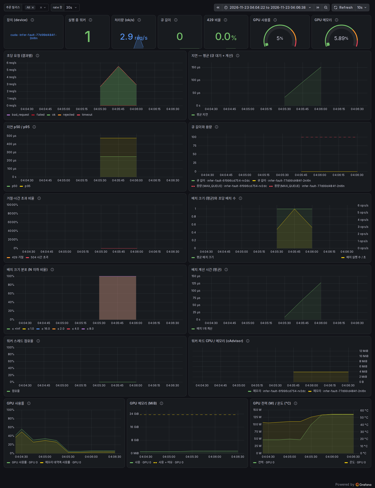

# F5 GPU 사용 불가 → CPU 대체 경로 시험 (2026-11-23 04:04)

- 생성: `scripts/fault-test.sh gpu-busy --model-job db-1107b-train --tag git-760a534 --prom monitoring/prometheus:9090 --yes`
- 설계: `docs/plan-week13-verification.md`. 시각은 이 PC(gpu-host) 시계 기준이고, 측정 오차는 확인 간격(약 1초) 안팎이다.
- 릴리스 `infer-fault`, 모델 작업 `db-1107b-train`, 이미지 `infer-worker:git-760a534`. GPU 점유 파드 `fault-gpu-hold`가 GPU 1개를 쥐고 있는 상황을 만든다.

**실험 시작: ci 네임스페이스 파드 (Jenkins 에이전트 = 빌드 중)**

```text
NAME        READY   STATUS    RESTARTS   AGE     IP           NODE           NOMINATED NODE   READINESS GATES
jenkins-0   1/1     Running   0          6h32m   10.42.3.19   worker-cpu-1   <none>           <none>
```

**실험 시작: gpu-host CPU·메모리 사용량 (kubectl top)**

```text
NAME       CPU(cores)   CPU(%)   MEMORY(bytes)   MEMORY(%)   
gpu-host   1220m        7%       15205Mi         47%         
```

## 1. GPU를 점유한 상태에서 GPU 추론을 배포

**GPU 요청 추론 파드의 스케줄 메시지**

```text
0/4 nodes are available: 1 Insufficient nvidia.com/gpu, 3 node(s) didn't match Pod's node affinity/selector. no new claims to deallocate, preemption: 0/4 nodes are available: 1 No preemption victims found for incoming pod, 3 Preemption is not helpful for scheduling.
```

**파드 목록**

```text
infer-fault-64fd79d445-tl9m5  Pending  node=-  restarts=0  
```

- ✅ **PASS** — GPU를 요청한 추론 파드는 Pending (Insufficient nvidia.com/gpu) — CPU로 저절로 넘어가지 않는다

- ✅ **PASS** — 15초가 지나도 Pending (자동 대체 경로 없음)

## 2. 대체 경로: GPU를 요청하지 않고(gpu=0) DEVICE=auto로 다시 배포

- 📏 대체 배포 시작 → 파드 Ready (t_fb, Service 대기 5초 포함): **6.7초**

**POST /infer 응답**

```text
{"class":9,"batch":1,"queue_ms":0,"device":"cpu","model_version":"fault-test","probs":[0.11131,0.10886,0.07117,0.04424,0.06280,0.02707,0.04345,0.07155,0.01421,0.44534]}
```

**추론 워커 시작 로그 (장치 선택 줄)**

```text
k3slab-infer: GPU not used (no CUDA driver or device: CUDA driver version is insufficient for CUDA runtime version); computing on the CPU
k3slab-infer: model /models/db-1107b-train/model.k3sm (fault-test) in=64 out=10 layers=2 macs/sample=9472; device=cpu (cpu); MAX_QUEUE=100 MAX_BATCH=8 WORKER_THREADS=2 TIMEOUT_MS=10000 WORK_MS=0 PORT=8080
```

- ✅ **PASS** — 대체 배포가 Ready

- ✅ **PASS** — /metrics의 device가 cpu

- ✅ **PASS** — 응답에 "device":"cpu"

## 3. GPU 복귀: 점유 파드를 지우고 gpu=1, DEVICE=cuda로 다시 배포

- 📏 GPU 배포 시작 → Ready (전환 시간): **12.5초**

**프로버 요약 (초당 약 10회 요청, 실패 = HTTP 200이 아닌 응답 또는 시간 초과 000)**

```text
total=154 failed=3 codes=000:3,200:151
first_fail_after_t0=5.0 last_fail_after_t0=6.2 fail_window=1.2
```

- 📏 전환(CPU→GPU) 중 실패 요청 수: **3 / 154 (코드별 000:3,200:151)**

예상: GPU 배포는 maxSurge 0이라 예전 파드를 먼저 내려 전환 중 짧은 공백이 있을 것으로 보았다(charts/k3slab-workload/templates/infer-deployment.yaml). 실제 실패 수는 위 지표가 답이다. 전환 시간에는 infer_deploy의 Service 대기 5초가 들어 있다.

**Prometheus: Pending 파드 (GPU 점유 구간)  (쿼리: max_over_time(kube_pod_status_phase{namespace="k3slab-fault",phase="Pending"}[105s]))**

```text
instance=10.42.3.6:8080,job=kube-state-metrics,namespace=k3slab-fault,phase=Pending,pod=fault-gpu-hold,uid=3ea1e4fc-d4cb-4105-8d25-1c0043dca4f1	0
instance=10.42.3.6:8080,job=kube-state-metrics,namespace=k3slab-fault,phase=Pending,pod=infer-fault-64fd79d445-tl9m5,uid=75eb6ab0-d970-4810-96f4-2faba4f9f039	1
instance=10.42.3.6:8080,job=kube-state-metrics,namespace=k3slab-fault,phase=Pending,pod=infer-fault-6f996cd754-rv2dc,uid=bbdbcc2f-e52a-4d43-b0dd-f5885b623a08	0
instance=10.42.3.6:8080,job=kube-state-metrics,namespace=k3slab-fault,phase=Pending,pod=fault-probe,uid=b3f2acc6-9903-4048-a53c-65a4eca3d722	0
instance=10.42.3.6:8080,job=kube-state-metrics,namespace=k3slab-fault,phase=Pending,pod=infer-fault-77d99d484f-2nl6n,uid=b07a1633-96c5-446d-b117-54fd3ff99449	0
```

- ✅ **PASS** — GPU가 비면 GPU 경로(cuda)로 복귀

## 4. 되돌리기

- ✅ **PASS** — GPU를 쓰는 파드가 남아 있지 않음 (종료 중인 파드가 사라지기를 최대 60초 기다린 뒤 확인)

- ✅ **PASS** — 실험용 네임스페이스(k3slab-fault)가 사라짐

- ✅ **PASS** — 노드 4개 모두 Ready

- ✅ **PASS** — MySQL이 1/1 Ready

- ✅ **PASS** — 레지스트리가 1/1 Ready

## 결과 요약

PASS 11, FAIL 0

---

## 5. 사람이 덧붙인 부분 (위는 `scripts/fault-test.sh`가 쓴 것, 아래는 실행 뒤에 사람이 정리한 것)

14주차 몫(계획 6절 순서 6, GPU 실험)을 12주차 첫날(2026-11-23, 1주차 = 9/7)에 앞당겨 실행했다. 이미지는 **`infer-worker:git-760a534`**(CI가 만든 최신, 지연 히스토그램 있음)를 `--tag`로 줬다. 모델 작업 `db-1107b-train`. 이 실행은 `fault-gpu-busy-20261123-0402.md`(FAIL 1건, 원인은 스크립트의 GPU 반납 확인 타이밍)를 고친 뒤 같은 실험을 다시 돌린 것이다. GPU 슬롯은 이 실험 동안 내가 썼고, 끝난 뒤 GPU를 요청한 파드는 0개다(4절 PASS).

### 5.1 핵심 숫자 (두 실행)

| 항목 | 첫 실행 (0402, 고치기 전) | 이 실행 (0404) |
|---|---|---|
| 판정 | PASS 10 / FAIL 1 (GPU 반납 확인 타이밍) | **PASS 11 / FAIL 0** |
| GPU를 점유한 상태에서 GPU 추론 배포 | Pending, `1 Insufficient nvidia.com/gpu` | Pending, `1 Insufficient nvidia.com/gpu`, 15초 뒤에도 Pending |
| t_fb (`gpu=0`·`auto` 대체 배포 → Ready) | 5.9초 | **6.7초** (Service 대기 5초 포함이라 파드 Ready까지는 약 1.7초) |
| 대체 파드의 장치 | cpu | cpu (`"device":"cpu"`, 로그: `GPU not used (no CUDA driver or device …); computing on the CPU`) |
| GPU 복귀(`gpu=1`·`cuda`) 전환 시간 | 8.7초 (약 3.7초) | **12.5초** (Service 대기 5초 포함, 약 7.5초) |
| 전환(CPU→GPU) 중 실패 요청 | **0 / 136** | **3 / 154** (코드 000, 첫~마지막 실패 T0+5.0 ~ 6.2초, 구간 1.2초) |

### 5.2 읽는 법과 한계

- **GPU가 다른 파드에 잡혀 있으면 GPU 요청 파드는 스케줄 단계에서 Pending이다.** `DEVICE=auto`는 파드 안에서 GPU가 안 보일 때의 장치 선택일 뿐이라 이 경우에는 컨테이너가 시작되지도 않는다. 대체 경로는 사람(또는 상위 도구)이 `gpu=0`으로 다시 배포하는 수동 개입이다(계획 4절 F5의 예상 그대로).
- **전환 중 실패는 두 번 중 한 번만 났고 1.2초 구간이다.** 계획은 maxSurge 0이라 예전 파드를 먼저 내려 서비스가 끊길 것으로 예상했다. 실제로는 0개(첫 실행)와 3개(이 실행)였다. 추정: 예전 CPU 파드는 종료 때 preStop 5초 동안 계속 요청을 받고(종료 중인 엔드포인트도 다른 대상이 없으면 쓰인다), 새 GPU 파드가 그 안에 Ready가 되면 끊김이 없다. 이 실행에서는 새 파드가 늦어(전환 약 7.5초) T0+5.0 ~ 6.2초에 틈이 생긴 것으로 읽힌다. 이 추정은 직접 확인하지 않았다(예전 파드가 요청을 받은 시각을 재지 않았다). 간접 근거: F8 GPU(`fault-bad-deploy-20261123-0409.md`)에서 첫 실패가 T0 + 4.5초로 preStop 5초 근처였다. 표본이 2개라 "공백은 없다/있다"를 말할 수 없고, **끊김의 크기는 새 GPU 파드가 Ready가 되는 시간에 달렸다**고만 적는다.
- 전환 시간과 t_fb에는 `infer_deploy`가 Helm `--wait` 뒤에 더하는 Service 대기 5초가 들어 있다(스크립트 메시지에 "Service 대기 5초 포함"은 t_fb에만 적혀 있고 전환 시간에는 없어서 여기에 적는다).
- "GPU가 비면 cuda로 복귀" 판정(PASS)은 Helm 배포가 Ready가 되었는지를 본다. **장치가 `cuda`인지는 이 판정이 아니라 `/metrics`로 따로 확인했어야 하는데 판정에는 들어 있지 않다**(`wait_for 60 device_is cuda`는 실패해도 로그만 남긴다). 이 실행에서는 아래 Grafana 화면의 "장치(device)" 카드가 `cuda · infer-fault-77d99d484f-2nl6n`을 보여 준다.
- 시작 때 `ci`에는 `jenkins-0`만 있었고 에이전트 파드가 없었다(위 "실험 시작" 블록). gpu-host CPU는 이 보고서 머리의 값.

### 5.3 Grafana 화면 (추론 워커 대시보드, 장치 전환)



- 촬영: 임시 `kubectl port-forward`(Grafana)와 Playwright(시스템 Chromium, 헤드리스). 로그인 값은 남기지 않았다. 대시보드 `k3slab-infer`, 릴리스 `All`, `rate 창 = 30s`, 시간 범위 04:04:22 ~ 04:06:38. 촬영은 GPU 전환이 끝난 직후(04:05:38 ~ 04:05:55), 실험이 끝나기 전에 했다.
- **보이는 것:** 맨 위 "장치(device)" 카드가 `cuda`(파드 `…77d99d484f-2nl6n`), 실행 중 워커 1. 큐 길이 패널에는 파드가 둘 보인다(CPU 대체 파드 `…6f996cd754-rv2dc`와 GPU 파드). **지연 p50/p95 패널이 처음으로 값을 낸다**(이전 v0.2 실험은 "No data"): p50 약 250 µs, p95 약 475 µs. 둘 다 첫 버킷(≤ 0.5 ms) 안의 보간 값이라 "99% 이상이 0.5 ms 이하"로 읽어야 한다(`cicd-e2e-20261122-2141.md` 9절과 같은 해석).
- 파드가 CPU 파드에서 GPU 파드로 바뀐 것이 파드 이름이 다른 두 계열(큐 길이·메모리 패널 범례)로 보인다. 요청 수 패널은 프로버가 센 구간(04:05:25 ~ 04:06:00)만 값이 있다. 이 실험의 프로버는 초당 약 7~10개라 처리량(최대 약 5.5 req/s 평균)이 작다. 부하 시험이 아니다.
- GPU 사용률·메모리 패널은 이 실험이 GPU를 거의 쓰지 않는 구간(추론 요청이 초당 몇 개)이라 5% / 5.9% 안팎이다. 04:04:30경의 40~55%는 실험 시작(04:04:53) 전부터 있던 값이라 이 실험이 아니라 데스크톱 쪽으로 보인다(모니터링 보고서 9.3절 8번의 "데스크톱 GPU 잡음"과 같은 종류, 단정하지 않는다). **GPU 전력은 GPU 추론 파드가 시작되는 시점(04:05:15 ~ 04:05:45)에 약 50 → 135 W로 올라 요청이 거의 없는데도 그 값을 유지한다.** 같은 모양이 F1 GPU(`fault-infer-kill-20261123-0407.md`)에서도 파드 시작 때 나타난다. 원인(CUDA 컨텍스트가 생기면 GPU 클럭 상태가 올라가는지)은 확인하지 못했다.
