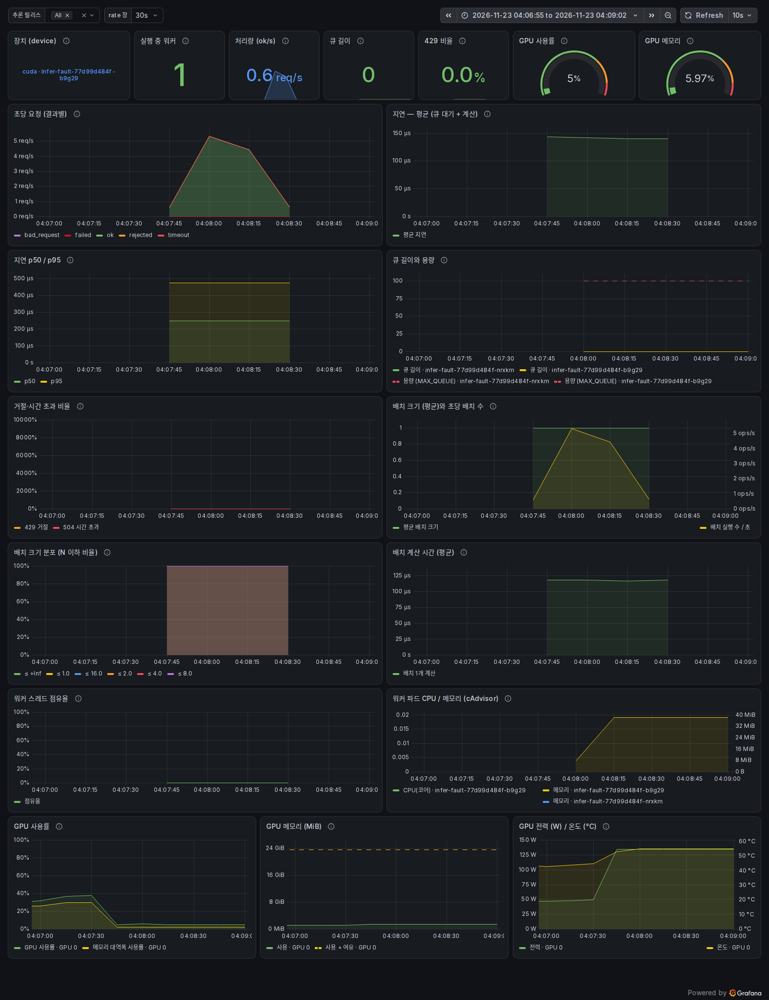

# F1 추론 파드 강제 종료 시험 (2026-11-23 04:07)

- 생성: `scripts/fault-test.sh infer-kill --gpu 1 --mode force --model-job db-1107b-train --tag git-760a534 --prom monitoring/prometheus:9090 --yes`
- 설계: `docs/plan-week13-verification.md`. 시각은 이 PC(gpu-host) 시계 기준이고, 측정 오차는 확인 간격(약 1초) 안팎이다.
- 대상: 릴리스 `infer-fault`(네임스페이스 `k3slab-fault`), 모델 작업 `db-1107b-train`, 이미지 `infer-worker:git-760a534`, 장치 `cuda`(GPU 1), 종료 방식 `force`

**실험 시작: ci 네임스페이스 파드 (Jenkins 에이전트 = 빌드 중)**

```text
NAME        READY   STATUS    RESTARTS   AGE     IP           NODE           NOMINATED NODE   READINESS GATES
jenkins-0   1/1     Running   0          6h35m   10.42.3.19   worker-cpu-1   <none>           <none>
```

**실험 시작: gpu-host CPU·메모리 사용량 (kubectl top)**

```text
NAME       CPU(cores)   CPU(%)   MEMORY(bytes)   MEMORY(%)   
gpu-host   1701m        10%      14894Mi         46%         
```

## 1. 평상시

- 추론 파드 `infer-fault-77d99d484f-nrxkm`(노드 gpu-host)가 Ready이고, 프로버 요청이 모두 200이다.

## 2. 장애

- 파드 삭제 시각 T0 = 04:07:49

- 📏 복구 시간 (T0 → 새 파드 Ready): **1.5초**

**새 파드 infer-fault-77d99d484f-b9g29 의 시각 (쿠버네티스 기록, 1초 단위)**

```text
생성 2026-11-22T19:07:49Z → 스케줄 +0s → 컨테이너 시작 +0s → Ready +1s
```

- 📏 컨트롤러가 새 파드를 만들기까지 (T0 → 생성): **0초 안팎(1초 단위)**

**파드 목록 (시도한 파드 수와 상태)**

```text
infer-fault-77d99d484f-b9g29  Running  node=gpu-host  restarts=0  
```

**관련 이벤트 (최근 15개)**

```text
33s         Normal    ScalingReplicaSet   deployment/infer-fault              Scaled up replica set infer-fault-77d99d484f from 0 to 1
33s         Normal    SuccessfulCreate    replicaset/infer-fault-77d99d484f   Created pod: infer-fault-77d99d484f-nrxkm
32s         Normal    Created             pod/infer-fault-77d99d484f-nrxkm    Container created
32s         Normal    Pulled              pod/infer-fault-77d99d484f-nrxkm    Container image "registry.k3slab.local:5000/infer-worker:git-760a534" already present on machine and can be accessed by the pod
31s         Normal    Started             pod/infer-fault-77d99d484f-nrxkm    Container started
31s         Warning   Unhealthy           pod/infer-fault-77d99d484f-nrxkm    Readiness probe failed: Get "http://10.42.2.158:8080/healthz": dial tcp 10.42.2.158:8080: connect: connection refused
20s         Normal    Started             pod/fault-probe                     Container started
20s         Normal    Created             pod/fault-probe                     Container created
20s         Normal    Pulled              pod/fault-probe                     Container image "docker.io/curlimages/curl:8.23.0" already present on machine and can be accessed by the pod
12s         Warning   Unhealthy           pod/infer-fault-77d99d484f-b9g29    Readiness probe failed: Get "http://10.42.2.159:8080/healthz": dial tcp 10.42.2.159:8080: connect: connection refused
12s         Normal    Started             pod/infer-fault-77d99d484f-b9g29    Container started
12s         Normal    Created             pod/infer-fault-77d99d484f-b9g29    Container created
12s         Normal    Pulled              pod/infer-fault-77d99d484f-b9g29    Container image "registry.k3slab.local:5000/infer-worker:git-760a534" already present on machine and can be accessed by the pod
12s         Normal    Killing             pod/infer-fault-77d99d484f-nrxkm    Stopping container worker
12s         Normal    SuccessfulCreate    replicaset/infer-fault-77d99d484f   Created pod: infer-fault-77d99d484f-b9g29
```

**프로버 요약 (초당 약 10회 요청, 실패 = HTTP 200이 아닌 응답 또는 시간 초과 000)**

```text
total=177 failed=0 codes=200:177
first_fail_after_t0=- last_fail_after_t0=- fail_window=0.0
```

- 📏 실패한 요청 수: **0 / 177 (코드별 200:177)**

- 📏 실패 구간 (첫 실패 ~ 마지막 실패): **실패 없음**

**Prometheus: 요청 결과별 증가량  (쿼리: sum by (result) (increase(k3slab_infer_requests_total{namespace="k3slab-fault"}[94s])))**

```text
result=ok	190.1952380952381
result=rejected	0
result=timeout	0
result=bad_request	0
result=failed	0
```

**Prometheus: 컨테이너 재시작 횟수  (쿼리: max(kube_pod_container_status_restarts_total{namespace="k3slab-fault"}))**

```text
	0
```

## 3. 판정

- ✅ **PASS** — 새 파드가 사람 개입 없이 Ready

- ✅ **PASS** — 복구 뒤 마지막 30개 요청이 모두 200

- ✅ **PASS** — 새 파드의 계산 장치가 cuda (/metrics의 device)

- ✅ **PASS** — 복구 시간이 120초 이내 (참고 기준, 실측 뒤 조정)

## 4. 되돌리기

- ✅ **PASS** — 실험용 네임스페이스(k3slab-fault)가 사라짐

- ✅ **PASS** — 노드 4개 모두 Ready

- ✅ **PASS** — MySQL이 1/1 Ready

- ✅ **PASS** — 레지스트리가 1/1 Ready

- ✅ **PASS** — GPU를 쓰는 파드가 남아 있지 않음 (GPU 반납)

## 결과 요약

PASS 9, FAIL 0

---

## 5. 사람이 덧붙인 부분 (위는 `scripts/fault-test.sh`가 쓴 것, 아래는 실행 뒤에 사람이 정리한 것)

14주차 몫(계획 6절 순서 6, GPU 변형)을 12주차 첫날(2026-11-23, 1주차 = 9/7)에 앞당겨 실행했다. 이미지는 **`infer-worker:git-760a534`**(`--tag`로 지정, CI가 만든 최신, 지연 히스토그램 있음)다. CPU 반복 실험의 `v0.2`와 이미지가 다르다는 점에 주의한다. 모델 작업 `db-1107b-train`. GPU 슬롯은 이 실험 동안 내가 썼고, 끝난 뒤 GPU를 요청한 파드는 0개다(4절 "GPU 반납" PASS).

### 5.1 핵심 숫자 (GPU, force)

| 항목 | 값 | 근거 |
|---|---|---|
| 종료 방식 | `force` (`--grace-period=0 --force`) | 명령 줄 |
| 복구 시간 (T0 → 새 파드 Ready) | **1.5초** (상한, 1초 간격 확인) | 2절 |
| 새 파드의 생성 · 스케줄 · 컨테이너 시작 · Ready | +0 · +0 · +0 · **+1초** (쿠버네티스 시각, 1초 단위) | 2절 |
| 시도한 파드 수 / 재시작 | 새 파드 1개 / 0 | 파드 목록, Prometheus |
| **Pending·GPU 배정 실패** | **없음.** 새 파드는 바로 스케줄되고 Running이 됐다 | 파드 목록, 이벤트 |
| 실패한 요청 | **0 / 177** (모두 200) | 프로버 |
| 장치 | `cuda` (`/metrics`의 `device`, 판정 PASS) | 3절 |
| GPU 반납 | 끝난 뒤 GPU를 요청한 파드 0개 (PASS) | 4절 |
| 판정 | PASS 9 / FAIL 0 | 결과 요약 |

### 5.2 계획의 예상과 다른 점, 읽는 법

- **계획은 "강제 삭제 직후 새 파드가 GPU를 아직 쥔 예전 컨테이너 때문에 Pending이나 배정 실패가 될 수 있다"고 예상했다. 실제로는 일어나지 않았다.** 새 파드는 같은 초에 만들어지고 스케줄됐다. 추정: `--force`는 파드 오브젝트를 곧바로 지우므로 스케줄러와 kubelet은 GPU를 비었다고 보고 새 파드를 배정한다. 예전 컨테이너가 아직 종료 중이어도 GPU는 프로세스가 같이 쓸 수 있어서 충돌이 없었던 것으로 보인다. 이 추정은 직접 확인하지 않았다(두 컨테이너가 GPU를 동시에 쓴 시간은 재지 않았다). 한 번의 시행이라 "항상 Pending이 없다"고 말할 수는 없다.
- **복구 시간 1.5초는 CPU(1.3 ~ 1.5초)와 같다.** 이 모델은 아주 작고(`model.k3sm` 38,468바이트) 이미지는 노드에 이미 있다(`already present on machine`). CUDA 초기화와 모델 적재가 더해져도 이 크기에서는 1초 안쪽이다. **큰 모델(예: `bench-large` 68 MB)에서는 다를 수 있다.**
- 이벤트에 `Readiness probe failed … connection refused`가 새 파드와 처음 파드에 한 번씩 보인다. 컨테이너가 막 시작해 포트를 열기 전의 정상적인 경고이고 서비스에는 영향이 없었다(실패 요청 0).
- **판정 기준 제안(GPU): 복구 시간 10초 이내.** 지금의 임시 기준 120초는 실측(1.5초)의 80배라 의미가 없다. 표본이 1개(작은 모델)라서 CPU와 같은 10초로 두고, 큰 모델·다른 이미지에서 다시 재면 조정한다.
- 시작 때 `ci`에는 `jenkins-0`만 있었고 에이전트 파드가 없었다. gpu-host CPU 1701m(10%).

### 5.3 Grafana 화면 (추론 워커 대시보드, GPU 파드 종료 뒤)



- 촬영: 임시 `kubectl port-forward`(Grafana)와 Playwright(시스템 Chromium, 헤드리스). 로그인 값은 남기지 않았다. 대시보드 `k3slab-infer`, 릴리스 `All`, `rate 창 = 30s`, 시간 범위 04:06:55 ~ 04:09:02. 촬영은 새 파드가 Ready가 된 뒤(04:08:02 ~ 04:08:19), 실험이 끝나기 전에 했다.
- **보이는 것:** "장치(device)" 카드 `cuda`(새 파드 `…b9g29`). 큐 길이 패널 범례에 파드가 둘(처음 파드 `…nrxkm`, 새 파드 `…b9g29`)이다. **지연 p50 / p95 패널에 값이 나온다**: p50 약 250 µs, p95 약 475 µs. 둘 다 첫 버킷(≤ 0.5 ms) 안의 보간 값이라 "99% 이상이 0.5 ms 이하"로 읽어야 한다(`cicd-e2e-20261122-2141.md` 9절). 평균 지연은 약 140 µs.
- 요청 수 패널은 프로버가 센 구간(04:07:45 ~ 04:08:30)에만 값이 있고(초당 최대 약 5), 429·시간 초과는 0이다. 파드가 바뀌는 순간의 끊김은 이 해상도(수집 5초 + rate 창 30초)로는 보이지 않는다. 끊김이 없었다는 근거는 프로버(실패 0 / 177)다.
- GPU 사용률은 5%, GPU 메모리는 5.97%다. 요청이 초당 몇 개라 GPU는 거의 놀고 있다. **GPU 전력이 파드 시작 시점(04:07:30 ~ 04:08:00)에 약 50 → 135 W로 올라 그대로 유지**된다(F5에서도 같은 모양, 원인 미확인). 04:07:00 ~ 04:07:40의 사용률 30~40%는 실험 시작(04:07:27) 전후의 값인데, 요청이 거의 없는 이 실험의 GPU 사용으로는 설명되지 않는다. 데스크톱 쪽으로 보이나 단정하지 않는다.
