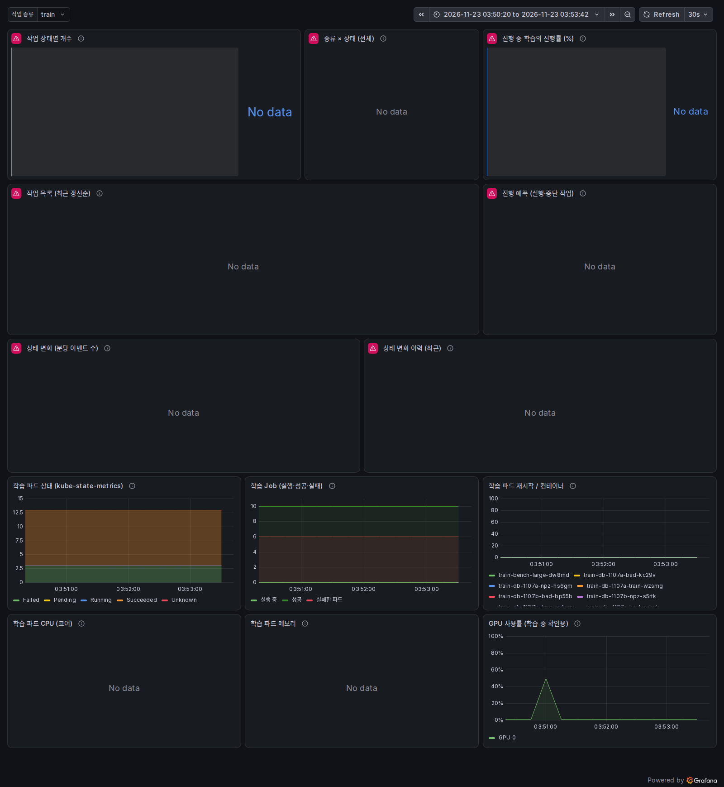

# F4 MySQL 중단 시험 (75초) (2026-11-23 03:51)

- 생성: `scripts/fault-test.sh mysql-down --model-job db-1107b-train --down-seconds 75 --prom monitoring/prometheus:9090 --yes`
- 설계: `docs/plan-week13-verification.md`. 시각은 이 PC(gpu-host) 시계 기준이고, 측정 오차는 확인 간격(약 1초) 안팎이다.
- 대상 `k3slab-system/mysql` (replicas 1→0→1), 중단 75초, 추론 지속 확인(모델 작업 `db-1107b-train`, CPU)
- 시작 전 jobs 14행, job_events 84행

**실험 시작: ci 네임스페이스 파드 (Jenkins 에이전트 = 빌드 중)**

```text
NAME        READY   STATUS    RESTARTS   AGE     IP           NODE           NOMINATED NODE   READINESS GATES
jenkins-0   1/1     Running   0          6h18m   10.42.3.19   worker-cpu-1   <none>           <none>
```

**실험 시작: gpu-host CPU·메모리 사용량 (kubectl top)**

```text
NAME       CPU(cores)   CPU(%)   MEMORY(bytes)   MEMORY(%)   
gpu-host   546m         3%       13845Mi         43%         
```

**진행 중인 작업 (RUNNING·PENDING)**

```text

```

## 1. DB가 없는 동안

- MySQL 중단 03:51:35 (replicas 0 → 파드가 사라지기까지 1.6초)

**scripts/job.sh submit train fault-db-1123035133 (DB 없음) — 종료 코드 1**

```text
error: timed out waiting for the condition
03:52:35 job fault-db-1123035133 already exists; not starting it again (status below)
error: timed out waiting for the condition
```

- ✅ **PASS** — DB가 없으면 등록 요청이 실패한다 (종료 코드 ≠ 0)

- ✅ **PASS** — 실패한 요청으로 Helm 릴리스·Job이 만들어지지 않음

- DB 없음 구간: 196.1초

## 2. 복구

- 📏 replicas 1 → 쿼리에 답할 때까지 (t_db, rollout 대기 포함): **6.9초**
- 복구 뒤 jobs 14행 (전 14행)

**프로버 요약 (초당 약 10회 요청, 실패 = HTTP 200이 아닌 응답 또는 시간 초과 000)**

```text
total=1932 failed=0 codes=200:1932
first_fail_after_t0=- last_fail_after_t0=- fail_window=0.0
```

- 📏 DB 중단 동안 추론 요청 실패 수: **0 / 1932 (코드별 200:1932)**

- ✅ **PASS** — 추론 요청이 DB와 무관하게 계속 200 (실패 0)

**Prometheus: MySQL 준비된 복제본 (중단 동안 0)  (쿼리: min_over_time(kube_deployment_status_replicas_available{namespace="k3slab-system",deployment="mysql"}[282s]))**

```text
deployment=mysql,instance=10.42.3.6:8080,job=kube-state-metrics,namespace=k3slab-system	0
```

## 3. 판정

- ✅ **PASS** — 복구 뒤 jobs 행 수가 그대로 (데이터 보존)

- ✅ **PASS** — 복구 뒤 job_events가 줄지 않음

- ✅ **PASS** — MySQL PVC가 Bound

- ✅ **PASS** — 복구 뒤 scripts/job.sh list가 동작

## 되돌리기

- ✅ **PASS** — 실험용 네임스페이스(k3slab-fault)가 사라짐

- ✅ **PASS** — 노드 4개 모두 Ready

- ✅ **PASS** — MySQL이 1/1 Ready

- ✅ **PASS** — 레지스트리가 1/1 Ready

## 결과 요약

PASS 11, FAIL 0

---

## 4. 사람이 덧붙인 부분 (위는 `scripts/fault-test.sh`가 쓴 것, 아래는 실행 뒤에 사람이 정리한 것)

14주차 몫(계획 6절 순서 5)을 12주차 첫날(2026-11-23, 1주차 = 9/7)에 앞당겨 실행했다. 이미지 `infer-worker:v0.2`, 모델 작업 `db-1107b-train`(13주와 같다). `--with-training`은 쓰지 않았다(11/7 기록 `job-db-20261107-1258.md`가 있다, 계획 4절).

### 4.1 핵심 숫자

| 항목 | 값 | 근거 |
|---|---|---|
| 명령 줄 | `--down-seconds 75`를 줬다(기본 30초). **Grafana 화면에 MySQL이 끊긴 구간을 담으려고** 늘렸다(촬영에 약 30초 걸린다) | 보고서 머리 |
| MySQL 중단 → 파드 사라짐 | 1.6초 | 1절 |
| **실제 DB 없음 구간** | **196.1초**(03:51:35 ~ 03:54:51, 요청한 75초가 아니다. 이유는 아래 4.2) | 1절 "DB 없음 구간" |
| t_db (replicas 1 → 쿼리에 답함) | **6.9초** | 2절 |
| **`job.sh submit`(DB 없음)의 종료 코드** | **1** (0이 아님) | 1절 |
| 추론 요청 실패 | **0 / 1932** (모두 200) | 2절 |
| 행 수 전·후 | `jobs` 14 → 14, `job_events` 84 → 84 | 2·3절, 복구 뒤 내가 다시 조회해 같은 값 확인 |
| 실패한 요청의 흔적 | `jobs`에 `fault-db-%` 행 0개, Helm 릴리스·Job·파드 0개 | 복구 뒤 조회 |
| 판정 | PASS 11 / FAIL 0 | 결과 요약 |

### 4.2 계획 4절 "확인할 점": `job.sh submit`은 DB가 없을 때 어떻게 되는가

**종료 코드는 1이라 실패로 끝난다. 그러나 두 가지가 문제다.** (`scripts/job.sh`는 내 수정 범위 밖이라 고치지 않고 보고한다.)

1. **메시지가 사실과 다르다.** 보고서 1절에 찍힌 출력은 다음과 같다.

   ```text
   error: timed out waiting for the condition
   03:52:35 job fault-db-1123035133 already exists; not starting it again (status below)
   error: timed out waiting for the condition
   ```

   작업이 이미 있는 것이 아니라 DB에 닿지 못한 것이다. 원인으로 보이는 코드: `submit_train`(`scripts/job.sh` 104행)은 `[[ "$(register …)" != 1 ]]`로 "새로 넣었는가"를 판정한다. `register`가 실패하면 출력이 비어 `"" != 1`이 참이 되어 "이미 있는 작업" 분기(`show_existing`, 76행)로 간다. 사용자는 "이미 있다"는 안내만 읽고 DB가 내려간 것을 알 수 없다. 두 번째 `error:`는 `show_existing`이 `row_json`으로 다시 DB를 부르다 실패한 것이다.
2. **약 2분(120초) 멈춘다.** `kubectl exec deploy/mysql`은 파드가 없으면 기본 60초(`--pod-running-timeout`) 기다린 뒤 `timed out waiting for the condition`으로 실패한다. 이 대기가 `register`에서 한 번, `show_existing`에서 한 번 일어나 합계 약 120초다. 위 로그 시각(03:51:35 중단 → 03:52:35 첫 실패 메시지 → 03:53:36 종료)과 맞는다. 이 때문에 DB 없음 구간이 요청한 75초가 아니라 196.1초가 됐다(스크립트는 이 등록 요청이 끝난 뒤에 `sleep 75`를 한다).

**보고할 고칠 점(고치지 않음):**
- `register` 실패(DB 오류)와 "이미 있음"(결과 0)을 구분한다. 예: `n=$(register …) || die "DB에 등록하지 못했다(MySQL이 내려가 있나?)"`.
- `sql()`의 `kubectl exec`에 `--pod-running-timeout=5s`처럼 짧은 한도를 준다. 그러면 DB가 없을 때 2분이 아니라 몇 초 안에 실패한다.

`scripts/fault-test.sh`의 판정("종료 코드 ≠ 0", "Job·Helm 릴리스가 만들어지지 않음")은 모두 PASS이므로 성공 기준은 충족했다. 다만 "안내 메시지가 올바른가"는 판정하지 않았다(계획에 없는 기준이라 FAIL이 아니라 발견 사항으로만 적는다).

### 4.3 읽는 법과 한계

- **추론은 DB와 무관하게 200으로 계속 응답했다.** 프로버는 추론 배포 직후부터 복구 뒤 5초까지 초당 약 10개를 보냈고(1932개) 그 안에 DB 없음 구간 약 200초가 모두 들어 있다. 추론 워커는 DB에 접속하지 않는다(`apps/infer/`와 추론 차트에 `mysql`·`3306`이 없다, grep으로 확인).
- **이 실험은 DB가 없는 동안 학습이 어떻게 되는지는 다시 재지 않았다.** 그것은 `job-db-20261107-1258.md` 4절(학습은 계속, 기록은 DB가 돌아온 뒤 채움)에 있다.
- 시작 때 `ci`에는 `jenkins-0`만 있었고(위 "실험 시작" 블록), 시작 직전 Jenkins API로 대기열 비어 있음·빌드 없음을 확인했다. gpu-host CPU 546m(3%).
- `진행 중인 작업 (RUNNING·PENDING)` 블록은 비어 있었다(진행 중인 학습 없음). 그래서 DB를 내려도 잃은 기록이 없다.

### 4.4 Grafana 화면 (학습 작업 대시보드, DB가 내려가 있는 동안)



- 촬영: 임시 `kubectl port-forward`와 Playwright(시스템 Chromium, 헤드리스). 로그인 값은 남기지 않았다. 대시보드 `k3slab-training`, `작업 종류 = train`. 촬영 시각은 MySQL 중단(03:51:35) **직후**라서 이 화면이 DB가 끊긴 구간이다.
- **보이는 것:** MySQL 데이터소스를 쓰는 패널 7개(작업 상태별 개수, 종류 × 상태, 진행률, 작업 목록, 진행 에폭, 상태 변화, 상태 변화 이력)가 모두 **붉은 경고 아이콘과 "No data"**다. 오류 문구 자체는 화면에서 읽지 않았다(마우스를 올리지 않았다). Prometheus를 쓰는 패널(학습 파드 상태, 학습 Job, 재시작, GPU 사용률)은 그대로 값이 나온다. 즉 DB만 끊기고 모니터링의 나머지는 살아 있다.
- 학습 파드 CPU·메모리 패널이 "No data"인 것은 이 시간에 학습 파드가 없어서다(이 실험과 무관, F2에서 채운다).
- GPU 사용률 패널의 03:51경 약 50% 봉우리는 이 실험이 GPU를 쓰지 않았는데 보인 값이다(바로 앞 촬영 또는 데스크톱 때문으로 보이나 원인은 확인하지 못했다. 모니터링 보고서 9.3절 8번의 "데스크톱 GPU 잡음"과 같은 종류).
- 복구 뒤(03:54:58 이후)의 화면은 따로 찍지 않았다.
