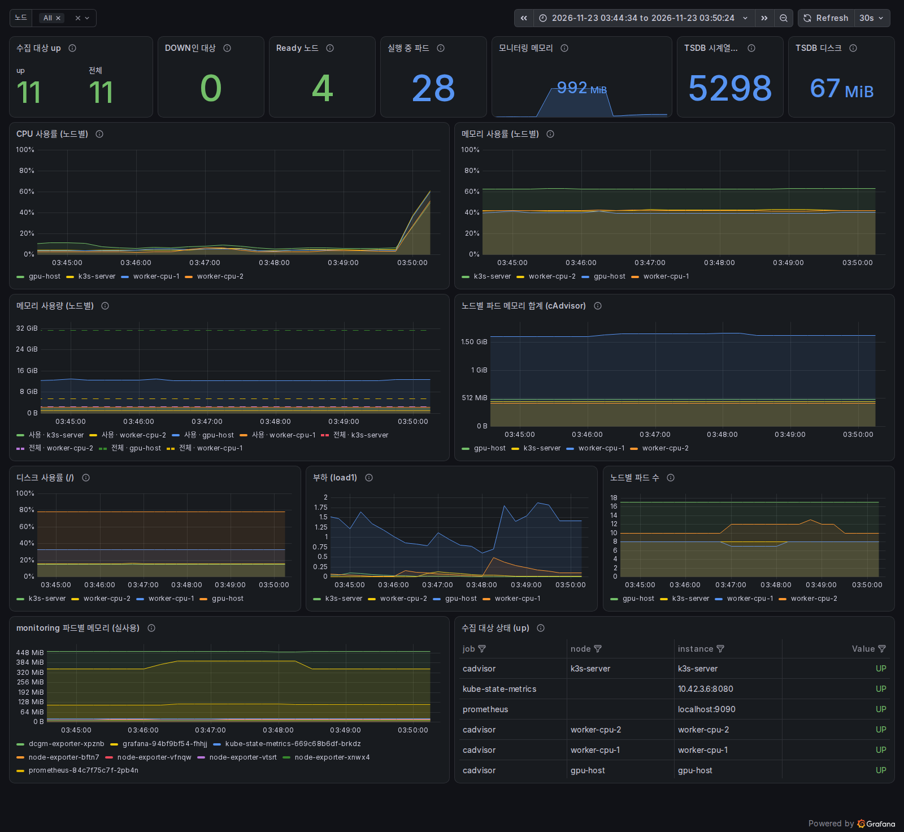

# F6 레지스트리 중단 시험 (60초) (2026-11-23 03:46)

- 생성: `scripts/fault-test.sh registry-down --prom monitoring/prometheus:9090 --yes`
- 설계: `docs/plan-week13-verification.md`. 시각은 이 PC(gpu-host) 시계 기준이고, 측정 오차는 확인 간격(약 1초) 안팎이다.
- 대상 `k3slab-system/registry`, 확인용 이미지 `registry.k3slab.local:5000/infer-worker:v0.2`, 확인용 파드는 worker-cpu-2(role=app)

## 1. 레지스트리가 없는 동안

- 레지스트리 중단 03:46:43 (파드가 사라지기까지 1.3초)

**확인용 파드 상태**

```text
NAME                READY   STATUS         RESTARTS   AGE   IP           NODE           NOMINATED NODE   READINESS GATES
fault-pull-always   0/1     ErrImagePull   0          6s    10.42.1.35   worker-cpu-2   <none>           <none>
fault-pull-cached   1/1     Running        0          6s    10.42.1.34   worker-cpu-2   <none>           <none>
Always 파드 대기 사유: ErrImagePull
```

**Always 파드 이벤트**

```text
6s          Normal    Scheduled   pod/fault-pull-always   Successfully assigned k3slab-fault/fault-pull-always to worker-cpu-2
7s          Normal    Pulling     pod/fault-pull-always   Pulling image "registry.k3slab.local:5000/infer-worker:v0.2"
2s          Warning   Failed      pod/fault-pull-always   Failed to pull image "registry.k3slab.local:5000/infer-worker:v0.2": failed to pull and unpack image "registry.k3slab.local:5000/infer-worker:v0.2": failed to resolve reference "registry.k3slab.local:5000/infer-worker:v0.2": failed to do request: Head "http://10.43.0.50:5000/v2/infer-worker/manifests/v0.2?ns=%5BREDACTED%5D": dial tcp 10.43.0.50:5000: connect: connection refused
2s          Warning   Failed      pod/fault-pull-always   Error: ErrImagePull
1s          Normal    BackOff     pod/fault-pull-always   Back-off pulling image "registry.k3slab.local:5000/infer-worker:v0.2"
1s          Warning   Failed      pod/fault-pull-always   Error: ImagePullBackOff
```

- 📏 이미지가 노드에 있을 때(IfNotPresent) 중단 시작 → Running: **1.4초 (레지스트리 없이도 시작)**

## 2. 복구

- 📏 replicas 1 → 레지스트리 Ready (t_reg, rollout 대기 포함): **1.6초**

- 📏 레지스트리 Ready → Always 파드 Running (t_pull, 재시도 간격 포함): **40.7초**

- ✅ **PASS** — 이미지가 노드에 있으면 레지스트리 없이도 파드가 시작 (IfNotPresent)

- ✅ **PASS** — 레지스트리 확인이 필요한 파드는 이미지 받기 실패 (ErrImagePull/ImagePullBackOff)

- ✅ **PASS** — 레지스트리 복구 뒤 사람 개입 없이 파드가 Running

- ✅ **PASS** — 복구 뒤 카탈로그에 infer-worker가 있음 (local-path 데이터 보존)

**Prometheus: 레지스트리 준비된 복제본 (중단 동안 0)  (쿼리: min_over_time(kube_deployment_status_replicas_available{namespace="k3slab-system",deployment="registry"}[180s]))**

```text
deployment=registry,instance=10.42.3.6:8080,job=kube-state-metrics,namespace=k3slab-system	0
```

**Prometheus: 이미지 받기 대기 파드  (쿼리: max_over_time(kube_pod_container_status_waiting_reason{namespace="k3slab-fault",reason=~"ErrImagePull|ImagePullBackOff"}[181s]))**

```text
container=c,instance=10.42.3.6:8080,job=kube-state-metrics,namespace=k3slab-fault,pod=fault-pull-always,reason=ImagePullBackOff,uid=86697abb-5bea-4753-a3a3-474618cf6b13	1
container=c,instance=10.42.3.6:8080,job=kube-state-metrics,namespace=k3slab-fault,pod=fault-pull-always,reason=ErrImagePull,uid=86697abb-5bea-4753-a3a3-474618cf6b13	1
```

## 3. 되돌리기

- ✅ **PASS** — 실험용 네임스페이스(k3slab-fault)가 사라짐

- ✅ **PASS** — 노드 4개 모두 Ready

- ✅ **PASS** — MySQL이 1/1 Ready

- ✅ **PASS** — 레지스트리가 1/1 Ready

## 결과 요약

PASS 8, FAIL 0

---

## 4. 사람이 덧붙인 부분 (위는 `scripts/fault-test.sh`가 쓴 것, 아래는 실행 뒤에 사람이 정리한 것)

14주차 몫(계획 6절 순서 4)을 12주차 첫날(2026-11-23, 1주차 = 9/7)에 앞당겨 실행했다. 이미지 태그는 `infer-worker:v0.2`(13주와 같다).

### 4.1 핵심 숫자

| 항목 | 값 | 근거 |
|---|---|---|
| 레지스트리 중단 → 파드 사라짐 | 1.3초 | 보고서 1절 |
| 이미지가 노드에 있을 때(`IfNotPresent`) 시작 | **1.4초**, 레지스트리 없이 Running | `fault-pull-cached` |
| 이미지 확인이 필요할 때(`Always`) | **`ErrImagePull` → `ImagePullBackOff`** (`connect: connection refused`, 레지스트리 Service 10.43.0.50:5000) | 1절 이벤트 |
| t_reg (replicas 1 → 레지스트리 Ready) | **1.6초** | 2절 |
| t_pull (레지스트리 Ready → `Always` 파드 Running) | **40.7초** (재시도 간격 포함) | 2절 |
| 카탈로그 | 복구 뒤 `infer-worker`가 그대로 있음 | 2절 PASS |
| 판정 | PASS 8 / FAIL 0 | 결과 요약 |
| 레지스트리 중단 시간 | 약 60초(03:46:43 ~ 03:47:51) | 스크립트 로그 |

### 4.2 시작 직전 점검 (CICD와 겹치지 않았는가)

이 실험 함수는 `ci` 네임스페이스를 보고서에 남기지 않는다(F1·F7·F8에만 있다). 그래서 시작 직전(03:46:34)에 사람이 따로 확인했다.

- 노드 4개 Ready, `k3slab-fault` 없음, MySQL·레지스트리 1/1, GPU를 요청한 파드 0.
- `ci` 네임스페이스에는 `jenkins-0`(컨트롤러)만 있었고 빌드 에이전트 파드는 없었다. Argo CD Application 0개.
- Jenkins API로 확인: 대기열 비어 있음, 실행기는 Built-In Node(실행기 0개)뿐이고 `idle`, 두 작업(`k3slab-ci` 마지막 #11, `k3slab-ci-local` 마지막 #10) 모두 `building: false`. 로그인 값은 화면에 남기지 않았다.
- 그래서 이 60초 동안 Kaniko 빌드와 Jenkins의 이미지 push는 없었다. 레지스트리가 없어서 실패한 빌드도 없다.

### 4.3 읽는 법과 한계

- **t_pull 40.7초는 한 번 잰 값이다.** `ImagePullBackOff` 재시도 간격은 10초부터 두 배씩 늘어(최대 5분) 레지스트리가 돌아온 때가 간격의 어디쯤이었는지에 따라 값이 달라진다. 이번에는 재시도 시각을 따로 기록하지 않아서, 40.7초가 간격 규칙과 맞는지는 확인하지 못했다. 간격의 상한(5분)을 보려면 중단 시간을 길게(`--down-seconds`) 해서 다시 재야 한다.
- 레지스트리가 돌아온 뒤 사람이 한 일은 없다(복구는 스크립트의 `scale`뿐이고 파드는 스스로 시작했다).
- 이 실험은 "노드에 이미지가 있는 파드"와 "없거나 확인이 필요한 파드"를 나눠 보여 준다. 새 노드나 새 태그의 첫 배포는 레지스트리가 없으면 시작하지 못하고, 돌아오면 최대 수십 초~수 분 늦게 시작할 수 있다.
- 노드에 이미지가 이미 있어도 `imagePullPolicy: Always`는 시작 때마다 레지스트리에 확인하므로 이 경우도 실패한다(위 `Always` 파드). 이 저장소의 추론 차트가 어떤 정책을 쓰는지는 이 실험에서 확인하지 않았다.

### 4.4 Grafana 화면 (제안서 14번: 명령 기록, DB 작업 상태, Grafana 화면을 함께 저장)



- 촬영: 임시 `kubectl port-forward`(Grafana)와 Playwright(시스템 Chromium, 헤드리스). 로그인 값은 화면·로그·보고서에 남기지 않았다. 대시보드 `k3slab-nodes`, 시간 범위 03:44:34 ~ 03:50:24(실험 03:46:34 ~ 03:49:21 앞뒤로 조금씩 넓힘). 실제 클러스터 값이다.
- **이미지 받기 실패 자체를 보여 주는 패널은 노드 대시보드에 없다.** 그 증거는 이 보고서 2절의 Prometheus 쿼리(`kube_pod_container_status_waiting_reason`, 1)와 1절 이벤트다.
- 보이는 것: **노드별 파드 수** 패널에서 worker-cpu-1이 03:47경 8 → 7개로 줄었다가 03:48:20경 8개로 돌아온다(레지스트리 파드가 없던 구간. 같은 쿼리를 20초 간격으로 읽어 확인: 7개가 4개 샘플 = 약 80초). worker-cpu-2는 10 → 12 → 13 → 12 → 10개(확인용 파드 2개가 더해진 것, 13은 잠깐)로 오르내린다. 맨 위 "실행 중 파드"는 촬영 시점(28)이라 정상 값이다.
- **오른쪽 끝(03:50)의 CPU 사용률 급상승(모든 노드 약 60%)은 실험이 아니라 촬영이다.** 같은 PC에서 헤드리스 Chromium이 돌았고 VM과 gpu-host가 이 PC의 CPU를 나눠 쓴다. 실험은 03:49:21에 끝났다. 이후 촬영은 실험이 끝난 뒤에 하므로 같은 현상이 마지막에 보일 수 있다.
