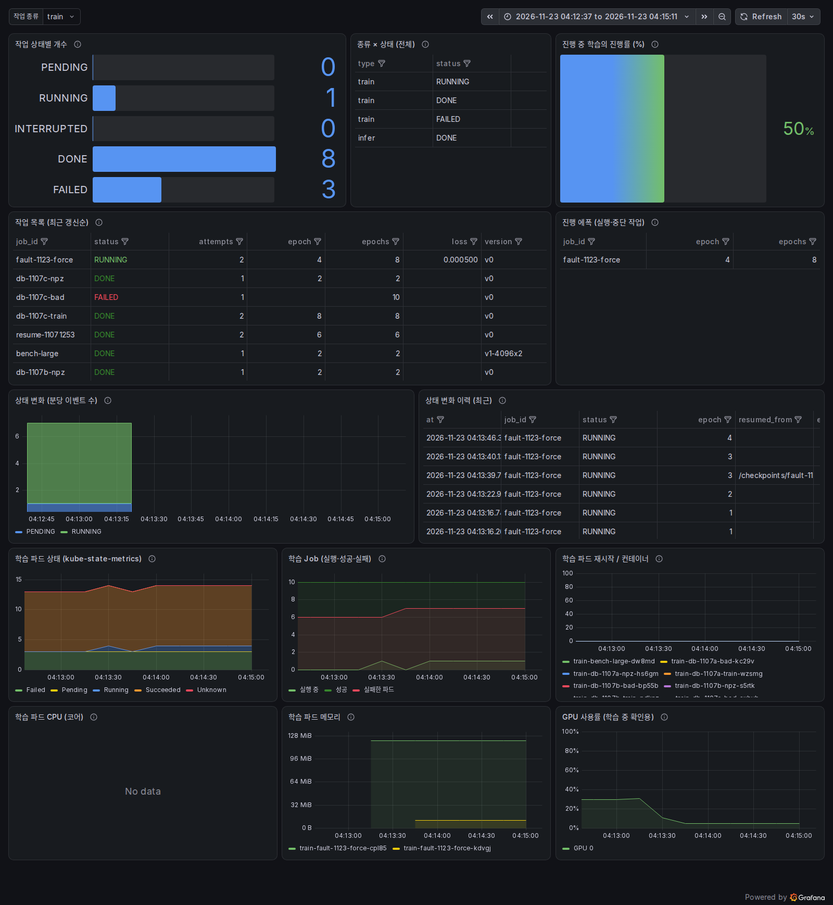
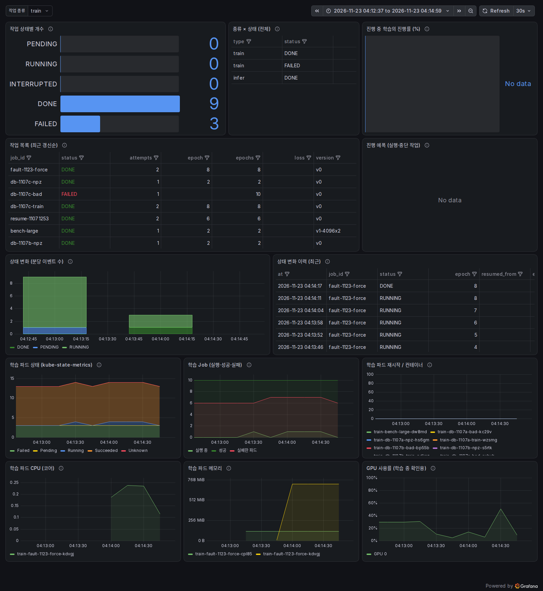

# F2 학습 파드 중단 → 체크포인트 재개 (force) (2026-11-23 04:13)

- 생성: `scripts/fault-test.sh train-kill --mode force --job-id fault-1123-force --prom monitoring/prometheus:9090 --yes`
- 설계: `docs/plan-week13-verification.md`. 시각은 이 PC(gpu-host) 시계 기준이고, 측정 오차는 확인 간격(약 1초) 안팎이다.
- 작업 번호 `fault-1123-force`, 방식 `force` (SIGKILL: --grace-period=0 --force)

**실험 시작: ci 네임스페이스 파드 (Jenkins 에이전트 = 빌드 중)**

```text
NAME        READY   STATUS    RESTARTS   AGE     IP           NODE           NOMINATED NODE   READINESS GATES
jenkins-0   1/1     Running   0          6h40m   10.42.3.19   worker-cpu-1   <none>           <none>
```

**실험 시작: gpu-host CPU·메모리 사용량 (kubectl top)**

```text
NAME       CPU(cores)   CPU(%)   MEMORY(bytes)   MEMORY(%)   
gpu-host   1247m        7%       14756Mi         46%         
```

- 파드 `train-fault-1123-force-cpl85`를 DB 에폭 2 기록 뒤 강제 삭제(SIGKILL), 04:13:24

- 📏 중단 → 재개 기록 (T0 → resumed_from, 확인 간격 1~2초): **15.8초**

- 📏 재개한 체크포인트 / 종료 직전 DB 에폭: **`/checkpoints/fault-1123-force/ckpt-e0002-s00200.pt` / 에폭 2**

- ✅ **PASS** — 재개한 체크포인트의 에폭(2)이 종료 직전 DB 에폭(2) 이상 (진행이 되돌아가지 않음)

**상태 이력 (UNIX 시각, 상태, 에폭, 체크포인트, resumed_from)**

```text
1795374789.481	PENDING	-	-	-
1795374796.263	RUNNING	1	-	-
1795374796.741	RUNNING	1	/checkpoints/fault-1123-force/ckpt-e0001-s00200.pt	-
1795374802.928	RUNNING	2	/checkpoints/fault-1123-force/ckpt-e0002-s00200.pt	-
1795374819.751	RUNNING	3	/checkpoints/fault-1123-force/ckpt-e0002-s00200.pt	/checkpoints/fault-1123-force/ckpt-e0002-s00200.pt
1795374820.138	RUNNING	3	/checkpoints/fault-1123-force/ckpt-e0003-s00200.pt	-
1795374826.309	RUNNING	4	/checkpoints/fault-1123-force/ckpt-e0004-s00200.pt	-
1795374832.474	RUNNING	5	/checkpoints/fault-1123-force/ckpt-e0005-s00200.pt	-
1795374838.666	RUNNING	6	/checkpoints/fault-1123-force/ckpt-e0006-s00200.pt	-
1795374844.866	RUNNING	7	/checkpoints/fault-1123-force/ckpt-e0007-s00200.pt	-
1795374851.054	RUNNING	8	/checkpoints/fault-1123-force/ckpt-e0008-s00200.pt	-
1795374857.058	DONE	8	/checkpoints/fault-1123-force/ckpt-e0008-s00200.pt	-
```

INTERRUPTED 기록 없음: SIGKILL은 종료 신호를 못 받아 마지막 에폭 체크포인트에서 재개한다. 재개 체크포인트: `/checkpoints/fault-1123-force/ckpt-e0002-s00200.pt`

- ✅ **PASS** — 재개 기록(resumed_from)이 DB에 있음

- ✅ **PASS** — 최종 상태 DONE

- ✅ **PASS** — attempts가 2 이상 (재시도로 파드가 다시 시작됨)

- ✅ **PASS** — 추론용 model.k3sm이 만들어짐

**Prometheus: 학습 파드 재시작·상태  (쿼리: kube_pod_status_phase{namespace="default",pod=~"train-fault-1123-force-.*"})**

```text
__name__=kube_pod_status_phase,instance=10.42.3.6:8080,job=kube-state-metrics,namespace=default,phase=Pending,pod=train-fault-1123-force-kdvgj,uid=c4160d4d-0850-4a6e-b7c5-c588ec489e3a	0
__name__=kube_pod_status_phase,instance=10.42.3.6:8080,job=kube-state-metrics,namespace=default,phase=Succeeded,pod=train-fault-1123-force-kdvgj,uid=c4160d4d-0850-4a6e-b7c5-c588ec489e3a	0
__name__=kube_pod_status_phase,instance=10.42.3.6:8080,job=kube-state-metrics,namespace=default,phase=Failed,pod=train-fault-1123-force-kdvgj,uid=c4160d4d-0850-4a6e-b7c5-c588ec489e3a	0
__name__=kube_pod_status_phase,instance=10.42.3.6:8080,job=kube-state-metrics,namespace=default,phase=Unknown,pod=train-fault-1123-force-kdvgj,uid=c4160d4d-0850-4a6e-b7c5-c588ec489e3a	0
__name__=kube_pod_status_phase,instance=10.42.3.6:8080,job=kube-state-metrics,namespace=default,phase=Running,pod=train-fault-1123-force-kdvgj,uid=c4160d4d-0850-4a6e-b7c5-c588ec489e3a	1
```

## 되돌리기

학습 릴리스만 지웠다. DB 행(`scripts/job.sh status fault-1123-force`)과 `/var/lib/k3slab/checkpoints/fault-1123-force`는 증거로 남긴다(폴더는 root 소유).

- ✅ **PASS** — 노드 4개 모두 Ready

- ✅ **PASS** — GPU를 쓰는 파드가 남아 있지 않음 (GPU 반납)

- ✅ **PASS** — default의 train-fault-1123-force Helm 릴리스가 지워짐

## 결과 요약

PASS 8, FAIL 0

---

## 4. 사람이 덧붙인 부분 (위는 `scripts/fault-test.sh`가 쓴 것, 아래는 실행 뒤에 사람이 정리한 것)

14주차 몫(계획 6절 순서 6, F2 force)을 12주차 첫날(2026-11-23, 1주차 = 9/7)에 앞당겨 실행했다. 작업 번호 `fault-1123-force`(새 번호), 학습 이미지 `train-worker:v0.4`(차트 기본), 8 에폭, 에폭마다 6초 쉼(`--epoch-sleep 6`), GPU 1. 이 실험은 **학습 Job이 도는 동안 모니터링의 학습 대시보드와 DCGM 값을 확인하는 단계**(모니터링 보고서 9.4절 "못 본 것")를 겸한다. GPU 슬롯은 이 실험 동안 내가 썼고 끝난 뒤 GPU를 요청한 파드는 0개다(위 PASS). DB 행(`scripts/job.sh status fault-1123-force`)과 체크포인트 폴더 `/var/lib/k3slab/checkpoints/fault-1123-force`는 증거로 남겼다.

### 4.1 핵심 숫자 (force = SIGKILL)

| 항목 | 값 | 근거 |
|---|---|---|
| 강제 종료 시각 T0 | 04:13:24, DB 에폭 2(체크포인트 `ckpt-e0002`) 기록 뒤 | 위 |
| **중단 → 재개 기록(`resumed_from`)** | **15.8초** (확인 간격 1~2초) | 위 METRIC |
| **재개 체크포인트** | `/checkpoints/fault-1123-force/ckpt-e0002-s00200.pt` (에폭 2) | 상태 이력 |
| **손실 에폭** (종료 직전 DB 에폭 2 − 재개 체크포인트 에폭 2) | **0** (완료한 에폭 기준). 죽을 때 진행 중이던 에폭 3은 처음부터 다시 했다 | 상태 이력, 판정 PASS |
| 진행이 되돌아가지 않음 | 재개 에폭(2) ≥ 종료 직전 DB 에폭(2) (PASS) | 위 |
| `INTERRUPTED` 기록 | 없음(SIGKILL은 종료 신호를 못 받는다. graceful과 다른 점) | 상태 이력 |
| 최종 | DONE(에폭 8), `attempts` 2, `model.k3sm` 생성 | 위 PASS |
| 학습 Helm 릴리스 | 끝에 `train-fault-1123-force` 제거 확인(PASS, `default`) | 위 |
| 판정 | PASS 8 / FAIL 0 | 결과 요약 |

- **중단 → 재개 15.8초에는 새 파드 시작뿐 아니라 Job 컨트롤러가 실패한 파드를 다시 만들기 전의 대기가 들어 있을 가능성이 크다.** 11/7 기록(`train-resume-20261107-1253.md`, SIGTERM) 14초와 비슷하다. 대기 시간을 따로 재지는 않았다.
- 종료 시각이 에폭 2 기록 직후(약 1~2초)라서 force의 손실이 거의 최소인 조건이다. 에폭 중간(계산 한복판)에 죽이면 그 에폭의 계산이 사라진다. 이 실험의 에폭은 계산이 약 0.4초이고 나머지 6초는 쉼이라 그 차이가 작다. **force에서 완료한 에폭의 손실이 0이라는 것은 에폭 끝마다 체크포인트를 쓰기 때문**이다. 한 에폭이 길어지면 손실도 길어진다(체크포인트 간격 = 에폭 하나).
- 시작 때 `ci`에는 `jenkins-0`만 있었고 에이전트 파드가 없었다(위 "실험 시작" 블록). gpu-host CPU 1247m(7%).

### 4.2 학습 대시보드에서 본 것 (모니터링 9.4절 "못 본 것" 채우기)

화면 두 장. 촬영 방법은 임시 `kubectl port-forward`(Grafana) + Playwright(시스템 Chromium, 헤드리스), 로그인 값은 남기지 않았다. 대시보드 `k3slab-training`, `작업 종류 = train`.

**(1) 학습이 재개되어 도는 중 (04:13:41 ~ 04:13:56 촬영, 시간 범위 04:12:37 ~ 04:15:11)** — `fault-train-kill-20261123-0413-dashboard.png`



- **진행 중 학습의 진행률 (%) 패널: 50%**(에폭 4 / 8). **진행 에폭 패널: `fault-1123-force` 에폭 4, 에폭 수 8.** 작업 목록: `fault-1123-force` RUNNING, attempts 2, epoch 4, epochs 8, loss 0.000500. 작업 상태별 개수: RUNNING 1. 상태 변화 이력에 에폭 1~4와 3에서 `resumed_from`(`/checkpoints/fault-1123-force/…`)이 보인다. **이 패널들은 값을 낸다.**
- 학습 파드 상태·학습 Job 패널(kube-state-metrics)에 Running 파드와 실행 중 Job 1이 보인다.
- **학습 파드 CPU(코어) 패널은 이 화면에서 "No data"다.** 쿼리 오류는 아닌 것으로 보인다. cAdvisor 수집 간격이 15초라서(Prometheus 전역 `scrape_interval: 15s`, `infra/k8s/monitoring/prometheus/`) 재개된 파드가 뜬 지 20~30초 만에 찍은 이 화면에는 파드의 CPU 값이 두 개 미만이어서 `rate()`가 비었을 가능성이 크다(수집 시각은 직접 확인하지 않았다). 아래 (2)에서 같은 패널이 값을 낸다.
- 학습 파드 메모리 패널에는 두 파드(강제 종료된 `…cpl85`, 재개된 `…kdvgj`)가 보인다. 종료된 파드의 선이 죽은 뒤에도 평평하게 이어지는 것은 이 시간 범위에서 확인했을 뿐 원인(cAdvisor가 종료된 컨테이너를 잠시 내보내는 것인지, 그래프가 이어 그린 것인지)은 알아보지 않았다.

**(2) 학습이 끝난 뒤 (같은 시간 범위로 04:12:37 ~ 04:14:59)** — `fault-train-kill-20261123-0413-dashboard-done.png`



- **학습 파드 CPU(코어) 패널이 값을 낸다**(`…kdvgj`, 최대 약 0.24코어). 강제 종료된 `…cpl85`는 CPU 선이 없다: 이 파드는 약 8초만 살아서 cAdvisor가 한 번밖에 못 읽었고(수집 15초) `rate()`를 못 낸다. **학습 파드 CPU 패널은 수집 간격(15초)보다 오래 사는 파드만 보여 준다**는 한계가 있다.
- 학습 파드 메모리 패널은 `…kdvgj`가 최대 약 716 MiB까지 오르는 것을 보여 준다(Prometheus로 확인한 최댓값은 아래).
- 작업 상태별 개수: DONE 9(전보다 +1), RUNNING 0. 진행률·진행 에폭 패널은 **"No data"다**(쿼리가 PENDING·RUNNING·INTERRUPTED 작업만 보기 때문이고, 작업이 DONE이면 비는 것이 맞다). 작업 목록에는 `fault-1123-force` DONE, attempts 2, epoch 8 / 8이 나온다.
- GPU 사용률(학습 중 확인용) 패널은 DCGM 값을 보여 준다(아래).

### 4.3 Prometheus 쿼리 결과 (아래 통계는 04:12:57 ~ 04:14:29, 5초 간격. DCGM 표는 04:12:37부터)

```text
container_cpu_usage_seconds_total{pod=~"train-fault-1123-force-.*"}
  train-fault-1123-force-cpl85 (강제 종료, 약 8초)  누적 0.207 CPU초 (샘플 1개 수준)
  train-fault-1123-force-kdvgj (재개, 약 56초)      누적 11.30 CPU초 → 평균 약 0.2코어
sum by (pod)(rate(container_cpu_usage_seconds_total{pod=~"train-.*",container!=""}[30s]))
  train-fault-1123-force-kdvgj                       최대 0.41코어
container_memory_working_set_bytes{pod=~"train-fault-1123-force-.*",container!=""}
  cpl85 최대 121 MiB / kdvgj 최대 716 MiB
```

**DCGM(GPU)** — `DCGM_FI_DEV_GPU_UTIL`, `DCGM_FI_DEV_FB_USED`, `DCGM_FI_DEV_POWER_USAGE`:

| 시각 | 사건 | 사용률 | 메모리 | 전력 |
|---|---|---|---|---|
| 04:12:37 ~ 04:13:17 | 학습 전(기준선) | 30 ~ 37% | 1173 MiB | 46.5 ~ 47.3 W |
| 04:13:22 ~ 04:13:27 | 첫 파드가 학습 중, 곧 강제 종료(04:13:24) | 6 ~ 8% | 1519 ~ 1536 MiB | 134 ~ 136 W |
| 04:13:32 ~ 04:13:37 | 첫 파드는 사라졌고 새 파드는 아직 | 11 → 54% | **1181 → 1178 MiB** | 103 → 48 W |
| 04:13:42 ~ 04:14:17 | 재개된 파드가 학습 중 | 4 ~ 17% | 1444 ~ **1757 MiB** | 112 ~ **152 W** |
| 04:14:22 ~ 04:14:37 | 학습 끝, 파드 종료 | 8 → 51 ~ 54% | 1235 → 1168 ~ 1197 MiB | 136 → 44 ~ 47 W |

(구간 전체: 사용률 4 ~ 54%, 평균 17.8%. 메모리 1173 ~ 1757 MiB. 전력 46.9 ~ 152.3 W. 온도 44 ~ 56 °C. 최댓값 54%는 학습이 없는 04:13:37과 04:14:32 ~ 37에도 나온다.)

- **GPU 메모리와 전력은 학습이 있을 때 분명히 오른다**: 기준선 1173 MiB → 학습 중 1444 ~ 1757 MiB(약 +270 ~ +580 MiB), 47 W → 103 ~ 152 W. 학습이 끝나면 기준선(1168 ~ 1215 MiB, 44 ~ 48 W)으로 돌아온다.
- **GPU 사용률은 이 학습의 부하로 읽을 수 없다.** 학습 전 기준선이 30%이고(데스크톱이 GPU를 같이 쓴다, 낮은 클럭에서의 값), 학습 중에는 오히려 4 ~ 17%였다. 모델이 아주 작고(hidden 128) 에폭마다 6초 쉬어서 GPU 계산이 거의 없다. 클럭이 올라가면(전력 130 W대) 같은 데스크톱 작업이 차지하는 비율이 줄어 사용률이 낮게 나온 것으로 보이나, 이 추정은 확인하지 않았다. **GPU 학습의 사용률을 보려면 더 큰 모델이 필요하다(이 실험의 목적이 아니다).**
- **강제 종료 뒤 GPU 메모리가 비워지는 시간**: 04:13:24에 SIGKILL한 뒤 첫 파드의 메모리(1519 ~ 1536 MiB)가 04:13:32 샘플에서 기준선(1181 MiB)으로 돌아갔다. 즉 **8초 안에 해제**됐고 새 파드는 그 뒤(04:13:42경)에 메모리를 잡기 시작했다. 두 파드가 GPU를 동시에 쥔 시간은 이 해상도(5초)에서는 보이지 않는다.
- 모니터링 9.4절의 "GPU를 쓰는 학습 Job이 돌 때의 DCGM 값(추론 워커로만 확인했다)"과 "학습 Job 진행률·진행 에폭 패널"은 이 실험으로 **확인했다**(위 값과 화면). "보존 7일 실제 삭제", "대시보드 JSON 핫 리로드"는 이 작업의 범위 밖이라 그대로 남아 있다.
