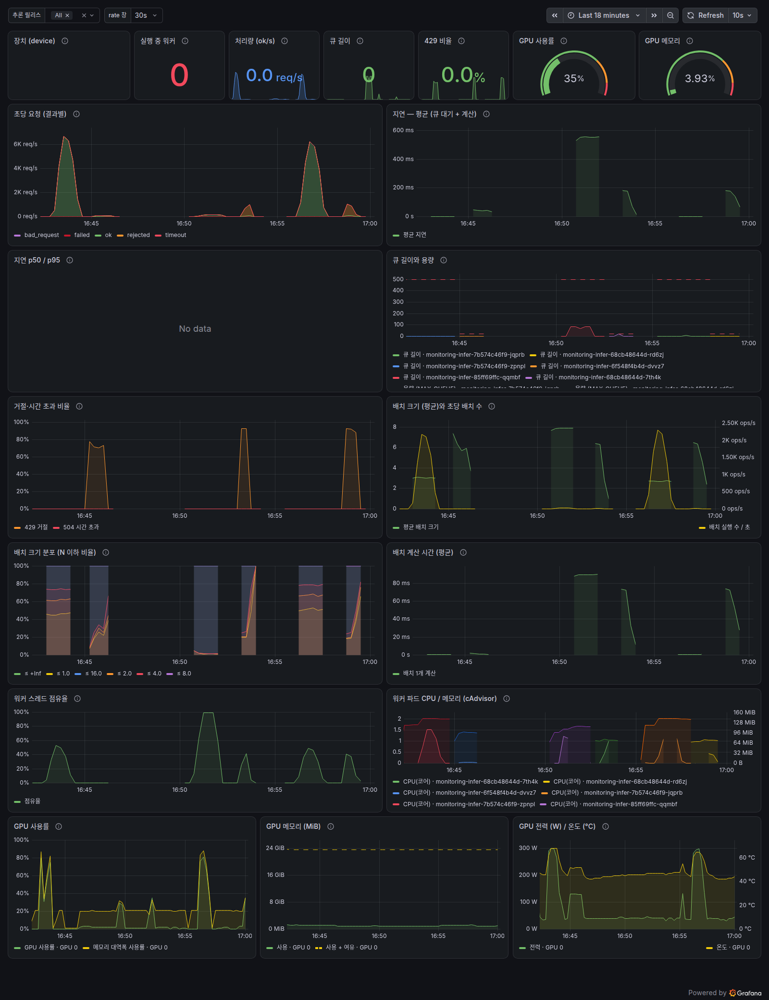
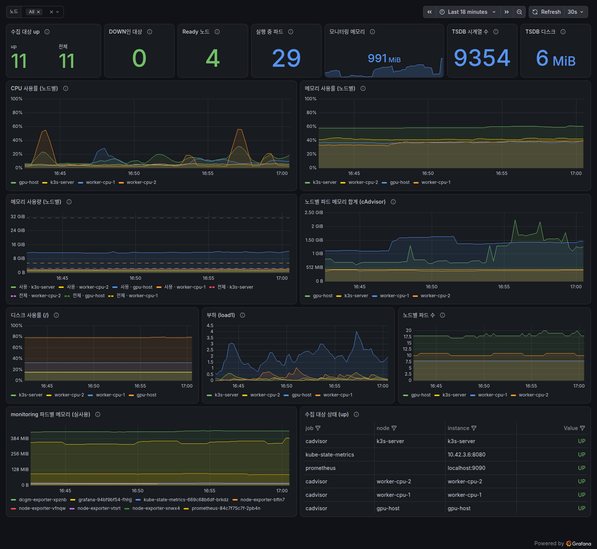
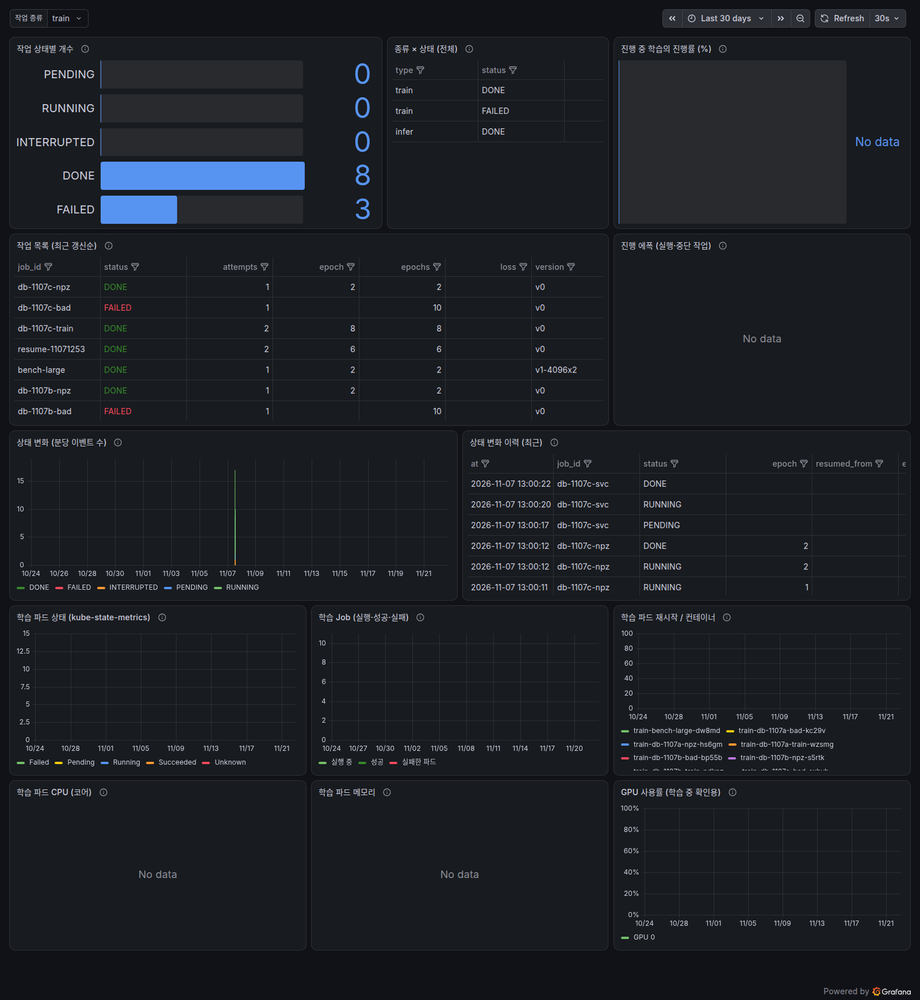

# 모니터링 시험 (2026-11-22 16:54)

- 생성: `scripts/monitoring-test.sh --with-gpu`
- 대상: `infra/k8s/monitoring`(네임스페이스 `monitoring`), 노드 4대
- 이미지: Prometheus v3.16.0, Grafana 13.3.1, kube-state-metrics v2.20.0, node-exporter v1.13.1, dcgm-exporter 4.6.1-4.8.4

**노드**

```text
NAME           STATUS   ROLES           AGE   VERSION        INTERNAL-IP      EXTERNAL-IP   OS-IMAGE                      KERNEL-VERSION    
gpu-host       Ready    <none>          47d   v1.36.4+k3s1   172.16.133.1     <none>        Ubuntu 26.04.1 LTS            7.0.0-43-generic (
k3s-server     Ready    control-plane   64d   v1.36.4+k3s1   172.16.133.134   <none>        Rocky Linux 9.8 (Blue Onyx)   5.14.0-687.48.1.el
worker-cpu-1   Ready    <none>          64d   v1.36.4+k3s1   172.16.133.136   <none>        Rocky Linux 9.8 (Blue Onyx)   5.14.0-687.48.1.el
worker-cpu-2   Ready    <none>          64d   v1.36.4+k3s1   172.16.133.135   <none>        Rocky Linux 9.8 (Blue Onyx)   5.14.0-687.48.1.el
```

## 1. 파드 상태


**파드 (monitoring)**

```text
NAME                                  READY   STATUS    RESTARTS   AGE   IP           NODE           NOMINATED NODE   READINESS GATES
dcgm-exporter-xpznb                   1/1     Running   0          21m   10.42.2.88   gpu-host       <none>           <none>
grafana-94bf9bf54-fhhjj               1/1     Running   0          21m   10.42.3.14   worker-cpu-1   <none>           <none>
kube-state-metrics-669c68b6df-brkdz   1/1     Running   0          43m   10.42.3.6    worker-cpu-1   <none>           <none>
node-exporter-bftn7                   1/1     Running   0          21m   10.42.1.20   worker-cpu-2   <none>           <none>
node-exporter-vfnqw                   1/1     Running   0          21m   10.42.0.8    k3s-server     <none>           <none>
node-exporter-vtsrt                   1/1     Running   0          21m   10.42.3.15   worker-cpu-1   <none>           <none>
node-exporter-xnwx4                   1/1     Running   0          21m   10.42.2.87   gpu-host       <none>           <none>
prometheus-84c7f75c7f-2pb4n           1/1     Running   0          43m   10.42.3.9    worker-cpu-1   <none>           <none>
```

**PVC**

```text
NAME              STATUS   VOLUME                                     CAPACITY   ACCESS MODES   STORAGECLASS   VOLUMEATTRIBUTESCLASS   AGE
prometheus-data   Bound    pvc-f451c3f4-793e-4110-a237-ab51af33b05f   3Gi        RWO            local-path     <unset>                 43m
```

- ✅ **PASS** — monitoring의 모든 파드가 Running·Ready (준비 안 된 파드 0개)

- ✅ **PASS** — 컨테이너 재시작 0회 (실제 0회)

- ✅ **PASS** — OOMKilled 컨테이너 없음 (실제 0개)

- ✅ **PASS** — dcgm-exporter 파드는 nvidia.com/gpu를 요청하지 않는다 (GPU 1장을 점유하지 않음)

- ✅ **PASS** — dcgm-exporter가 gpu-host에서 돈다

## 2. 수집 대상 (Prometheus targets)


- ✅ **PASS** — 수집 대상 prometheus: 1개 모두 up (실제 1/1)

- ✅ **PASS** — 수집 대상 kube-state-metrics: 1개 모두 up (실제 1/1)

- ✅ **PASS** — 수집 대상 node-exporter: 4개 모두 up (실제 4/4)

- ✅ **PASS** — 수집 대상 cadvisor: 4개 모두 up (실제 4/4)

- ✅ **PASS** — 수집 대상 dcgm-exporter: 1개 모두 up (실제 1/1)

**수집 대상 목록 (job · node · 주소 · 상태)**

```text
cadvisor            gpu-host      https://kubernetes.default.svc:443/api/v1/nodes/gpu-host/proxy/metrics/cadvisor      up  18ms
cadvisor            k3s-server    https://kubernetes.default.svc:443/api/v1/nodes/k3s-server/proxy/metrics/cadvisor    up  17ms
cadvisor            worker-cpu-1  https://kubernetes.default.svc:443/api/v1/nodes/worker-cpu-1/proxy/metrics/cadvisor  up  21ms
cadvisor            worker-cpu-2  https://kubernetes.default.svc:443/api/v1/nodes/worker-cpu-2/proxy/metrics/cadvisor  up  24ms
dcgm-exporter       gpu-host      http://10.42.2.88:9400/metrics                                                       up  1ms
kube-state-metrics  -             http://10.42.3.6:8080/metrics                                                        up  4ms
node-exporter       gpu-host      http://10.42.2.87:9100/metrics                                                       up  6ms
node-exporter       k3s-server    http://10.42.0.8:9100/metrics                                                        up  4ms
node-exporter       worker-cpu-1  http://10.42.3.15:9100/metrics                                                       up  4ms
node-exporter       worker-cpu-2  http://10.42.1.20:9100/metrics                                                       up  4ms
prometheus          -             http://localhost:9090/metrics                                                        up  3ms
```

## 3. 지표가 실제로 들어오는가


- ✅ **PASS** — 지표 DCGM_FI_DEV_GPU_UTIL 시계열 1개

- ✅ **PASS** — 지표 DCGM_FI_DEV_FB_USED 시계열 1개

- ✅ **PASS** — 지표 DCGM_FI_DEV_FB_FREE 시계열 1개

- ✅ **PASS** — 지표 DCGM_FI_DEV_POWER_USAGE 시계열 1개

- ✅ **PASS** — 지표 DCGM_FI_DEV_GPU_TEMP 시계열 1개

- ✅ **PASS** — 지표 node_cpu_seconds_total 시계열 176개

- ✅ **PASS** — 지표 node_memory_MemAvailable_bytes 시계열 4개

- ✅ **PASS** — 지표 node_filesystem_avail_bytes 시계열 12개

- ✅ **PASS** — 지표 node_load1 시계열 4개

- ✅ **PASS** — 지표 node_uname_info 시계열 4개

- ✅ **PASS** — 지표 kube_node_status_condition 시계열 48개

- ✅ **PASS** — 지표 kube_pod_status_phase 시계열 225개

- ✅ **PASS** — 지표 kube_pod_info 시계열 45개

- ✅ **PASS** — 지표 kube_pod_container_status_restarts_total 시계열 53개

- ✅ **PASS** — 지표 container_cpu_usage_seconds_total 시계열 43개

- ✅ **PASS** — 지표 container_memory_working_set_bytes 시계열 43개

- ✅ **PASS** — 지표 container_network_receive_bytes_total 시계열 49개

- ✅ **PASS** — 노드마다 node-exporter 지표가 있다 (node 라벨 4개 = 노드 4개)

- ✅ **PASS** — 노드마다 루트(/) 디스크 지표가 있다 (node 라벨 4개 = 노드 4개)

- 지금 GPU 사용률: 1% (gpu-host는 사용자의 데스크톱이기도 해서 부하가 없어도 0이 아닐 수 있다)

## 4. Grafana (손으로 만든 것 없이 자동으로 들어갔는가)


- ✅ **PASS** — 데이터소스 prometheus 상태 (OK: Successfully queried the Prometheus API.)

- ✅ **PASS** — 데이터소스 mysql-k3slab 상태 (OK: Database Connection OK)

- ✅ **PASS** — 대시보드 k3slab-infer '추론 워커'가 폴더 k3s-vmware-lab에 들어 있다

- ✅ **PASS** — 대시보드 k3slab-training '학습 작업'가 폴더 k3s-vmware-lab에 들어 있다

- ✅ **PASS** — 대시보드 k3slab-nodes '노드'가 폴더 k3s-vmware-lab에 들어 있다

**대시보드 목록 (uid · 제목 · 폴더 · 패널 수)**

```text
k3slab-nodes     노드       k3s-vmware-lab  16개
k3slab-infer     추론 워커  k3s-vmware-lab  20개
k3slab-training  학습 작업  k3s-vmware-lab  13개
```

- ✅ **PASS** — 대시보드는 화면에서 고칠 수 없다(프로비저닝, Git의 JSON이 기준)

## 5. 대시보드 쿼리 (모든 패널 쿼리를 Grafana를 거쳐 실행)


- ✅ **PASS** — 대시보드 k3slab-infer: 쿼리 28개 모두 오류 없이 실행 (오류 0개)

- ✅ **PASS** — 대시보드 k3slab-training: 쿼리 15개 모두 오류 없이 실행 (오류 0개)

- ✅ **PASS** — 대시보드 k3slab-nodes: 쿼리 18개 모두 오류 없이 실행 (오류 0개)

- 쿼리 합계 61개, 오류 0개

## 6. MySQL 읽기 전용 계정 (k3slab_ro)


- ✅ **PASS** — SELECT jobs 가능

- ✅ **PASS** — SELECT job_events 가능

- ✅ **PASS** — DELETE 거부

- ✅ **PASS** — UPDATE 거부

- ✅ **PASS** — INSERT 거부

- ✅ **PASS** — DROP 거부

- ✅ **PASS** — 다른 테이블(mysql.user) 조회 거부

## 7. 부하 시험 (추론 워커 + GPU)

- 추론 파드: Helm 릴리스 `monitoring-infer`, 이미지 `infer-worker:v0.2`, 모델 `bench-large`, MAX_BATCH 8, 스레드 2, WORK_MS 0 (흉내 비용 없이 실제 계산)
- GPU: 요청함(nvidia.com/gpu 1, DEVICE=cuda)
- 부하: 보통 = curl --parallel-max 100(최대 동시 전송 수)로 60초, 과부하 = 큐 20, curl --parallel-max 300(최대 동시 전송 수), 시간 30초 (keep-alive curl --parallel). 과부하 단계는 --with-gpu여도 CPU 워커로 돈다(GPU가 너무 빨라 큐가 차지 않는다)
- 워커의 HTTP 스레드 풀은 큐 크기 + 스레드×배치 + 16개다(`apps/infer/main.cpp` 128행). 큐 500이면 532개, 큐 20이면 52개라서, 연결이 이보다 많으면 나머지는 기다린다(큐 20에서 한 번에 처리되는 요청은 최대 52개)

- ✅ **PASS** — 추론 파드(monitoring-infer-7b574c46f9-jqprb)가 수집 대상(k3slab-infer)에 들어와 up

- ✅ **PASS** — 추론 워커 수집 대상 up (실제 1/1)

- ✅ **PASS** — 추론 지표 k3slab_infer_info (pod=monitoring-infer-7b574c46f9-jqprb) 시계열 1개

- ✅ **PASS** — 추론 지표 k3slab_infer_queue_length (pod=monitoring-infer-7b574c46f9-jqprb) 시계열 1개

- ✅ **PASS** — 추론 지표 k3slab_infer_queue_capacity (pod=monitoring-infer-7b574c46f9-jqprb) 시계열 1개

- ✅ **PASS** — 추론 지표 k3slab_infer_worker_threads (pod=monitoring-infer-7b574c46f9-jqprb) 시계열 1개

- ✅ **PASS** — 추론 지표 k3slab_infer_requests_total (pod=monitoring-infer-7b574c46f9-jqprb) 시계열 5개

- ✅ **PASS** — 추론 지표 k3slab_infer_batch_size_count (pod=monitoring-infer-7b574c46f9-jqprb) 시계열 1개

- ✅ **PASS** — 추론 지표 k3slab_infer_batch_compute_seconds_count (pod=monitoring-infer-7b574c46f9-jqprb) 시계열 1개

- ✅ **PASS** — 추론 지표 k3slab_infer_request_seconds_count (pod=monitoring-infer-7b574c46f9-jqprb) 시계열 1개

- 워커 장치(k3slab_infer_info): `cuda`

- ✅ **PASS** — 워커가 GPU(cuda)에서 계산한다 (device=cuda)

- ✅ **PASS** — 추론 파드가 모델을 올린 뒤 GPU 메모리가 늘었다 (884.75 → 1219 MiB)

**부하 Job 출력 (보통 부하)**

```text
load_code 200 346000
```
- 실제 요청 수: **346000개** (curl 한 번에 2000개씩 보내고, 시간이 다 될 때까지 되풀이해서 2000의 배수다. 200·429 이외 응답: 없음. 000은 연결 실패)
- 동시 수: 설정은 curl `--parallel-max 100`(최대 동시 전송 수). **실제 연결 수**는 추론 파드의 포트 8080 ESTABLISHED를 3초마다 센 값으로 최대 **101개**(Prometheus 수집 연결 1개 포함)

- ✅ **PASS** — 추론 지표가 변했다: ok 요청 카운터 +346000 (초당 5766.7)

- ✅ **PASS** — Prometheus 카운터 증가량(346000)이 부하 클라이언트가 센 200 응답(346000)과 같다(±1%)

- ✅ **PASS** — 배치가 묶였다: 평균 배치 크기 2.71 > 1

- ✅ **PASS** — 배치 계산 시간이 기록됐다 (배치당 평균 0.429 ms)

- ✅ **PASS** — GPU 사용률이 변했다: 부하 중 평균 46.93% > 부하 전·후 쉬는 구간의 최댓값 2.00%

- ✅ **PASS** — GPU 전력이 변했다: 부하 중 평균 252.52 W > 부하 전·후 쉬는 구간의 최댓값 133.53 W

- ✅ **PASS** — GPU 메모리는 부하 중에도 모델을 올린 상태로 유지된다 (부하 중 최대 1235 MiB ≥ 파드 없을 때 885 MiB + 50)

**부하 Job 출력 (과부하, 큐 20)**

```text
load_code 200 2438
load_code 429 29562
```
- 실제 요청 수: **32000개** (curl 한 번에 2000개씩 보내고, 시간이 다 될 때까지 되풀이해서 2000의 배수다. 200·429 이외 응답: 없음. 000은 연결 실패)
- 동시 수: 설정은 curl `--parallel-max 300`(최대 동시 전송 수). **실제 연결 수**는 추론 파드의 포트 8080 ESTABLISHED를 3초마다 센 값으로 최대 **229개**(Prometheus 수집 연결 1개 포함)

- ✅ **PASS** — 429 거절이 늘었다: rejected 카운터 +29562 (거절 비율 92.4%)

- ✅ **PASS** — Prometheus rejected 증가량(29562)이 부하 클라이언트가 센 429 응답(29562)과 같다(±1%)

- ✅ **PASS** — 과부하 중 큐 길이가 올랐다 (최대 20 / 용량 20)

- ✅ **PASS** — 성공(200) 응답도 계속 나왔다: Prometheus ok +2438, 클라이언트 200 응답 2438

- ✅ **PASS** — 추론 대시보드의 모든 패널이 값을 보여 준다 (비어 있는 패널: 없음; p50/p95 제외)

- ℹ️ **NOTE** — 지연 p50/p95 패널은 비어 있다: 추론 워커(apps/infer/metrics.cpp)가 k3slab_infer_request_seconds_sum/_count만 내보내고 히스토그램 버킷은 내보내지 않는다. 평균 지연은 보인다. p50/p95가 필요하면 워커에 버킷을 더해야 한다(CICD/추론 담당 협의).

### 측정값 (Prometheus에서 읽은 값)

| 지표 | 파드 없음 / 쉬는 상태 | 보통 부하 (60s, parallel-max 100) | 과부하 (큐 20, CPU, parallel-max 300) |
|---|---|---|---|
| 성공 요청 수 증가 (초당) | 0 | 346000 (5766.7/s) | 2438 |
| 거절(429) 증가 | 0 | 0 | 29562 (비율 92.4%) |
| 큐 길이 최대 | 0 | 10 | 20 / 20 |
| 평균 배치 크기 | - | 2.71 | - |
| 평균 지연 (큐 대기 + 계산) | - | 1.00 ms | - |
| 배치당 계산 시간 | - | 0.429 ms | - |
| GPU 사용률 평균 / 최대 (%) | 0.33 / 2.00 (부하 후 쉬는 구간 최대 1.00) | 46.93 / 81.00 | - |
| GPU 전력 평균 (W) | 34.66 (최대 40.23, 부하 후 최대 133.53) | 252.52 | - |
| 워커가 잰 계산 시간 / 경과 시간 (스레드 합) | - | 0.75 | - |
| GPU 메모리 사용 (MiB) | 추론 파드 전 885 → 모델 로드 후 1219 | 최대 1235 | - |

- 보통 부하 클라이언트 응답 코드: 200=346000 
- 과부하 클라이언트 응답 코드: 200=2438 429=29562 

## 8. 메모리 사용 (monitoring 파드)


**kubectl top pods -n monitoring**

```text
NAME                                  CPU(cores)   MEMORY(bytes)   
dcgm-exporter-xpznb                   12m          446Mi           
grafana-94bf9bf54-fhhjj               6m           343Mi           
kube-state-metrics-669c68b6df-brkdz   1m           19Mi            
node-exporter-bftn7                   1m           14Mi            
node-exporter-vfnqw                   1m           10Mi            
node-exporter-vtsrt                   1m           15Mi            
node-exporter-xnwx4                   1m           8Mi             
prometheus-84c7f75c7f-2pb4n           4m           87Mi            
```

**kubectl top nodes**

```text
NAME           CPU(cores)   CPU(%)   MEMORY(bytes)   MEMORY(%)   
gpu-host       1830m        11%      13720Mi         42%         
k3s-server     95m          4%       1982Mi          73%         
worker-cpu-1   136m         6%       2098Mi          37%         
worker-cpu-2   60m          3%       1084Mi          39%         
```

**파드 · 노드 · 컨테이너 · memory requests · limits**

```text
dcgm-exporter-xpznb                  gpu-host      dcgm-exporter       128Mi  768Mi
grafana-94bf9bf54-fhhjj              worker-cpu-1  grafana             192Mi  512Mi
kube-state-metrics-669c68b6df-brkdz  worker-cpu-1  kube-state-metrics  64Mi   128Mi
node-exporter-bftn7                  worker-cpu-2  node-exporter       32Mi   64Mi
node-exporter-vfnqw                  k3s-server    node-exporter       32Mi   64Mi
node-exporter-vtsrt                  worker-cpu-1  node-exporter       32Mi   64Mi
node-exporter-xnwx4                  gpu-host      node-exporter       32Mi   64Mi
prometheus-84c7f75c7f-2pb4n          worker-cpu-1  prometheus          384Mi  768Mi
```

**실사용 메모리 (cAdvisor working set, Prometheus 쿼리)**

```text
dcgm-exporter-xpznb                  446 MiB
grafana-94bf9bf54-fhhjj              343 MiB
kube-state-metrics-669c68b6df-brkdz  19 MiB
node-exporter-bftn7                  14 MiB
node-exporter-vfnqw                  10 MiB
node-exporter-vtsrt                  15 MiB
node-exporter-xnwx4                  7 MiB
prometheus-84c7f75c7f-2pb4n          87 MiB
```

- monitoring 네임스페이스 실사용 합계: **944 MiB** (requests 합계는 위 표, VM 노드는 worker-cpu-1 하나에 Prometheus·Grafana·kube-state-metrics가 모인다)
- Prometheus: 시계열 9336 개, 블록+WAL 5.8 MiB, 프로세스 메모리 153 MiB, 보존 7일·상한 2GB

- ✅ **PASS** — monitoring 파드가 memory limit 안에서 돈다 (OOMKilled 없음, 재시작 0)

## 요약

- PASS 70 · FAIL 0
- 보고서: `docs/labs/monitoring-20261122-1654.md`

---

## 9. 사람이 덧붙인 부분 (위는 `scripts/monitoring-test.sh`가 쓴 것, 아래는 시험 뒤에 사람이 정리한 것)

### 9.1 대시보드 화면 (실제 클러스터 값, 2026-11-22 17:00 촬영)

촬영은 임시로 연 `kubectl port-forward`와 시스템 Chrome(헤드리스)으로 했다. 가짜 데이터가 아니라 이 시험에서 쌓인 값이다.

| 대시보드 | 이미지 | 시간 범위 | 보이는 것 |
|---|---|---|---|
| 추론 워커 | `monitoring-20261122-dashboard-infer.png` | 최근 18분 | GPU 2회차(16:43)와 최종 시험(16:57)의 보통 부하 구간(초당 약 6천 요청), 429 비율이 세 번 솟음(2회차·CPU 전용·최종 시험의 과부하 구간), GPU 사용률·전력이 보통 부하 때 솟음, 배치 크기·큐 길이. 맨 위 숫자 카드(실행 중 워커 등)는 촬영 시점 값이라 시험 파드가 이미 지워져 0이다. 지연 p50/p95 패널은 "No data"(알려진 한계) |
| 노드 | `monitoring-20261122-dashboard-nodes.png` | 최근 18분 | 수집 대상 11/11 up, Ready 노드 4, 모니터링 메모리 991 MiB(촬영 시점), 디스크 사용률에 4노드 모두 나옴 |
| 학습 작업 | `monitoring-20261122-dashboard-training.png` | 최근 30일 | MySQL의 작업 11건(DONE 8, FAILED 3)과 2026-11-07의 상태 변화 이력. Prometheus 쪽 패널은 비어 있다(아래) |







- 학습 대시보드의 **진행률·진행 에폭·학습 파드 CPU/메모리 패널은 값을 보지 못했다.** 이 시험 동안 학습 Job을 돌리지 않았고(RUNNING 작업 0개), Prometheus 데이터도 오늘 배포한 뒤부터만 있다. 이 패널들은 쿼리가 오류 없이 실행되는 것까지만 확인했다(위 5절).

### 9.2 시험 실행 기록 (고치기 전 보고서도 지우지 않고 남겼다)

| 보고서 | 무엇 | 결과 | 원인 · 조치 |
|---|---|---|---|
| `monitoring-20261122-1612.md` | 첫 실행 (CPU 계산) | PASS 60 / FAIL 4 | Grafana가 Prometheus에 못 붙음(DNS `i/o timeout`) → 아래 발견 사항 1. 데이터소스 주소를 짧은 이름으로 바꿈 |
| `monitoring-20261122-1627.md` | 다시 실행 (CPU 계산) | PASS 64 / FAIL 0 | 이때는 "노드마다 `/` 디스크 지표" 검사가 없었다. 이후 VM 3대의 디스크 지표가 빠진 것을 찾아 고침(발견 사항 2) |
| `monitoring-20261122-1634.md` | GPU 1회차 | PASS 68 / FAIL 2 | GPU 판정은 모두 PASS. 과부하 단계에서 429가 0건, 큐 길이 0 → 발견 사항 5 |
| `monitoring-20261122-1641.md` | GPU 2회차 (과부하 단계에만 인위적 지연 `WORK_MS=20`) | PASS 69 / FAIL 1 | 429는 잡혔다(+2866). 큐 길이는 최대 0 → 발견 사항 6. **이 지연은 "모니터링이 429와 큐 길이를 잡아내는지"를 보려는 시험 조건이다. GPU 워커가 과부하에서 429를 낸다는 뜻이 아니다.** 이 실행에서만 썼고 최종 스크립트에서는 뺐다 |
| `monitoring-20261122-1649.md` | CPU 전용, 고친 스크립트 | PASS 65 / FAIL 0 | 과부하 단계를 CPU 워커로 돌리고 실제 연결 수·요청 수를 자동 기록하도록 고친 뒤 확인 |
| `monitoring-20261122-1654.md` | **GPU 최종 (이 보고서)** | **PASS 70 / FAIL 0** | 보통 부하는 GPU, 과부하는 CPU 워커 |

앞의 네 보고서에 적힌 "동시 N개"는 curl `--parallel-max` **설정값**이다. 실제 연결 수가 아니다(발견 사항 4).

### 9.3 발견 사항

1. **파드 DNS가 긴 이름에서 10초 기다리다 실패했다.** 파드의 `resolv.conf` 검색 목록 끝에 `localdomain`이 붙어 있다(VM의 `resolv.conf`를 물려받음). 점이 4개인 `prometheus.monitoring.svc.cluster.local`은 이 접미사를 먼저 시도하고, CoreDNS가 그 질의를 상위 DNS `172.16.133.2`로 넘기지만 답이 없어서 `i/o timeout`이 났다(CoreDNS 로그에 `….localdomain` 질의가 반복). Grafana 파드에서 `getent`로 재 보니 긴 이름은 10.01초 만에 실패, 짧은 이름(`prometheus`, `mysql.k3slab-system`)은 0.00초였다. 이 작업은 데이터소스 주소를 짧은 이름으로 바꿨다. 플랫폼_클러스터가 `coredns-custom`으로 `localdomain`을 바로 NXDOMAIN 처리하게 고쳤고, 긴 이름이 6.01초에서 0.01초로 줄었다고 총괄이 전했다(내가 직접 다시 재지는 않았다). 다른 세션(Gitea 등)도 같은 증상이 날 수 있었다.
2. **Rocky VM 3대에서 node-exporter 디스크 지표가 빠져 있었다.** 로그: `open /host/proc/1/mountinfo: permission denied`. SELinux가 켜진 VM에서 기본 라벨(`container_t`)이 호스트의 `/proc/1/mountinfo` 읽기를 막는 것으로 보인다(gpu-host는 SELinux가 없어서 됐다). 이 파드만 `seLinuxOptions.type: spc_t`로 바꾸자 4노드 모두 `/` 디스크 지표가 들어왔다(gpu-host 199.5 GiB, k3s-server 32.5, worker-cpu-1 26.0, worker-cpu-2 32.4 GiB 여유). 포기한 것(이 컨테이너의 SELinux 격리)과 대안은 `infra/k8s/monitoring/README.md`에 적었다. 시험 스크립트에 "노드마다 `/` 디스크 지표" 검사를 더했다.
3. **메모리 limit이 실사용에 너무 가까웠다.** 처음 limit 기준으로 Grafana 335 MiB / 384 MiB(87%), dcgm-exporter 439 MiB / 512 MiB(86%)였다. limit만 Grafana 512 MiB, dcgm-exporter 768 MiB로 올렸다(requests는 그대로, worker-cpu-1 limits 합 +128 MiB, 총괄 승인). 최종 실측은 위 8절: Grafana 343 MiB, dcgm-exporter 446 MiB.
4. **"동시 300개"는 사실이 아니었다.** 부하 Job은 `curl --parallel --parallel-max N`으로 요청 2000개를 한 묶음으로 보내고, 시간이 다 될 때까지 묶음을 되풀이한다. 그래서 총 요청 수는 2000의 배수 근처이고, N은 "최대 동시 전송 수"일 뿐이다. 추론 파드의 `/proc/net/tcp`에서 포트 8080의 ESTABLISHED 연결을 3초마다 세어 보니(스크립트에 넣음) 실제 연결은 다음과 같았다.

   | 실행 | 단계 | 설정(`--parallel-max`) | 실제 최대 연결 수 | 실제 요청 수 |
   |---|---|---|---|---|
   | 1649 (CPU 전용) | 보통 | 100 | 101 | 12000 |
   | 1649 (CPU 전용) | 과부하 | 300 | 263 | 28000 |
   | 1654 (GPU 최종) | 보통 | 100 | 101 | 346000 |
   | 1654 (GPU 최종) | 과부하 (CPU 워커) | 300 | 229 | 32000 |
   | 1641 (GPU 2회차, 스크립트 밖에서 따로 센 값) | 과부하 | 300 | 275 | 4000 (200=1127, 429=2866, 연결 실패 000=7) |

   (연결 수에는 Prometheus가 5초마다 여는 수집 연결 1개가 들어 있다.)
5. **GPU 워커는 이 부하 도구로 큐 20을 채우지 못했다.** 배치 하나를 0.43~0.48 ms에 끝내서(CPU 워커는 약 88 ms) 1634에서는 429가 0건, 큐 길이 0이었다(요청 4000개 모두 200이거나 연결 실패). 과부하 단계의 목적은 GPU가 아니라 "모니터링이 429와 큐 길이를 잡아내는가"이므로, 최종 스크립트는 과부하 단계를 `--with-gpu`여도 CPU 워커로 돌린다. 이 결과는 "GPU가 느려서" 가 아니라 "GPU가 너무 빨라서 이 부하로는 포화되지 않는다"는 뜻이다.
6. **큐 길이 게이지는 5초 간격 수집이라 짧은 포화를 놓친다.** 1641에서 429가 2866건 나왔는데 큐 길이 최대는 0이었다. 큐가 가득 찬 시간이 몇 초뿐이라 수집 시점에 걸리지 않은 것으로 보인다. 오래 이어지는 포화(CPU 워커)에서는 20/20이 잡혔다(1627·1649·1654). 그러니 검증 실험에서 큐 길이는 순간값으로 보고, 429 비율과 함께 읽어야 한다.
7. **연결 수가 약 50씩 계단식으로 줄어든 것은 워커의 HTTP 스레드 풀과 맞는다(추정).** 풀 크기는 `큐 + 스레드×배치 + 16`(`apps/infer/main.cpp` 128행)이라 큐 20이면 52개다. 1641 과부하에서 3초 간격 샘플이 275 → 225 → 173 → 122 → 71 → 1로 줄었다. 풀이 원인이라고 직접 확인하지는 않았다.
8. **데스크톱 GPU 잡음.** 쉬는 구간에도 GPU 사용률이 최대 16%, 전력이 최대 133 W까지 나왔다(보고서별 "쉬는 구간 최대"). 판정 기준 "부하 중 평균 > 쉬는 구간 최댓값"은 처음 정한 그대로 썼고, 모든 GPU 실행에서 통과했다(최종: 사용률 46.93% > 2.00%, 전력 252.52 W > 133.53 W).
9. **지연 p50/p95는 지금 구할 수 없다.** 워커가 히스토그램 버킷을 내보내지 않는다. 워커에 버킷을 더하는 일은 CICD_연결 작업으로 넘어갔다. 대시보드는 `k3slab_infer_request_seconds_bucket` 이름으로 미리 만들어 두었다.

### 9.4 이 시험으로 확인하지 못한 것

- 학습 Job 진행률·진행 에폭 패널(실행 중인 학습 없음, 9.1).
- 보존 7일이 실제로 오래된 블록을 지우는지(배포 후 하루도 안 됐다). 크기 상한 2GB 안에 있는 것만 확인했다(블록+WAL 5.8 MiB).
- 대시보드 JSON을 고친 뒤 화면에 반영되는 것(핫 리로드). 매니페스트를 다시 적용해 Grafana가 다시 뜨는 경우만 확인했다.
- GPU를 쓰는 학습 Job이 돌 때의 DCGM 값(추론 워커로만 확인했다).
